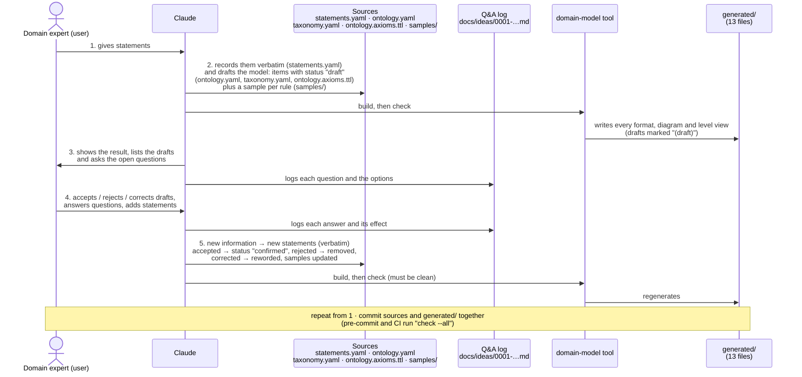

# AcmeDataPlatform domain model

Hand-authored with the domain expert in an interactive session (idea [0001](../../docs/ideas/0001-acme-data-platform-domain-model.md); restarted 2026-11-14, previous version archived as `data/archive-data-platform-concepts-v0.1.zip`, local only, git-ignored). Versioned in `data/` on purpose ([ADR-0015](../../docs/architecture/adr/0015-curated-domain-models-are-versioned-in-data.md)).

Namespace: `https://example.org/acme/data-platform#` (prefix `adp:`).

## Way of working



## Files

Only the **sources** are edited (by Claude, with the expert). Everything under `generated/` is written by the domain-model tool ([format and commands](../../tools/domain-model/README.md), [ADR-0016](../../docs/architecture/adr/0016-generate-domain-model-formats-from-yaml-sources.md)) and must never be edited by hand; pre-commit and CI fail when it differs from the sources.

| File | What it stores | Written by | Used by | Same information also in |
|------|----------------|------------|---------|--------------------------|
| **Sources** | | | | |
| [statements.yaml](statements.yaml) | The expert's statements, verbatim, with date and working level | Claude, copying the expert's words | the tool (provenance checks, `statements.md`); reviewers | `generated/statements.md`; the answers in the idea's Q&A log |
| [ontology.yaml](ontology.yaml) | Concepts, individuals, relations, properties and rules, each with level, status (draft / confirmed) and source statements | Claude; the expert confirms or corrects | the tool (every generated file) | rendered into every generated file |
| [taxonomy.yaml](taxonomy.yaml) | Extra trees beyond is-a, e.g. part-of (none yet) | Claude | the tool (`diagrams.md`, level views) | rendered into `diagrams.md` and the level views |
| [ontology.axioms.ttl](ontology.axioms.ttl) | OWL axioms the YAML cannot express: closed lists (platform resource kinds, data pipeline kinds) | Claude | the tool (merged into the ontology) | merged into `generated/ontology.owl.*` |
| [samples/](samples/) | Instance data: one consistent world (`valid.ttl`), and per rule a violating or a deriving sample | Claude | the tool (`check`, `validate` run pyshacl on them); readers, as worked examples | — |
| [Q&A log](../../docs/ideas/0001-acme-data-platform-domain-model.md#qa-log) | Every question, the options offered, the answer and its effect on the model | Claude | readers: why the model is the way it is | answers that add content are also statements in `statements.yaml` |
| **Generated** | | | | |
| [statements.md](generated/statements.md) | The statements as a table | tool | readers on GitHub | `statements.yaml` |
| [glossary.md](generated/glossary.md) | One entry per item: label, synonyms, definition, kind, level, status, sources | tool | the expert and readers | `glossary.tbx`, `taxonomy.skos.ttl` (labels, definitions), `level-3.md` |
| [glossary.tbx](generated/glossary.tbx) | The glossary in TBX-Basic (ISO 30042) | tool | terminology and translation tools (TBX import, e.g. memoQ, Trados MultiTerm) | `glossary.md`, `taxonomy.skos.ttl` |
| [taxonomy.skos.ttl](generated/taxonomy.skos.ttl) | The is-a tree as a SKOS concept scheme (broader / narrower), with labels, synonyms, definitions | tool | thesaurus and search tools (e.g. Skosmos, VocBench), tagging, synonym lookup by an assistant | `ontology.owl.*` (subclass hierarchy), glossary |
| [ontology.owl.ttl](generated/ontology.owl.ttl) | The OWL 2 ontology in Turtle: classes, hierarchy, individuals, relations, properties, cardinalities, disjointness, axioms | tool | OWL editors and reasoners (e.g. Protégé, HermiT), triple stores, Python apps (rdflib) | `ontology.owl.rdf`, `ontology.jsonld` (same triples) |
| [ontology.owl.rdf](generated/ontology.owl.rdf) | The same ontology in RDF/XML | tool | tools that only read RDF/XML (older OWL API based tools) | `ontology.owl.ttl`, `ontology.jsonld` |
| [ontology.jsonld](generated/ontology.jsonld) | The same ontology in JSON-LD | tool | web and JavaScript apps, JSON APIs | `ontology.owl.ttl`, `ontology.owl.rdf` |
| [rules.md](generated/rules.md) | Every rule in plain English with its pattern, level, status, sources | tool | the expert and readers | `rules.shacl.ttl`, `level-3.md` |
| [rules.shacl.ttl](generated/rules.shacl.ttl) | The rules as SHACL shapes (constraints) and SHACL-AF rules (derivations) | tool | SHACL engines validating instance data (pyshacl in `check`; e.g. Apache Jena, TopBraid) | `rules.md` |
| [diagrams.md](generated/diagrams.md) | Mermaid: is-a tree, extra trees, ontology graph, whole domain | tool | readers on GitHub | `level-3.md` (same diagrams) |
| [level-1.md](generated/level-1.md), [level-2.md](generated/level-2.md), [level-3.md](generated/level-3.md) | Per level (cumulative): intro, glossary, taxonomy, relations, properties, rules, diagrams | tool | onboarding at the right depth; `level-3.md` is the whole domain | `level-3.md` ⊇ `glossary.md` + `rules.md` + `diagrams.md` |

## Levels (granular learnability)

Every concept, individual, relation, property and rule has a level. Levels are cumulative.

| Level | Name | For | View |
|-------|------|-----|------|
| 1 | core | anyone: understand the domain in 5–10 minutes | [level-1.md](generated/level-1.md) |
| 2 | main | an adopter: use the domain for the simplest use cases | [level-2.md](generated/level-2.md) |
| 3 | detailed | everything that exists in the domain | [level-3.md](generated/level-3.md) |

Current working level: **2** (level 1 completed on 2026-11-14; new items get this level until the domain expert says the level is complete).

In the RDF formats the level is the annotation `adp:level` (1, 2 or 3) on every class, property, individual, SKOS concept and SHACL shape; in TBX it is a `note` on the concept entry.

## Commands

From the repo root:

```
uv run domain-model build data/AcmeDataPlatform   # after editing a source
uv run domain-model check data/AcmeDataPlatform   # model, freshness of generated/, samples
```
