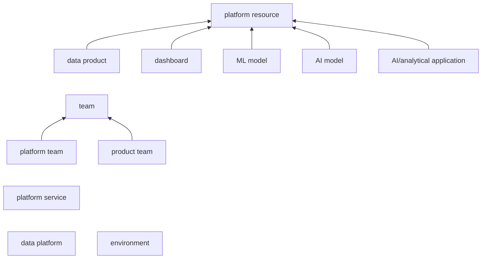
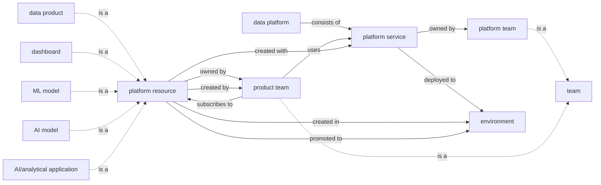

<!-- Generated by domain-model from the YAML sources of this folder. Do not edit. -->

# AcmeDataPlatform · level 1: core

For **anyone: understand the domain in 5–10 minutes**. Levels are cumulative: this view holds the level-1 items.

Contents: 12 concepts, 5 individuals, 11 relations, 0 properties, 12 rules. Items marked _(draft)_ are proposed wording, not yet confirmed.

## Diagrams

### Taxonomy (is-a)



### Ontology graph



## Glossary

| Term | Id | Kind | Synonyms | Definition | Level | Status | Sources |
|---|---|---|---|---|---|---|---|
| ACC | `ACC` | individual |  | The production-like environment, fully automated (deployment only via CI/CD pipeline), to prepare the deployment and UAT tests of the next MAJOR/MINOR versions and collect consumer feedback; less freedom than DEV. | 1 | confirmed | S1, S8, S13, S14, S60 |
| AcmeDataPlatform | `AcmeDataPlatform` | individual |  |  | 1 | confirmed | S1, S2 |
| AI model | `AIModel` | concept |  |  | 1 | confirmed | S9, S18 |
| AI/analytical application | `AIAnalyticalApplication` | concept |  |  | 1 | confirmed | S9 |
| consists of | `consistsOf` | relation |  |  | 1 | confirmed | S2 |
| created by | `createdBy` | relation |  |  | 1 | confirmed | S4, S5 |
| created in | `createdIn` | relation |  |  | 1 | confirmed | S7, S11 |
| created with | `createdWith` | relation |  |  | 1 | confirmed | S4, S10 |
| dashboard | `Dashboard` | concept |  |  | 1 | confirmed | S9, S18 |
| data platform | `DataPlatform` | concept |  | The kind of thing AcmeDataPlatform is. | 1 | confirmed | S1 |
| data product | `DataProduct` | concept |  |  | 1 | confirmed | S9, S18 |
| deployed to | `deployedTo` | relation |  |  | 1 | confirmed | S6, S10 |
| DEV | `DEV` | individual |  | The environment where platform resources are created via repeatable automation, so they can be deployed to upper environments reliably; less freedom than EXP. | 1 | confirmed | S1, S7, S8, S11, S59 |
| environment | `Environment` | concept |  |  | 1 | confirmed | S1, S6, S7, S8 |
| EXP | `EXP` | individual |  | The environment for experimentation and learning, with the highest degree of freedom: start experimenting in minutes, without prior approval for permission or budget. | 1 | confirmed | S1, S7, S8, S11, S12, S58 |
| ML model | `MLModel` | concept |  |  | 1 | confirmed | S9, S18 |
| owned by | `ownedBy` | relation |  | The team that owns a platform service (a platform team) or a platform resource (the product team that created it). | 1 | confirmed | S3, S5 |
| owned by | `resourceOwnedBy` | relation |  | The product team that owns a platform resource: the team which created it. | 1 | confirmed | S5 |
| owned by | `serviceOwnedBy` | relation |  | The platform team that owns a platform service. | 1 | confirmed | S3 |
| platform resource | `PlatformResource` | concept |  |  | 1 | confirmed | S1, S4, S5, S7, S8, S9, S11, S14, S15 |
| platform service | `PlatformService` | concept |  |  | 1 | confirmed | S1, S2, S3, S4, S6 |
| platform team | `PlatformTeam` | concept |  |  | 1 | confirmed | S1, S3, S10 |
| PRD | `PRD` | individual |  | The live environment, with the least freedom: maximum protection via policies, limited access and audit log. | 1 | confirmed | S1, S8, S14, S61 |
| product team | `ProductTeam` | concept |  |  | 1 | confirmed | S1, S4, S5, S10 |
| promoted to | `promotedTo` | relation |  |  | 1 | confirmed | S8 |
| subscribes to | `subscribesTo` | relation |  |  | 1 | confirmed | S21 |
| team | `Team` | concept |  |  | 1 | confirmed | S10 |
| uses | `uses` | relation |  |  | 1 | confirmed | S4 |

## Taxonomy (is-a)

- data platform (`DataPlatform`)
- platform service (`PlatformService`)
- platform resource (`PlatformResource`)
  - data product (`DataProduct`)
  - dashboard (`Dashboard`)
  - ML model (`MLModel`)
  - AI model (`AIModel`)
  - AI/analytical application (`AIAnalyticalApplication`)
- team (`Team`)
  - platform team (`PlatformTeam`)
  - product team (`ProductTeam`)
- environment (`Environment`)

## Relations

| Relation | Id | Domain | Range | Cardinality | Inverse | Super-relation | Characteristics | Level |
|---|---|---|---|---|---|---|---|---|
| consists of | `consistsOf` | `DataPlatform` | `PlatformService` | 1..* |  |  |  | 1 |
| owned by | `ownedBy` |  | `Team` |  |  |  |  | 1 |
| owned by | `serviceOwnedBy` | `PlatformService` | `PlatformTeam` | 1 |  | `ownedBy` |  | 1 |
| owned by | `resourceOwnedBy` | `PlatformResource` | `ProductTeam` | 1 |  | `ownedBy` |  | 1 |
| uses | `uses` | `ProductTeam` | `PlatformService` |  |  |  |  | 1 |
| subscribes to | `subscribesTo` | `ProductTeam` | `PlatformResource` | * |  |  |  | 1 |
| created by | `createdBy` | `PlatformResource` | `ProductTeam` | 1 |  |  |  | 1 |
| created with | `createdWith` | `PlatformResource` | `PlatformService` | 1..* |  |  |  | 1 |
| deployed to | `deployedTo` | `PlatformService` | `Environment` | * |  |  |  | 1 |
| created in | `createdIn` | `PlatformResource` | `Environment` | 1 |  |  |  | 1 |
| promoted to | `promotedTo` | `PlatformResource` | `Environment` | * |  |  |  | 1 |

## Properties

_None yet._

## Rules

### R1 · Each platform service is owned by exactly one team.

- **Kind:** constraint · **Pattern:** `cardinality` · **Level:** 1 · **Status:** confirmed · **Sources:** S3
- each `PlatformService` has at least 1 and at most 1 `ownedBy` value(s)

### R2 · The owner of a platform service is a platform team.

- **Kind:** constraint · **Pattern:** `sparql` · **Level:** 1 · **Status:** confirmed · **Sources:** S3
- SPARQL SELECT (each result is a violation) on each `PlatformService`

```sparql
SELECT $this WHERE { $this adp:ownedBy ?team . FILTER NOT EXISTS { ?team a adp:PlatformTeam } }
```

### R3 · Each (top-level or nested) platform resource is created with one or more platform services.

- **Kind:** constraint · **Pattern:** `cardinality` · **Level:** 1 · **Status:** confirmed · **Sources:** S10, S54
- each `PlatformResource` has at least 1 and  `createdWith` value(s)

### R4 · Each platform resource is created by exactly one team.

- **Kind:** constraint · **Pattern:** `cardinality` · **Level:** 1 · **Status:** confirmed · **Sources:** S5
- each `PlatformResource` has at least 1 and at most 1 `createdBy` value(s)

### R5 · A platform resource is created by a product team, never by a platform team.

- **Kind:** constraint · **Pattern:** `sparql` · **Level:** 1 · **Status:** confirmed · **Sources:** S4, S5
- SPARQL SELECT (each result is a violation) on each `PlatformResource`

```sparql
SELECT $this WHERE { $this adp:createdBy ?team . ?team a adp:PlatformTeam . }
```

### R6 · A platform resource is owned by the product team which created it.

- **Kind:** constraint · **Pattern:** `equal` · **Level:** 1 · **Status:** confirmed · **Sources:** S5
- for each `PlatformResource`, `ownedBy` and `createdBy` have the same values

### R7 · A platform resource is created in exactly one environment.

- **Kind:** constraint · **Pattern:** `cardinality` · **Level:** 1 · **Status:** confirmed · **Sources:** S7, S11
- each `PlatformResource` has at least 1 and at most 1 `createdIn` value(s)

### R8 · A platform resource is created in the EXP or in the DEV environment.

- **Kind:** constraint · **Pattern:** `values` · **Level:** 1 · **Status:** confirmed · **Sources:** S7, S11, S13
- every `createdIn` value of a `PlatformResource` is one of `EXP`, `DEV`

### R9 · A platform resource can only be promoted to DEV, ACC or PRD.

- **Kind:** constraint · **Pattern:** `values` · **Level:** 1 · **Status:** confirmed · **Sources:** S8, S11, S12
- every `promotedTo` value of a `PlatformResource` is one of `DEV`, `ACC`, `PRD`

### R10 · A platform resource promoted to DEV was created in EXP.

- **Kind:** constraint · **Pattern:** `implies` · **Level:** 1 · **Status:** confirmed · **Sources:** S8, S11
- if a `PlatformResource` has `DEV` as `promotedTo`, then it has `EXP` as `createdIn`

### R11 · A platform resource promoted to ACC was created in or promoted to DEV first.

- **Kind:** constraint · **Pattern:** `implies` · **Level:** 1 · **Status:** confirmed · **Sources:** S8, S11, S13
- if a `PlatformResource` has `ACC` as `promotedTo`, then it has `DEV` as `createdIn|promotedTo`

### R12 · A platform resource promoted to PRD was promoted to ACC first.

- **Kind:** constraint · **Pattern:** `implies` · **Level:** 1 · **Status:** confirmed · **Sources:** S8, S11, S14
- if a `PlatformResource` has `PRD` as `promotedTo`, then it has `ACC` as `promotedTo`

