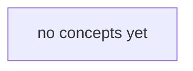

<!-- Generated by domain-model from the YAML sources of this folder. Do not edit. -->

# AcmeDataPlatform · level 2: main

For **an adopter: use the domain for the simplest use cases**. Levels are cumulative: this view holds every item of levels 1–2.

Contents: 0 concepts, 0 individuals, 0 relations, 0 properties, 0 rules. Items marked _(draft)_ are proposed wording, not yet confirmed.

## Glossary

_No terms yet._

## Taxonomy (is-a)

_No concepts yet._

## Relations

_None yet._

## Properties

_None yet._

## Rules

_No rules yet._

## Diagrams

### Taxonomy (is-a)

### Ontology graph

