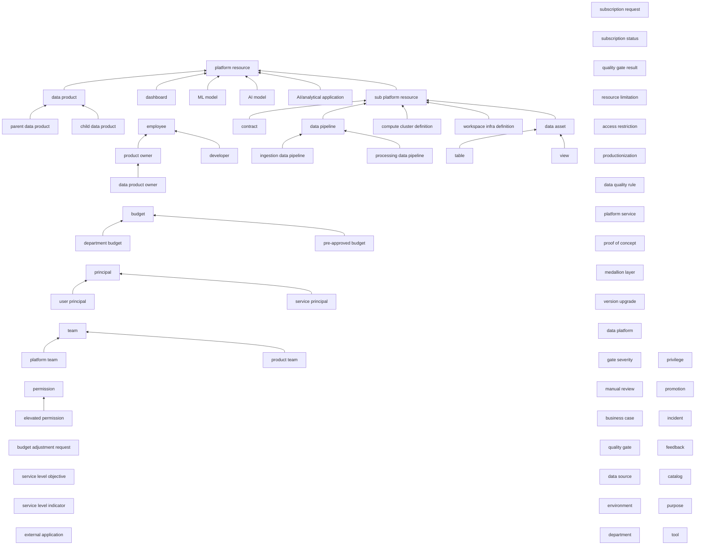
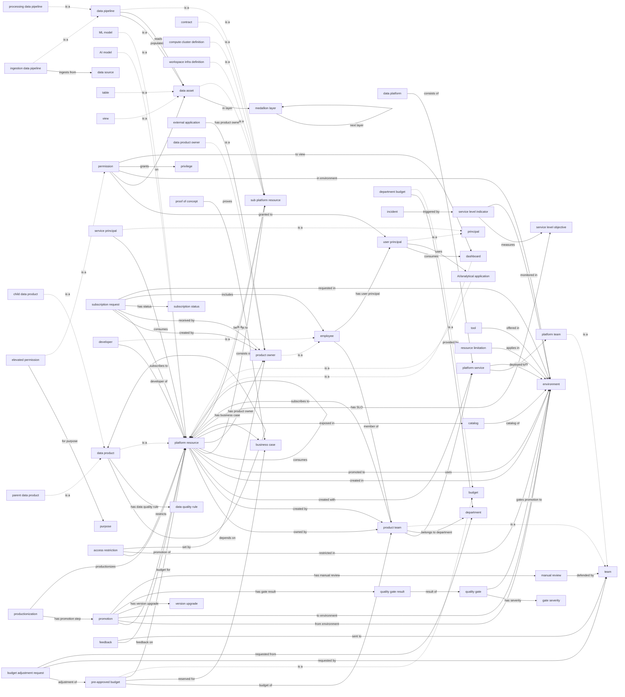

<!-- Generated by domain-model from the YAML sources of this folder. Do not edit. -->

# AcmeDataPlatform · level 3: detailed

For **everything that exists in the domain**. Levels are cumulative: this view holds the whole domain.

Contents: 63 concepts, 50 individuals, 79 relations, 9 properties, 87 rules. Items marked _(draft)_ are proposed wording, not yet confirmed.

## Diagrams

### Taxonomy (is-a)



### Ontology graph



## Glossary

| Term | Id | Kind | Synonyms | Definition | Level | Status | Sources |
|---|---|---|---|---|---|---|---|
| ACC | `ACC` | individual |  | The production-like environment, fully automated (deployment only via CI/CD pipeline), to prepare the deployment and UAT tests of the next MAJOR/MINOR versions and collect consumer feedback; less freedom than DEV. | 1 | confirmed | S1, S8, S13, S14, S60 |
| ACC catalog | `CatalogACC` | individual |  |  | 2 | confirmed | S49 |
| accepted | `reviewAccepted` | property |  |  | 3 | confirmed | S59 |
| access restriction | `AccessRestriction` | concept |  | A limit a product owner intentionally sets on the default read access of the owner team's members to their own platform resource, in some environments (e.g. not in PRD, which contains sensitive/PII information). | 3 | confirmed | S55, S56 |
| AcmeDataPlatform | `AcmeDataPlatform` | individual |  |  | 1 | confirmed | S1, S2 |
| adjustment of | `adjustmentOf` | relation |  |  | 3 | confirmed | S63 |
| AI assistant | `AIAssistant` | individual |  | Helps to build platform resources quickly. | 3 | confirmed | S58 |
| AI model | `AIModel` | concept |  |  | 1 | confirmed | S9, S18 |
| AI/analytical application | `AIAnalyticalApplication` | concept |  |  | 1 | confirmed | S9 |
| applies in | `limitationIn` | relation |  |  | 3 | confirmed | S58 |
| approved | `Approved` | individual |  |  | 2 | confirmed | S41 |
| automated testing | `AutomatedTesting` | individual |  |  | 3 | confirmed | S59 |
| belongs to | `belongsTo` | relation |  |  | 2 | confirmed | S18 |
| belongs to department | `belongsToDepartment` | relation |  |  | 3 | confirmed | S58, S65 |
| BLOCKED | `Blocked` | individual |  | A failed gate always stops the promotion; no manual review can override it. | 3 | confirmed | S59 |
| BLOCKING | `Blocking` | individual |  | A failed gate stops the promotion until a manual review accepts it. | 3 | confirmed | S59, S60 |
| breaking change | `breakingChange` | property |  |  | 3 | confirmed | S60 |
| budget | `Budget` | concept |  | There are 2 kinds: the department-level pre-allocated budget (EXP) and the pre-approved budget of a product team (DEV/ACC/PRD). | 3 | confirmed | S58, S59, S60, S65 |
| budget adjustment request | `BudgetAdjustmentRequest` | concept |  | A request by the owner team to its department to adjust the pre-approved development budget, if needed. | 3 | confirmed | S63 |
| budget for | `budgetForResource` | relation |  |  | 3 | confirmed | S60, S63, S65 |
| budget of | `budgetOfTeam` | relation |  |  | 3 | confirmed | S65 |
| budget test in ACC: costs under prod-like load fit into the pre-approved budget | `GateCostsWithinBudget` | individual |  |  | 3 | confirmed | S60, S63 |
| budget test in DEV: costs fit into the pre-approved budget | `GateBudgetTestDev` | individual |  |  | 3 | confirmed | S63 |
| business case | `BusinessCase` | concept | use case | The approved reason for building a platform resource; an outcome of EXP, needed to work in DEV. | 3 | confirmed | S58, S59 |
| catalog | `Catalog` | concept |  | Where the platform resources of one environment are exposed (findable) for anyone inside ACME company; there is a catalog per environment. | 2 | confirmed | S38, S49 |
| catalog of | `catalogOf` | relation |  |  | 2 | confirmed | S49 |
| child data product | `ChildDataProduct` | concept | downstream data product | A data product that depends on one or more parent data products. | 2 | confirmed | S24 |
| CI/CD pipeline | `CICDPipeline` | individual |  | The only way to deploy to ACC. | 3 | confirmed | S13, S60 |
| compatibility tests pass (e.g. no breaking change in a MINOR version upgrade) | `GateCompatibilityTests` | individual |  |  | 3 | confirmed | S60 |
| compute cluster definition | `ComputeClusterDefinition` | concept |  |  | 2 | confirmed | S20 |
| consists of | `consistsOf` | relation |  |  | 1 | confirmed | S2 |
| consists of | `hasSubResource` | relation | has sub platform resource |  | 2 | confirmed | S18 |
| consumer | `requestConsumer` | relation |  | The new platform resource or the other application that will consume the subscribed platform resource. | 2 | confirmed | S40, S42 |
| consumes | `consumes` | relation | references, uses | A dashboard, AI/analytical application or data product consumes an independent (upstream/parent) data product, ML model or AI model that is deployed separately; it is not a sub platform resource. | 2 | confirmed | S28, S29, S32 |
| consumes | `serviceConsumes` | relation |  |  | 2 | confirmed | S33 |
| consumes | `userConsumes` | relation |  |  | 2 | confirmed | S33 |
| contract | `DataContract` | concept |  |  | 2 | confirmed | S20 |
| created by | `createdBy` | relation |  |  | 1 | confirmed | S4, S5 |
| created by | `requestedBy` | relation |  |  | 2 | confirmed | S40 |
| created in | `createdIn` | relation |  |  | 1 | confirmed | S7, S11 |
| created with | `createdWith` | relation |  |  | 1 | confirmed | S4, S10 |
| CURATED | `CURATED` | individual |  |  | 2 | confirmed | S25 |
| dashboard | `Dashboard` | concept |  |  | 1 | confirmed | S9, S18 |
| data asset | `DataAsset` | concept |  | A part of a data product holding its data; typically tables and views in case of structured data products. | 2 | confirmed | S20 |
| data pipeline | `DataPipeline` | concept |  |  | 2 | confirmed | S20 |
| data pipelines are not notebooks (imperative/declarative definitions) | `GateNoNotebookPipeline` | individual |  |  | 3 | confirmed | S59 |
| data platform | `DataPlatform` | concept |  | The kind of thing AcmeDataPlatform is. | 1 | confirmed | S1 |
| data product | `DataProduct` | concept |  |  | 1 | confirmed | S9, S18 |
| data product owner | `DataProductOwner` | concept |  | The product owner of a data product. | 2 | confirmed | S36 |
| data quality rule | `DataQualityRule` | concept |  |  | 3 | confirmed | S59, S60 |
| data quality rules defined for a data product | `GateDataQualityRulesDefined` | individual |  |  | 3 | confirmed | S59 |
| data quality rules pass | `GateDataQualityRulesPass` | individual |  |  | 3 | confirmed | S60 |
| data source | `DataSource` | concept | source service | An internal or external service or data source that an ingestion data pipeline ingests data from. | 2 | confirmed | S25 |
| debugging | `Debugging` | individual |  |  | 3 | confirmed | S53 |
| defended by | `defendedBy` | relation |  |  | 3 | confirmed | S59 |
| department | `Department` | concept |  | An organisational unit whose product teams build on the AcmeDataPlatform; it provides the EXP budget for them. | 3 | confirmed | S58 |
| department budget | `ExperimentationBudget` | concept | experimentation budget, department-level pre-allocated budget | The EXP budget: pre-allocated by a department upfront, collectively for each month, for all its product teams and their platform resources. | 3 | confirmed | S58, S65 |
| depends on | `dependsOn` | relation | lineage | The lineage between data products: a child (downstream) data product depends on its parent (upstream) data products. | 2 | confirmed | S24, S29 |
| deployed to | `deployedTo` | relation |  |  | 1 | confirmed | S6, S10 |
| DEV | `DEV` | individual |  | The environment where platform resources are created via repeatable automation, so they can be deployed to upper environments reliably; less freedom than EXP. | 1 | confirmed | S1, S7, S8, S11, S59 |
| DEV catalog | `CatalogDEV` | individual |  |  | 2 | confirmed | S49 |
| developer | `Developer` | concept |  | An employee who develops a consumer application or other platform resource. | 3 | confirmed | S53 |
| developer of | `developerOf` | relation |  |  | 3 | confirmed | S53 |
| elevated permission | `ElevatedPermission` | concept |  | A time-limited permission a developer of the consumer application requests to run SELECT commands on tables/views in their data product or in the parent data products, for incident resolution or debugging. | 3 | confirmed | S53 |
| employee | `Employee` | concept |  | A person working for ACME company, e.g. a product owner or data product owner. | 2 | confirmed | S50 |
| environment | `Environment` | concept |  |  | 1 | confirmed | S1, S6, S7, S8 |
| EXP | `EXP` | individual |  | The environment for experimentation and learning, with the highest degree of freedom: start experimenting in minutes, without prior approval for permission or budget. | 1 | confirmed | S1, S7, S8, S11, S12, S58 |
| EXP catalog | `CatalogEXP` | individual |  |  | 2 | confirmed | S49 |
| exposed in | `exposedIn` | relation | findable in |  | 2 | confirmed | S38, S49 |
| exposed in catalog | `exposedInCatalog` | property |  | Whether a platform resource is exposed in the catalogs of its environments: yes by default, can be turned off. | 2 | confirmed | S38, S49 |
| external application | `ExternalApplication` | concept |  | An application that runs outside of the data platform and consumes the externally exposed/shared platform resources. | 3 | confirmed | S35 |
| externally shared | `externallyShared` | property | externally exposed | Whether a platform resource is exposed/shared to external applications. | 3 | confirmed | S35 |
| failing | `sliFailing` | property |  |  | 3 | confirmed | S60, S61 |
| feedback | `Feedback` | concept |  | What consumers send to the owner team after testing the next MAJOR/MINOR version in ACC. | 3 | confirmed | S60 |
| feedback on | `feedbackOn` | relation |  |  | 3 | confirmed | S60 |
| for purpose | `forPurpose` | relation |  |  | 3 | confirmed | S53 |
| from environment | `fromEnvironment` | relation |  |  | 3 | confirmed | S8, S62 |
| gate severity | `GateSeverity` | concept |  |  | 3 | confirmed | S59, S60 |
| gates promotion to | `gatesPromotionTo` | relation |  |  | 3 | confirmed | S59, S60 |
| granted to | `grantedTo` | relation |  |  | 3 | confirmed | S52, S53 |
| grants | `grantsPrivilege` | relation |  |  | 3 | confirmed | S52, S53 |
| green performance and scalability tests proving the data pipeline is incremental | `GateIncrementalPipelineTests` | individual |  |  | 3 | confirmed | S59 |
| green tests for immutability and backfill | `GateImmutabilityBackfillTests` | individual |  |  | 3 | confirmed | S59 |
| has access to | `hasAccessTo` | relation |  | A consumer application (or platform resource) that may use/consume/access a platform resource after an approved subscription request. | 2 | confirmed | S39, S42 |
| has business case | `hasBusinessCase` | relation |  |  | 3 | confirmed | S59 |
| has data quality rule | `hasDataQualityRule` | relation |  |  | 3 | confirmed | S59 |
| has gate result | `hasGateResult` | relation |  |  | 3 | confirmed | S59, S60 |
| has manual review | `hasManualReview` | relation |  |  | 3 | confirmed | S59 |
| has product owner | `externalAppOwner` | relation |  |  | 3 | confirmed | S48 |
| has product owner | `hasProductOwner` | relation |  |  | 2 | confirmed | S36, S37 |
| has promotion step | `promotionStep` | relation |  |  | 3 | confirmed | S62 |
| has severity | `hasSeverity` | relation |  |  | 3 | confirmed | S59, S60 |
| has SLO | `hasSLO` | relation |  |  | 3 | confirmed | S59 |
| has status | `hasStatus` | relation |  |  | 2 | confirmed | S41 |
| has user principal | `hasUserPrincipal` | relation |  |  | 2 | confirmed | S50 |
| has version upgrade | `hasVersionUpgrade` | relation |  |  | 3 | confirmed | S59, S60 |
| IaC tool | `IaCTool` | individual |  | Infrastructure as code, e.g. Terraform. | 3 | confirmed | S59 |
| in environment | `inEnvironment` | relation |  |  | 3 | confirmed | S52 |
| in layer | `inLayer` | relation |  |  | 2 | confirmed | S25 |
| incident | `Incident` | concept |  |  | 3 | confirmed | S61 |
| incident resolution | `IncidentResolution` | individual |  |  | 3 | confirmed | S53 |
| includes | `includesMember` | relation |  | The team members a product owner includes in a subscription request, so that they get access as well. | 2 | confirmed | S51 |
| ingestion data pipeline | `IngestionDataPipeline` | concept |  | A data pipeline that ingests data from an (internal or external) source service or data source and stores it unchanged in the RAW layer. | 2 | confirmed | S25, S30 |
| ingests from | `ingestsFrom` | relation |  |  | 2 | confirmed | S25 |
| internal developer portal | `InternalDeveloperPortal` | individual |  |  | 3 | confirmed | S58, S59 |
| MAJOR | `MAJOR` | individual |  |  | 3 | confirmed | S59, S60 |
| mandatory | `gateMandatory` | property |  | Whether the gate must run (true) or is optional (false), e.g. the budget test is mandatory in ACC and optional in DEV. | 3 | confirmed | S63 |
| manual review | `ManualReview` | concept |  | The review a failed BLOCKING quality gate requires, in which the owning team defends why its solution does not use the available standard solutions. | 3 | confirmed | S59 |
| measures | `measures` | relation |  |  | 3 | confirmed | S59 |
| medallion layer | `MedallionLayer` | concept |  |  | 2 | confirmed | S25 |
| member of | `memberOf` | relation |  |  | 2 | confirmed | S36, S37, S51 |
| metadata and a non-empty contract | `GateMetadataContract` | individual |  |  | 3 | confirmed | S59 |
| MINOR | `MINOR` | individual |  | A version upgrade without breaking changes. | 3 | confirmed | S59, S60 |
| ML model | `MLModel` | concept |  |  | 1 | confirmed | S9, S18 |
| monitored in | `monitoredIn` | relation |  |  | 3 | confirmed | S60, S61 |
| next layer | `nextLayer` | relation |  |  | 2 | confirmed | S25 |
| notebook | `Notebook` | individual |  | Used to create data pipelines; a pipeline defined in a notebook cannot be promoted to ACC. | 3 | confirmed | S58, S59 |
| offered in | `offeredIn` | relation |  |  | 3 | confirmed | S58, S59, S60 |
| on | `permissionOn` | relation |  |  | 3 | confirmed | S52, S53 |
| owned by | `ownedBy` | relation |  | The team that owns a platform service (a platform team) or a platform resource (the product team that created it). | 1 | confirmed | S3, S5 |
| owned by | `resourceOwnedBy` | relation |  | The product team that owns a platform resource: the team which created it. | 1 | confirmed | S5 |
| owned by | `serviceOwnedBy` | relation |  | The platform team that owns a platform service. | 1 | confirmed | S3 |
| parent data product | `ParentDataProduct` | concept | upstream data product | A data product another data product depends on. | 2 | confirmed | S24 |
| passed | `gatePassed` | property |  |  | 3 | confirmed | S59, S60 |
| pending | `Pending` | individual |  |  | 2 | confirmed | S41 |
| permission | `Permission` | concept |  | Access for a user principal to tables/views in one environment, e.g. SELECT; access for users can be differentiated per environment. | 3 | confirmed | S52 |
| platform resource | `PlatformResource` | concept |  |  | 1 | confirmed | S1, S4, S5, S7, S8, S9, S11, S14, S15 |
| platform service | `PlatformService` | concept |  |  | 1 | confirmed | S1, S2, S3, S4, S6 |
| platform team | `PlatformTeam` | concept |  |  | 1 | confirmed | S1, S3, S10 |
| populates | `populates` | relation |  |  | 2 | confirmed | S24 |
| PRD | `PRD` | individual |  | The live environment, with the least freedom: maximum protection via policies, limited access and audit log. | 1 | confirmed | S1, S8, S14, S61 |
| PRD catalog | `CatalogPRD` | individual |  |  | 2 | confirmed | S49 |
| pre-approved budget | `PreApprovedBudget` | concept | development budget, reserved budget | The DEV/ACC/PRD budget for the use case / platform resource of one product team (an outcome of EXP); automated budget tests validate that the costs fit into it, and the owner team may request an adjustment from its department. | 3 | confirmed | S58, S59, S60, S63, S65 |
| principal | `Principal` | concept |  | Someone or something that consumes platform resources: a user principal or a service principal. | 2 | confirmed | S33 |
| privilege | `Privilege` | concept |  |  | 3 | confirmed | S52, S53 |
| processing data pipeline | `ProcessingDataPipeline` | concept |  | A data pipeline that performs transformations (cleansing, curation, filtering, enrichment, aggregation) across the RAW->CURATED->SERVING medallion layers. | 2 | confirmed | S25, S30 |
| product owner | `ProductOwner` | concept |  | The member of the owner product team who owns a platform resource on its behalf. | 2 | confirmed | S37, S50 |
| product team | `ProductTeam` | concept |  |  | 1 | confirmed | S1, S4, S5, S10 |
| productionization | `Productionization` | concept |  | The promotion and approval process to deploy platform resources from lower environments to upper environments till PRD. | 3 | confirmed | S62 |
| productionizes | `productionizes` | relation |  |  | 3 | confirmed | S62 |
| promoted to | `promotedTo` | relation |  |  | 1 | confirmed | S8 |
| promotion | `Promotion` | concept |  | One step of a productionization: a platform resource is deployed from one environment to the next upper environment. | 3 | confirmed | S8, S62 |
| promotion of | `promotionOf` | relation |  |  | 3 | confirmed | S8, S62 |
| promotion/conversion tool | `PromotionConversionTool` | individual |  | Promotes/converts platform resources from EXP to DEV automatically. | 3 | confirmed | S58 |
| proof of concept | `ProofOfConcept` | concept | POC | The outcome of experimentation in EXP: fit for the purpose, with knowledge about the expected costs. | 3 | confirmed | S58 |
| proves | `provesCase` | relation |  |  | 3 | confirmed | S58 |
| provided by | `providedBy` | relation |  |  | 3 | confirmed | S58, S65 |
| purpose | `Purpose` | concept |  |  | 3 | confirmed | S53 |
| quality gate | `QualityGate` | concept |  | A check a platform resource must pass to be promoted to an environment; it is BLOCKED, BLOCKING or a WARNING. | 3 | confirmed | S59, S60 |
| quality gate result | `QualityGateResult` | concept |  | The outcome (passed or failed) of one quality gate for one promotion. | 3 | confirmed | S59, S60 |
| RAW | `RAW` | individual |  |  | 2 | confirmed | S25 |
| reads | `reads` | relation |  |  | 2 | confirmed | S24 |
| received by | `receivedBy` | relation |  |  | 2 | confirmed | S41 |
| rejected | `Rejected` | individual |  |  | 2 | confirmed | S41 |
| represents the identity of | `identityOf` | relation |  |  | 3 | confirmed | S34 |
| requested by | `adjustmentRequestedBy` | relation |  |  | 3 | confirmed | S63 |
| requested from | `adjustmentRequestedFrom` | relation |  |  | 3 | confirmed | S63 |
| requested in | `requestedIn` | relation |  |  | 3 | confirmed | S58 |
| requires manual approval | `requiresManualApproval` | property |  | Set by the data product owner, per data product, for reasons such as security or an intentionally limited audience: subscription requests need his/her manual approval, also in EXP. | 3 | confirmed | S64 |
| reserved for | `reservedFor` | relation |  | The use case (business case) the pre-approved budget is for. | 3 | confirmed | S65 |
| resource limitation | `ResourceLimitation` | concept |  | A limit on platform resources in EXP that avoids production usage. | 3 | confirmed | S58 |
| restricted in | `restrictedIn` | relation |  |  | 3 | confirmed | S55 |
| restricts | `restricts` | relation |  |  | 3 | confirmed | S55 |
| result of | `resultOf` | relation |  |  | 3 | confirmed | S59, S60 |
| reuse limitation | `ReuseLimitation` | individual |  |  | 3 | confirmed | S58 |
| schema compatibility guarantees | `GateSchemaCompatibility` | individual |  |  | 3 | confirmed | S59 |
| security tests pass | `GateSecurityTests` | individual |  |  | 3 | confirmed | S60 |
| SELECT | `SELECT` | individual |  |  | 3 | confirmed | S52, S53 |
| sent to | `sentTo` | relation |  |  | 3 | confirmed | S60 |
| service level indicator | `ServiceLevelIndicator` | concept | SLI | An automatically monitored measure of a service level objective, in one environment. | 3 | confirmed | S59, S60, S61 |
| service level objective | `ServiceLevelObjective` | concept | SLO |  | 3 | confirmed | S59 |
| service principal | `ServicePrincipal` | concept | application consumer | The identity of an application, data pipeline or other automation which is not performed by a human. | 2 | confirmed | S33, S34 |
| SERVING | `SERVING` | individual |  |  | 2 | confirmed | S25 |
| set by | `setBy` | relation |  |  | 3 | confirmed | S55, S56 |
| size limitation | `SizeLimitation` | individual |  |  | 3 | confirmed | S58 |
| skeleton application | `SkeletonApplication` | individual |  | A starting point for one of various use cases. | 3 | confirmed | S59 |
| SLIs pass | `GateSLIsPass` | individual |  |  | 3 | confirmed | S60 |
| SLOs and automatically monitored SLIs | `GateSLOsAndSLIs` | individual |  |  | 3 | confirmed | S59 |
| sub platform resource | `SubPlatformResource` | concept | nested platform resource | A platform resource that belongs to a parent platform resource and cannot live on its own. | 2 | confirmed | S18 |
| subscribes to | `requestFor` | relation |  |  | 2 | confirmed | S40 |
| subscribes to | `subscribesTo` | relation |  |  | 1 | confirmed | S21 |
| subscription request | `SubscriptionRequest` | concept |  | A request by a product owner to consume an existing platform resource, to build a new platform resource or to consume it by another application. | 2 | confirmed | S40, S41 |
| subscription status | `SubscriptionStatus` | concept |  |  | 2 | confirmed | S41 |
| sufficient test coverage | `GateTestCoverage` | individual |  |  | 3 | confirmed | S59 |
| table | `Table` | concept |  |  | 3 | confirmed | S20 |
| team | `Team` | concept |  |  | 1 | confirmed | S10 |
| time limitation | `TimeLimitation` | individual |  |  | 3 | confirmed | S58 |
| to environment | `toEnvironment` | relation |  |  | 3 | confirmed | S8, S62 |
| to view | `viewPermissionOn` | relation |  |  | 3 | confirmed | S55, S57 |
| tool | `Tool` | concept |  | Tooling offered to the teams in an environment, e.g. the internal developer portal in EXP or IaC tools in DEV. | 3 | confirmed | S58, S59 |
| triggered by | `triggeredBy` | relation |  |  | 3 | confirmed | S61 |
| user principal | `UserPrincipal` | concept | human user | The identity of a user or group of users who can look at dashboards and use AI/analytical applications. | 2 | confirmed | S33, S34 |
| uses | `userUses` | relation |  |  | 3 | confirmed | S34 |
| uses | `uses` | relation |  |  | 1 | confirmed | S4 |
| uses one of the standard templates | `GateStandardTemplate` | individual |  |  | 3 | confirmed | S59 |
| valid until | `validUntil` | property |  |  | 3 | confirmed | S53 |
| version upgrade | `VersionUpgrade` | concept |  | The kind of new version a promotion delivers: MAJOR or MINOR; decided in DEV. | 3 | confirmed | S59, S60 |
| VIEW | `VIEW` | individual |  |  | 3 | confirmed | S55, S57 |
| view | `View` | concept |  |  | 3 | confirmed | S20 |
| WARNING | `Warning` | individual |  | A failed gate is reported but does not stop the promotion. | 3 | confirmed | S59, S60 |
| workspace infra definition | `WorkspaceInfraDefinition` | concept |  |  | 2 | confirmed | S20 |

## Taxonomy (is-a)

- data platform (`DataPlatform`)
- platform service (`PlatformService`)
- platform resource (`PlatformResource`)
  - data product (`DataProduct`)
    - parent data product (`ParentDataProduct`)
    - child data product (`ChildDataProduct`)
  - dashboard (`Dashboard`)
  - ML model (`MLModel`)
  - AI model (`AIModel`)
  - AI/analytical application (`AIAnalyticalApplication`)
  - sub platform resource (`SubPlatformResource`)
    - contract (`DataContract`)
    - data pipeline (`DataPipeline`)
      - ingestion data pipeline (`IngestionDataPipeline`)
      - processing data pipeline (`ProcessingDataPipeline`)
    - compute cluster definition (`ComputeClusterDefinition`)
    - workspace infra definition (`WorkspaceInfraDefinition`)
    - data asset (`DataAsset`)
      - table (`Table`)
      - view (`View`)
- data source (`DataSource`)
- medallion layer (`MedallionLayer`)
- principal (`Principal`)
  - user principal (`UserPrincipal`)
  - service principal (`ServicePrincipal`)
- external application (`ExternalApplication`)
- catalog (`Catalog`)
- subscription request (`SubscriptionRequest`)
- subscription status (`SubscriptionStatus`)
- employee (`Employee`)
  - product owner (`ProductOwner`)
    - data product owner (`DataProductOwner`)
  - developer (`Developer`)
- permission (`Permission`)
  - elevated permission (`ElevatedPermission`)
- privilege (`Privilege`)
- purpose (`Purpose`)
- access restriction (`AccessRestriction`)
- team (`Team`)
  - platform team (`PlatformTeam`)
  - product team (`ProductTeam`)
- environment (`Environment`)
- productionization (`Productionization`)
- promotion (`Promotion`)
- version upgrade (`VersionUpgrade`)
- quality gate (`QualityGate`)
- gate severity (`GateSeverity`)
- quality gate result (`QualityGateResult`)
- manual review (`ManualReview`)
- tool (`Tool`)
- resource limitation (`ResourceLimitation`)
- department (`Department`)
- budget (`Budget`)
  - department budget (`ExperimentationBudget`)
  - pre-approved budget (`PreApprovedBudget`)
- budget adjustment request (`BudgetAdjustmentRequest`)
- business case (`BusinessCase`)
- proof of concept (`ProofOfConcept`)
- service level objective (`ServiceLevelObjective`)
- service level indicator (`ServiceLevelIndicator`)
- incident (`Incident`)
- data quality rule (`DataQualityRule`)
- feedback (`Feedback`)

## Relations

| Relation | Id | Domain | Range | Cardinality | Inverse | Super-relation | Characteristics | Level |
|---|---|---|---|---|---|---|---|---|
| consists of | `consistsOf` | `DataPlatform` | `PlatformService` | 1..* |  |  |  | 1 |
| owned by | `ownedBy` |  | `Team` |  |  |  |  | 1 |
| owned by | `serviceOwnedBy` | `PlatformService` | `PlatformTeam` | 1 |  | `ownedBy` |  | 1 |
| owned by | `resourceOwnedBy` | `PlatformResource` | `ProductTeam` | 1 |  | `ownedBy` |  | 1 |
| uses | `uses` | `ProductTeam` | `PlatformService` |  |  |  |  | 1 |
| subscribes to | `subscribesTo` | `ProductTeam` | `PlatformResource` | * |  |  |  | 1 |
| created by | `createdBy` | `PlatformResource` | `ProductTeam` | 1 |  |  |  | 1 |
| created with | `createdWith` | `PlatformResource` | `PlatformService` | 1..* |  |  |  | 1 |
| deployed to | `deployedTo` | `PlatformService` | `Environment` | * |  |  |  | 1 |
| created in | `createdIn` | `PlatformResource` | `Environment` | 1 |  |  |  | 1 |
| promoted to | `promotedTo` | `PlatformResource` | `Environment` | * |  |  |  | 1 |
| consists of | `hasSubResource` | `PlatformResource` | `SubPlatformResource` | * | `belongsTo` |  |  | 2 |
| belongs to | `belongsTo` | `SubPlatformResource` | `PlatformResource` | 1 | `hasSubResource` |  | functional, irreflexive | 2 |
| depends on | `dependsOn` | `DataProduct` | `DataProduct` | * |  | `consumes` |  | 2 |
| populates | `populates` | `DataPipeline` | `DataAsset` | 1..* |  |  |  | 2 |
| reads | `reads` | `DataPipeline` | `DataAsset` | * |  |  |  | 2 |
| ingests from | `ingestsFrom` | `IngestionDataPipeline` | `DataSource` | 1..* |  |  |  | 2 |
| in layer | `inLayer` | `DataAsset` | `MedallionLayer` | 1 |  |  |  | 2 |
| next layer | `nextLayer` | `MedallionLayer` | `MedallionLayer` | 0..1 |  |  |  | 2 |
| consumes | `consumes` | `PlatformResource` | `PlatformResource` | * |  |  |  | 2 |
| consumes | `userConsumes` | `UserPrincipal` | `Dashboard` | * |  |  |  | 2 |
| consumes | `serviceConsumes` | `ServicePrincipal` | `PlatformResource` | * |  |  |  | 2 |
| uses | `userUses` | `UserPrincipal` | `AIAnalyticalApplication` | * |  |  |  | 3 |
| represents the identity of | `identityOf` | `ServicePrincipal` |  |  |  |  |  | 3 |
| has product owner | `hasProductOwner` | `PlatformResource` | `ProductOwner` | 0..1 |  |  |  | 2 |
| member of | `memberOf` | `Employee` | `ProductTeam` |  |  |  |  | 2 |
| exposed in | `exposedIn` | `PlatformResource` | `Catalog` | * |  |  |  | 2 |
| created by | `requestedBy` | `SubscriptionRequest` | `ProductOwner` | 1 |  |  |  | 2 |
| subscribes to | `requestFor` | `SubscriptionRequest` | `PlatformResource` | 1 |  |  |  | 2 |
| consumer | `requestConsumer` | `SubscriptionRequest` |  | 1 |  |  |  | 2 |
| received by | `receivedBy` | `SubscriptionRequest` | `ProductOwner` | 1 |  |  |  | 2 |
| has status | `hasStatus` | `SubscriptionRequest` | `SubscriptionStatus` | 1 |  |  |  | 2 |
| has access to | `hasAccessTo` |  | `PlatformResource` |  |  |  |  | 2 |
| catalog of | `catalogOf` | `Catalog` | `Environment` | 1 |  |  |  | 2 |
| has user principal | `hasUserPrincipal` | `Employee` | `UserPrincipal` | 1 |  |  |  | 2 |
| has product owner | `externalAppOwner` | `ExternalApplication` | `ProductOwner` | 1 |  |  |  | 3 |
| includes | `includesMember` | `SubscriptionRequest` | `Employee` | * |  |  |  | 2 |
| developer of | `developerOf` | `Developer` | `PlatformResource` | * |  |  |  | 3 |
| granted to | `grantedTo` | `Permission` | `UserPrincipal` | 1 |  |  |  | 3 |
| on | `permissionOn` | `Permission` | `DataAsset` | 1..* |  |  |  | 3 |
| in environment | `inEnvironment` | `Permission` | `Environment` | 1 |  |  |  | 3 |
| grants | `grantsPrivilege` | `Permission` | `Privilege` | 1..* |  |  |  | 3 |
| for purpose | `forPurpose` | `ElevatedPermission` | `Purpose` | 1 |  |  |  | 3 |
| restricts | `restricts` | `AccessRestriction` | `PlatformResource` | 1 |  |  |  | 3 |
| restricted in | `restrictedIn` | `AccessRestriction` | `Environment` | 1..* |  |  |  | 3 |
| set by | `setBy` | `AccessRestriction` | `ProductOwner` | 1 |  |  |  | 3 |
| to view | `viewPermissionOn` | `Permission` | `Dashboard` | * |  |  |  | 3 |
| has promotion step | `promotionStep` | `Productionization` | `Promotion` | 1..* |  |  |  | 3 |
| productionizes | `productionizes` | `Productionization` | `PlatformResource` | 1 |  |  |  | 3 |
| promotion of | `promotionOf` | `Promotion` | `PlatformResource` | 1 |  |  |  | 3 |
| from environment | `fromEnvironment` | `Promotion` | `Environment` | 1 |  |  |  | 3 |
| to environment | `toEnvironment` | `Promotion` | `Environment` | 1 |  |  |  | 3 |
| has version upgrade | `hasVersionUpgrade` | `Promotion` | `VersionUpgrade` | 0..1 |  |  |  | 3 |
| has gate result | `hasGateResult` | `Promotion` | `QualityGateResult` | * |  |  |  | 3 |
| result of | `resultOf` | `QualityGateResult` | `QualityGate` | 1 |  |  |  | 3 |
| has manual review | `hasManualReview` | `Promotion` | `ManualReview` | * |  |  |  | 3 |
| defended by | `defendedBy` | `ManualReview` | `Team` | 1 |  |  |  | 3 |
| has severity | `hasSeverity` | `QualityGate` | `GateSeverity` | 1 |  |  |  | 3 |
| gates promotion to | `gatesPromotionTo` | `QualityGate` | `Environment` | 1 |  |  |  | 3 |
| offered in | `offeredIn` | `Tool` | `Environment` | 1..* |  |  |  | 3 |
| applies in | `limitationIn` | `ResourceLimitation` | `Environment` | 1..* |  |  |  | 3 |
| belongs to department | `belongsToDepartment` | `ProductTeam` | `Department` | 0..1 |  |  |  | 3 |
| provided by | `providedBy` | `ExperimentationBudget` | `Department` | 1 |  |  |  | 3 |
| budget of | `budgetOfTeam` | `PreApprovedBudget` | `ProductTeam` | 1 |  |  |  | 3 |
| reserved for | `reservedFor` | `PreApprovedBudget` | `BusinessCase` | 1 |  |  |  | 3 |
| budget for | `budgetForResource` | `PreApprovedBudget` | `PlatformResource` | * |  |  |  | 3 |
| adjustment of | `adjustmentOf` | `BudgetAdjustmentRequest` | `PreApprovedBudget` | 1 |  |  |  | 3 |
| requested by | `adjustmentRequestedBy` | `BudgetAdjustmentRequest` | `Team` | 1 |  |  |  | 3 |
| requested from | `adjustmentRequestedFrom` | `BudgetAdjustmentRequest` | `Department` | 1 |  |  |  | 3 |
| has business case | `hasBusinessCase` | `PlatformResource` | `BusinessCase` | 0..1 |  |  |  | 3 |
| proves | `provesCase` | `ProofOfConcept` | `BusinessCase` | 0..1 |  |  |  | 3 |
| has SLO | `hasSLO` | `PlatformResource` | `ServiceLevelObjective` | * |  |  |  | 3 |
| measures | `measures` | `ServiceLevelIndicator` | `ServiceLevelObjective` | 1 |  |  |  | 3 |
| monitored in | `monitoredIn` | `ServiceLevelIndicator` | `Environment` | 1 |  |  |  | 3 |
| triggered by | `triggeredBy` | `Incident` | `ServiceLevelIndicator` | 1..* |  |  |  | 3 |
| has data quality rule | `hasDataQualityRule` | `DataProduct` | `DataQualityRule` | * |  |  |  | 3 |
| feedback on | `feedbackOn` | `Feedback` | `PlatformResource` | 1 |  |  |  | 3 |
| sent to | `sentTo` | `Feedback` | `Team` | 1 |  |  |  | 3 |
| requested in | `requestedIn` | `SubscriptionRequest` | `Environment` | 0..1 |  |  |  | 3 |

## Properties

| Property | Id | Domain | Datatype | Cardinality | Level |
|---|---|---|---|---|---|
| externally shared | `externallyShared` | `PlatformResource` | `xsd:boolean` | 0..1 | 3 |
| exposed in catalog | `exposedInCatalog` | `PlatformResource` | `xsd:boolean` | 0..1 | 2 |
| valid until | `validUntil` | `ElevatedPermission` | `xsd:dateTime` | 1 | 3 |
| mandatory | `gateMandatory` | `QualityGate` | `xsd:boolean` | 0..1 | 3 |
| requires manual approval | `requiresManualApproval` | `DataProduct` | `xsd:boolean` | 0..1 | 3 |
| passed | `gatePassed` | `QualityGateResult` | `xsd:boolean` | 1 | 3 |
| breaking change | `breakingChange` | `Promotion` | `xsd:boolean` | 0..1 | 3 |
| accepted | `reviewAccepted` | `ManualReview` | `xsd:boolean` | 1 | 3 |
| failing | `sliFailing` | `ServiceLevelIndicator` | `xsd:boolean` | 0..1 | 3 |

## Rules

### R1 · Each platform service is owned by exactly one team.

- **Kind:** constraint · **Pattern:** `cardinality` · **Level:** 1 · **Status:** confirmed · **Sources:** S3
- each `PlatformService` has at least 1 and at most 1 `ownedBy` value(s)

### R2 · The owner of a platform service is a platform team.

- **Kind:** constraint · **Pattern:** `sparql` · **Level:** 1 · **Status:** confirmed · **Sources:** S3
- SPARQL SELECT (each result is a violation) on each `PlatformService`

```sparql
SELECT $this WHERE { $this adp:ownedBy ?team . FILTER NOT EXISTS { ?team a adp:PlatformTeam } }
```

### R3 · Each (top-level or nested) platform resource is created with one or more platform services.

- **Kind:** constraint · **Pattern:** `cardinality` · **Level:** 1 · **Status:** confirmed · **Sources:** S10, S54
- each `PlatformResource` has at least 1 and  `createdWith` value(s)

### R4 · Each platform resource is created by exactly one team.

- **Kind:** constraint · **Pattern:** `cardinality` · **Level:** 1 · **Status:** confirmed · **Sources:** S5
- each `PlatformResource` has at least 1 and at most 1 `createdBy` value(s)

### R5 · A platform resource is created by a product team, never by a platform team.

- **Kind:** constraint · **Pattern:** `sparql` · **Level:** 1 · **Status:** confirmed · **Sources:** S4, S5
- SPARQL SELECT (each result is a violation) on each `PlatformResource`

```sparql
SELECT $this WHERE { $this adp:createdBy ?team . ?team a adp:PlatformTeam . }
```

### R6 · A platform resource is owned by the product team which created it.

- **Kind:** constraint · **Pattern:** `equal` · **Level:** 1 · **Status:** confirmed · **Sources:** S5
- for each `PlatformResource`, `ownedBy` and `createdBy` have the same values

### R7 · A platform resource is created in exactly one environment.

- **Kind:** constraint · **Pattern:** `cardinality` · **Level:** 1 · **Status:** confirmed · **Sources:** S7, S11
- each `PlatformResource` has at least 1 and at most 1 `createdIn` value(s)

### R8 · A platform resource is created in the EXP or in the DEV environment.

- **Kind:** constraint · **Pattern:** `values` · **Level:** 1 · **Status:** confirmed · **Sources:** S7, S11, S13
- every `createdIn` value of a `PlatformResource` is one of `EXP`, `DEV`

### R9 · A platform resource can only be promoted to DEV, ACC or PRD.

- **Kind:** constraint · **Pattern:** `values` · **Level:** 1 · **Status:** confirmed · **Sources:** S8, S11, S12
- every `promotedTo` value of a `PlatformResource` is one of `DEV`, `ACC`, `PRD`

### R10 · A platform resource promoted to DEV was created in EXP.

- **Kind:** constraint · **Pattern:** `implies` · **Level:** 1 · **Status:** confirmed · **Sources:** S8, S11
- if a `PlatformResource` has `DEV` as `promotedTo`, then it has `EXP` as `createdIn`

### R11 · A platform resource promoted to ACC was created in or promoted to DEV first.

- **Kind:** constraint · **Pattern:** `implies` · **Level:** 1 · **Status:** confirmed · **Sources:** S8, S11, S13
- if a `PlatformResource` has `ACC` as `promotedTo`, then it has `DEV` as `createdIn|promotedTo`

### R12 · A platform resource promoted to PRD was promoted to ACC first.

- **Kind:** constraint · **Pattern:** `implies` · **Level:** 1 · **Status:** confirmed · **Sources:** S8, S11, S14
- if a `PlatformResource` has `PRD` as `promotedTo`, then it has `ACC` as `promotedTo`

### R13 · A sub platform resource belongs to exactly one parent platform resource; it cannot live on its own.

- **Kind:** constraint · **Pattern:** `cardinality` · **Level:** 2 · **Status:** confirmed · **Sources:** S18
- each `SubPlatformResource` has at least 1 and at most 1 `belongsTo` value(s)

### R14 · A sub platform resource is created by the same product team as its parent platform resource.

- **Kind:** constraint · **Pattern:** `equal` · **Level:** 2 · **Status:** confirmed · **Sources:** S18, S27
- for each `SubPlatformResource`, `createdBy` and `belongsTo/createdBy` have the same values

### R15 · A sub platform resource is created in the environment of its parent platform resource.

- **Kind:** derivation · **Pattern:** `derive` · **Level:** 2 · **Status:** confirmed · **Sources:** S18, S19, S27
- each `SubPlatformResource` gets `createdIn` → `belongsTo+/createdIn`

### R16 · A sub platform resource is promoted with its parent platform resource.

- **Kind:** derivation · **Pattern:** `derive` · **Level:** 2 · **Status:** confirmed · **Sources:** S19, S27
- each `SubPlatformResource` gets `promotedTo` → `belongsTo+/promotedTo`

### R17 · A sub platform resource is never promoted on its own: it is in exactly the environments its parent was promoted to.

- **Kind:** constraint · **Pattern:** `equal` · **Level:** 2 · **Status:** confirmed · **Sources:** S19
- for each `SubPlatformResource`, `promotedTo` and `belongsTo/promotedTo` have the same values

### R18 · A data product consists of a contract.

- **Kind:** constraint · **Pattern:** `cardinality` · **Level:** 2 · **Status:** confirmed · **Sources:** S20
- each `DataProduct` has at least 1 and  `^belongsTo` value(s) of class `DataContract`

### R19 · A data product consists of a data pipeline.

- **Kind:** constraint · **Pattern:** `cardinality` · **Level:** 2 · **Status:** confirmed · **Sources:** S20
- each `DataProduct` has at least 1 and  `^belongsTo` value(s) of class `DataPipeline`

### R20 · A data product consists of a compute cluster definition.

- **Kind:** constraint · **Pattern:** `cardinality` · **Level:** 2 · **Status:** confirmed · **Sources:** S20
- each `DataProduct` has at least 1 and  `^belongsTo` value(s) of class `ComputeClusterDefinition`

### R21 · A data product consists of a workspace infra definition.

- **Kind:** constraint · **Pattern:** `cardinality` · **Level:** 2 · **Status:** confirmed · **Sources:** S20
- each `DataProduct` has at least 1 and  `^belongsTo` value(s) of class `WorkspaceInfraDefinition`

### R22 · A data product consists of at least one data asset.

- **Kind:** constraint · **Pattern:** `cardinality` · **Level:** 2 · **Status:** confirmed · **Sources:** S20
- each `DataProduct` has at least 1 and  `^belongsTo` value(s) of class `DataAsset`

### R23 · A data product consists of at least one dashboard showing its health.

- **Kind:** constraint · **Pattern:** `cardinality` · **Level:** 2 · **Status:** confirmed · **Sources:** S20
- each `DataProduct` has at least 1 and  `^belongsTo` value(s) of class `Dashboard`

### R24 · A data product consists only of the sub platform resources listed for it.

- **Kind:** constraint · **Pattern:** `sparql` · **Level:** 2 · **Status:** confirmed · **Sources:** S20, S22
- SPARQL SELECT (each result is a violation) on each `DataProduct`

```sparql
SELECT $this WHERE {
  ?sub adp:belongsTo $this .
  FILTER NOT EXISTS { ?sub a ?kind . FILTER (?kind IN (adp:DataContract, adp:DataPipeline, adp:ComputeClusterDefinition, adp:WorkspaceInfraDefinition, adp:DataAsset, adp:Dashboard)) }
}
```

### R25 · A AI/analytical application consists only of the sub platform resources listed for it.

- **Kind:** constraint · **Pattern:** `sparql` · **Level:** 2 · **Status:** confirmed · **Sources:** S20
- SPARQL SELECT (each result is a violation) on each `AIAnalyticalApplication`

```sparql
SELECT $this WHERE {
  ?sub adp:belongsTo $this .
  FILTER NOT EXISTS { ?sub a ?kind . FILTER (?kind IN (adp:Dashboard, adp:DataProduct, adp:MLModel, adp:AIModel)) }
}
```

### R26 · A dashboard consists only of the sub platform resources listed for it.

- **Kind:** constraint · **Pattern:** `sparql` · **Level:** 2 · **Status:** confirmed · **Sources:** S20
- SPARQL SELECT (each result is a violation) on each `Dashboard`

```sparql
SELECT $this WHERE {
  ?sub adp:belongsTo $this .
  FILTER NOT EXISTS { ?sub a ?kind . FILTER (?kind IN (adp:DataProduct, adp:MLModel, adp:AIModel)) }
}
```

### R27 · An ML model consists only of data products.

- **Kind:** constraint · **Pattern:** `sparql` · **Level:** 2 · **Status:** confirmed · **Sources:** S23
- SPARQL SELECT (each result is a violation) on each `MLModel`

```sparql
SELECT $this WHERE {
  ?sub adp:belongsTo $this .
  FILTER NOT EXISTS { ?sub a ?kind . FILTER (?kind IN (adp:DataProduct)) }
}
```

### R28 · An AI model consists only of data products.

- **Kind:** constraint · **Pattern:** `sparql` · **Level:** 2 · **Status:** confirmed · **Sources:** S23
- SPARQL SELECT (each result is a violation) on each `AIModel`

```sparql
SELECT $this WHERE {
  ?sub adp:belongsTo $this .
  FILTER NOT EXISTS { ?sub a ?kind . FILTER (?kind IN (adp:DataProduct)) }
}
```

### R29 · A data product that depends on another data product is a child data product.

- **Kind:** derivation · **Pattern:** `derive` · **Level:** 2 · **Status:** confirmed · **Sources:** S24
- each `DataProduct` that has at least 1 `dependsOn` value(s) is also a `ChildDataProduct`

### R30 · A data product another data product depends on is a parent data product.

- **Kind:** derivation · **Pattern:** `derive` · **Level:** 2 · **Status:** confirmed · **Sources:** S24
- each `DataProduct` that has at least 1 `^dependsOn` value(s) is also a `ParentDataProduct`

### R31 · A data asset is always built by a data pipeline.

- **Kind:** constraint · **Pattern:** `cardinality` · **Level:** 2 · **Status:** confirmed · **Sources:** S24
- each `DataAsset` has at least 1 and  `^populates` value(s)

### R32 · A data pipeline populates only the data assets of its own data product.

- **Kind:** constraint · **Pattern:** `sparql` · **Level:** 2 · **Status:** confirmed · **Sources:** S24
- SPARQL SELECT (each result is a violation) on each `DataPipeline`

```sparql
SELECT $this WHERE {
  $this adp:populates ?asset .
  FILTER NOT EXISTS { $this adp:belongsTo ?product . ?asset adp:belongsTo ?product . }
}
```

### R33 · A data pipeline reads only data assets of its own data product or of the parent data products of its data product.

- **Kind:** constraint · **Pattern:** `sparql` · **Level:** 2 · **Status:** confirmed · **Sources:** S24, S25
- SPARQL SELECT (each result is a violation) on each `DataPipeline`

```sparql
SELECT $this WHERE {
  $this adp:reads ?asset .
  FILTER NOT EXISTS {
    $this adp:belongsTo ?product .
    { ?asset adp:belongsTo ?product } UNION { ?product adp:dependsOn ?parent . ?asset adp:belongsTo ?parent }
  }
}
```

### R34 · The ingestion produces a data asset in the RAW layer.

- **Kind:** constraint · **Pattern:** `implies` · **Level:** 2 · **Status:** confirmed · **Sources:** S25
- if a `DataAsset` has a `^populates` value of class `IngestionDataPipeline`, then it has `RAW` as `inLayer`

### R35 · A processing data pipeline populates only data assets in the CURATED or SERVING layer.

- **Kind:** constraint · **Pattern:** `values` · **Level:** 2 · **Status:** confirmed · **Sources:** S25
- every `populates/inLayer` value of a `ProcessingDataPipeline` is one of `CURATED`, `SERVING`

### R36 · Each data asset is in exactly one medallion layer.

- **Kind:** constraint · **Pattern:** `cardinality` · **Level:** 2 · **Status:** confirmed · **Sources:** S25
- each `DataAsset` has at least 1 and at most 1 `inLayer` value(s)

### R37 · An ingestion data pipeline ingests data from at least one source service or data source.

- **Kind:** constraint · **Pattern:** `cardinality` · **Level:** 2 · **Status:** confirmed · **Sources:** S25
- each `IngestionDataPipeline` has at least 1 and  `ingestsFrom` value(s)

### R38 · A data product is created via ingestion or from parent data products.

- **Kind:** constraint · **Pattern:** `sparql` · **Level:** 2 · **Status:** confirmed · **Sources:** S25
- SPARQL SELECT (each result is a violation) on each `DataProduct`

```sparql
SELECT $this WHERE {
  FILTER NOT EXISTS { ?pipeline adp:belongsTo $this . ?pipeline a adp:IngestionDataPipeline . }
  FILTER NOT EXISTS { $this adp:dependsOn ?parent . }
}
```

### R39 · Lineage is a directed acyclic graph: a data product never depends on itself, directly or indirectly.

- **Kind:** constraint · **Pattern:** `sparql` · **Level:** 2 · **Status:** confirmed · **Sources:** S26
- SPARQL SELECT (each result is a violation) on each `DataProduct`

```sparql
SELECT $this WHERE { $this adp:dependsOn+ $this . }
```

### R40 · Nesting has no cycles: a platform resource never belongs to itself, directly or indirectly.

- **Kind:** constraint · **Pattern:** `sparql` · **Level:** 2 · **Status:** confirmed · **Sources:** S27
- SPARQL SELECT (each result is a violation) on each `SubPlatformResource`

```sparql
SELECT $this WHERE { $this adp:belongsTo+ $this . }
```

### R41 · Only dashboards, AI/analytical applications and data products consume other platform resources.

- **Kind:** constraint · **Pattern:** `sparql` · **Level:** 2 · **Status:** confirmed · **Sources:** S28, S29, S32
- SPARQL SELECT (each result is a violation) on each `PlatformResource`

```sparql
SELECT $this WHERE {
  $this adp:consumes ?used .
  FILTER NOT EXISTS { $this a ?kind . FILTER (?kind IN (adp:Dashboard, adp:AIAnalyticalApplication, adp:DataProduct)) }
}
```

### R42 · Only data products, ML models and AI models are consumed.

- **Kind:** constraint · **Pattern:** `sparql` · **Level:** 2 · **Status:** confirmed · **Sources:** S28, S33
- SPARQL SELECT (each result is a violation) on each `PlatformResource`

```sparql
SELECT $this WHERE {
  $this adp:consumes ?used .
  FILTER NOT EXISTS { ?used a ?kind . FILTER (?kind IN (adp:DataProduct, adp:MLModel, adp:AIModel)) }
}
```

### R43 · A consumed platform resource is not a sub platform resource: it is deployed separately and can live independently.

- **Kind:** constraint · **Pattern:** `sparql` · **Level:** 2 · **Status:** confirmed · **Sources:** S28, S32
- SPARQL SELECT (each result is a violation) on each `PlatformResource`

```sparql
SELECT $this WHERE { $this adp:consumes ?used . ?used a adp:SubPlatformResource . }
```

### R44 · The data products a data product consumes are its parent (upstream) data products.

- **Kind:** constraint · **Pattern:** `equal` · **Level:** 2 · **Status:** confirmed · **Sources:** S29
- for each `DataProduct`, `consumes` and `dependsOn` have the same values

### R45 · Each data pipeline is either an ingestion data pipeline or a processing data pipeline.

- **Kind:** constraint · **Pattern:** `sparql` · **Level:** 2 · **Status:** confirmed · **Sources:** S30
- SPARQL SELECT (each result is a violation) on each `DataPipeline`

```sparql
SELECT $this WHERE {
  FILTER NOT EXISTS { $this a ?kind . FILTER (?kind IN (adp:IngestionDataPipeline, adp:ProcessingDataPipeline)) }
}
```

### R46 · An ingestion data pipeline does not transform data: it reads no data assets.

- **Kind:** constraint · **Pattern:** `cardinality` · **Level:** 2 · **Status:** confirmed · **Sources:** S30
- each `IngestionDataPipeline` has  and at most 0 `reads` value(s)

### R47 · A processing data pipeline is not allowed to ingest.

- **Kind:** constraint · **Pattern:** `cardinality` · **Level:** 2 · **Status:** confirmed · **Sources:** S30
- each `ProcessingDataPipeline` has  and at most 0 `ingestsFrom` value(s)

### R48 · A contract, data pipeline, compute cluster definition, workspace infra definition or data asset has no sub platform resources.

- **Kind:** constraint · **Pattern:** `sparql` · **Level:** 2 · **Status:** confirmed · **Sources:** S31
- SPARQL SELECT (each result is a violation) on each `SubPlatformResource`

```sparql
SELECT $this WHERE {
  ?sub adp:belongsTo $this .
  $this a ?kind . FILTER (?kind IN (adp:DataContract, adp:DataPipeline, adp:ComputeClusterDefinition, adp:WorkspaceInfraDefinition, adp:DataAsset))
}
```

### R49 · User principals consume only dashboards.

- **Kind:** constraint · **Pattern:** `sparql` · **Level:** 2 · **Status:** confirmed · **Sources:** S33
- SPARQL SELECT (each result is a violation) on each `UserPrincipal`

```sparql
SELECT $this WHERE {
  $this adp:userConsumes ?used .
  ?used a ?kind . FILTER (?kind IN (adp:DataProduct, adp:MLModel, adp:AIModel, adp:AIAnalyticalApplication, adp:DataContract, adp:DataPipeline, adp:ComputeClusterDefinition, adp:WorkspaceInfraDefinition, adp:DataAsset))
}
```

### R50 · Service principals consume only data products, ML models and AI models.

- **Kind:** constraint · **Pattern:** `sparql` · **Level:** 2 · **Status:** confirmed · **Sources:** S33
- SPARQL SELECT (each result is a violation) on each `ServicePrincipal`

```sparql
SELECT $this WHERE {
  $this adp:serviceConsumes ?used .
  FILTER NOT EXISTS { ?used a ?kind . FILTER (?kind IN (adp:DataProduct, adp:MLModel, adp:AIModel)) }
}
```

### R52 · An external application consumes only externally exposed/shared platform resources.

- **Kind:** constraint · **Pattern:** `sparql` · **Level:** 3 · **Status:** confirmed · **Sources:** S35
- SPARQL SELECT (each result is a violation) on each `ServicePrincipal`

```sparql
SELECT $this WHERE {
  $this adp:identityOf ?app . ?app a adp:ExternalApplication .
  $this adp:serviceConsumes ?resource .
  FILTER NOT EXISTS { ?resource adp:externallyShared true }
}
```

### R53 · Each top-level platform resource (not a sub platform resource) has a product owner or data product owner.

- **Kind:** constraint · **Pattern:** `sparql` · **Level:** 2 · **Status:** confirmed · **Sources:** S36, S37, S43
- SPARQL SELECT (each result is a violation) on each `PlatformResource`

```sparql
SELECT $this WHERE {
  FILTER NOT EXISTS { $this a adp:SubPlatformResource }
  FILTER NOT EXISTS { $this adp:hasProductOwner ?owner }
}
```

### R54 · Each top-level platform resource has at most one product owner; with R53: exactly one.

- **Kind:** constraint · **Pattern:** `sparql` · **Level:** 2 · **Status:** confirmed · **Sources:** S43
- SPARQL SELECT (each result is a violation) on each `PlatformResource`

```sparql
SELECT $this WHERE {
  FILTER NOT EXISTS { $this a adp:SubPlatformResource }
  $this adp:hasProductOwner ?first, ?second .
  FILTER (?first != ?second)
}
```

### R55 · The product owner of a data product is a data product owner.

- **Kind:** constraint · **Pattern:** `values` · **Level:** 2 · **Status:** confirmed · **Sources:** S36
- every `hasProductOwner` value of a `DataProduct` is of class `DataProductOwner`

### R56 · The product owner of a platform resource is a member of the owner product team.

- **Kind:** constraint · **Pattern:** `sparql` · **Level:** 2 · **Status:** confirmed · **Sources:** S36, S37
- SPARQL SELECT (each result is a violation) on each `PlatformResource`

```sparql
SELECT $this WHERE {
  $this adp:hasProductOwner ?owner ; adp:resourceOwnedBy ?team .
  FILTER NOT EXISTS { ?owner adp:memberOf ?team }
}
```

### R57 · A subscription request is created by exactly one product owner.

- **Kind:** constraint · **Pattern:** `cardinality` · **Level:** 2 · **Status:** confirmed · **Sources:** S40
- each `SubscriptionRequest` has at least 1 and at most 1 `requestedBy` value(s)

### R58 · A subscription request is for exactly one existing platform resource.

- **Kind:** constraint · **Pattern:** `cardinality` · **Level:** 2 · **Status:** confirmed · **Sources:** S40
- each `SubscriptionRequest` has at least 1 and at most 1 `requestFor` value(s)

### R59 · A subscription request names exactly one consumer: the new platform resource or the other application.

- **Kind:** constraint · **Pattern:** `cardinality` · **Level:** 2 · **Status:** confirmed · **Sources:** S40, S42
- each `SubscriptionRequest` has at least 1 and at most 1 `requestConsumer` value(s)

### R60 · A subscription request for a new data product, application or other platform resource is created by its owner.

- **Kind:** constraint · **Pattern:** `sparql` · **Level:** 2 · **Status:** confirmed · **Sources:** S40, S45
- SPARQL SELECT (each result is a violation) on each `SubscriptionRequest`

```sparql
SELECT $this WHERE {
  $this adp:requestedBy ?requester ; adp:requestConsumer ?consumer .
  ?consumer a adp:PlatformResource .
  FILTER NOT EXISTS { ?consumer adp:hasProductOwner ?requester }
}
```

### R61 · The product owner of the subscribed platform resource receives the subscription request.

- **Kind:** constraint · **Pattern:** `equal` · **Level:** 2 · **Status:** confirmed · **Sources:** S41
- for each `SubscriptionRequest`, `receivedBy` and `requestFor/hasProductOwner` have the same values

### R62 · A subscription request is pending, approved or rejected.

- **Kind:** constraint · **Pattern:** `values` · **Level:** 2 · **Status:** confirmed · **Sources:** S41
- every `hasStatus` value of a `SubscriptionRequest` is one of `Pending`, `Approved`, `Rejected`

### R63 · After approval the subscribed platform resource is accessible for the consumer application and its owner team.

- **Kind:** derivation · **Pattern:** `sparql` · **Level:** 2 · **Status:** confirmed · **Sources:** S42
- SPARQL CONSTRUCT (derived triples) on each `SubscriptionRequest`

```sparql
CONSTRUCT { ?consumer adp:hasAccessTo ?resource . ?team adp:subscribesTo ?resource . }
WHERE {
  $this adp:hasStatus adp:Approved ; adp:requestFor ?resource ; adp:requestConsumer ?consumer .
  OPTIONAL { ?consumer adp:resourceOwnedBy ?team }
}
```

### R64 · A platform resource consumes another platform resource only after an approved subscription request, also when both are created by the same product team.

- **Kind:** constraint · **Pattern:** `sparql` · **Level:** 2 · **Status:** confirmed · **Sources:** S39, S42, S44, S46, S47
- SPARQL SELECT (each result is a violation) on each `PlatformResource`

```sparql
SELECT $this WHERE {
  $this adp:consumes ?resource .
  FILTER NOT EXISTS { $this adp:hasAccessTo ?resource }
}
```

### R65 · An application (internal or external) consumes a platform resource only after an approved subscription request, also when it is created by the same product team.

- **Kind:** constraint · **Pattern:** `sparql` · **Level:** 3 · **Status:** confirmed · **Sources:** S39, S44, S46, S47
- SPARQL SELECT (each result is a violation) on each `ServicePrincipal`

```sparql
SELECT $this WHERE {
  $this adp:serviceConsumes ?resource .
  FILTER NOT EXISTS { $this adp:identityOf ?app . ?app adp:hasAccessTo ?resource . }
}
```

### R66 · Each external application has exactly one product owner.

- **Kind:** constraint · **Pattern:** `cardinality` · **Level:** 3 · **Status:** confirmed · **Sources:** S48
- each `ExternalApplication` has at least 1 and at most 1 `externalAppOwner` value(s)

### R67 · A subscription request for an external application is created by its product owner.

- **Kind:** constraint · **Pattern:** `sparql` · **Level:** 3 · **Status:** confirmed · **Sources:** S48
- SPARQL SELECT (each result is a violation) on each `SubscriptionRequest`

```sparql
SELECT $this WHERE {
  $this adp:requestedBy ?requester ; adp:requestConsumer ?app .
  ?app a adp:ExternalApplication .
  FILTER NOT EXISTS { ?app adp:externalAppOwner ?requester }
}
```

### R68 · By default a platform resource is exposed (automatically) in the catalog of each environment it is in, unless exposure is turned off.

- **Kind:** derivation · **Pattern:** `sparql` · **Level:** 2 · **Status:** confirmed · **Sources:** S38, S49
- SPARQL CONSTRUCT (derived triples) on each `PlatformResource`

```sparql
CONSTRUCT { $this adp:exposedIn ?catalog . }
WHERE {
  $this adp:createdIn|adp:promotedTo ?environment .
  ?catalog adp:catalogOf ?environment .
  FILTER NOT EXISTS { $this adp:exposedInCatalog false }
}
```

### R69 · Each employee has exactly one user principal.

- **Kind:** constraint · **Pattern:** `cardinality` · **Level:** 2 · **Status:** confirmed · **Sources:** S50
- each `Employee` has at least 1 and at most 1 `hasUserPrincipal` value(s)

### R70 · After approval the team members included in a subscription request get access to the subscribed platform resource as well.

- **Kind:** derivation · **Pattern:** `sparql` · **Level:** 2 · **Status:** confirmed · **Sources:** S51
- SPARQL CONSTRUCT (derived triples) on each `SubscriptionRequest`

```sparql
CONSTRUCT { ?user adp:hasAccessTo ?resource . }
WHERE {
  $this adp:hasStatus adp:Approved ; adp:requestFor ?resource ; adp:includesMember ?member .
  ?member adp:hasUserPrincipal ?user .
}
```

### R71 · The members included in a subscription request are members of the consumer's owner team.

- **Kind:** constraint · **Pattern:** `sparql` · **Level:** 2 · **Status:** confirmed · **Sources:** S51
- SPARQL SELECT (each result is a violation) on each `SubscriptionRequest`

```sparql
SELECT $this WHERE {
  $this adp:includesMember ?member ; adp:requestConsumer ?consumer .
  ?consumer adp:resourceOwnedBy ?team .
  FILTER NOT EXISTS { ?member adp:memberOf ?team }
}
```

### R72 · A user principal consumes a platform resource of another team only after being included in an approved subscription request.

- **Kind:** constraint · **Pattern:** `sparql` · **Level:** 2 · **Status:** confirmed · **Sources:** S51, S55
- SPARQL SELECT (each result is a violation) on each `UserPrincipal`

```sparql
SELECT $this WHERE {
  $this adp:userConsumes ?resource .
  ?resource adp:resourceOwnedBy ?team .
  FILTER NOT EXISTS { ?member adp:hasUserPrincipal $this ; adp:memberOf ?team . }
  FILTER NOT EXISTS { $this adp:hasAccessTo ?resource }
}
```

### R73 · An elevated permission is time-limited: it has exactly one end time.

- **Kind:** constraint · **Pattern:** `cardinality` · **Level:** 3 · **Status:** confirmed · **Sources:** S53
- each `ElevatedPermission` has at least 1 and at most 1 `validUntil` value(s)

### R74 · An elevated permission is for incident resolution or debugging.

- **Kind:** constraint · **Pattern:** `values` · **Level:** 3 · **Status:** confirmed · **Sources:** S53
- every `forPurpose` value of a `ElevatedPermission` is one of `IncidentResolution`, `Debugging`

### R75 · An elevated permission covers only tables/views in the developer's own data product or in the parent data products.

- **Kind:** constraint · **Pattern:** `sparql` · **Level:** 3 · **Status:** confirmed · **Sources:** S53
- SPARQL SELECT (each result is a violation) on each `ElevatedPermission`

```sparql
SELECT $this WHERE {
  $this adp:grantedTo ?user ; adp:permissionOn ?asset .
  FILTER NOT EXISTS {
    ?developer adp:hasUserPrincipal ?user ; adp:developerOf ?resource .
    { ?asset adp:belongsTo ?resource } UNION { ?resource adp:consumes ?parent . ?asset adp:belongsTo ?parent }
  }
}
```

### R77 · An access restriction is set by the product owner of the restricted platform resource.

- **Kind:** constraint · **Pattern:** `equal` · **Level:** 3 · **Status:** confirmed · **Sources:** S55, S56
- for each `AccessRestriction`, `setBy` and `restricts/hasProductOwner` have the same values

### R78 · In an environment where the product owner restricted a platform resource, users get only elevated permissions on its tables/views.

- **Kind:** constraint · **Pattern:** `sparql` · **Level:** 3 · **Status:** confirmed · **Sources:** S53, S55
- SPARQL SELECT (each result is a violation) on each `Permission`

```sparql
SELECT $this WHERE {
  $this adp:inEnvironment ?environment ; adp:permissionOn ?asset .
  ?asset adp:belongsTo ?resource .
  ?restriction adp:restricts ?resource ; adp:restrictedIn ?environment .
  FILTER NOT EXISTS { $this a adp:ElevatedPermission }
}
```

### R79 · In an environment where the product owner restricted a dashboard (or the platform resource it belongs to), users get only elevated permissions to view it.

- **Kind:** constraint · **Pattern:** `sparql` · **Level:** 3 · **Status:** confirmed · **Sources:** S55, S57
- SPARQL SELECT (each result is a violation) on each `Permission`

```sparql
SELECT $this WHERE {
  $this adp:inEnvironment ?environment ; adp:viewPermissionOn ?dashboard .
  { ?restriction adp:restricts ?dashboard } UNION { ?dashboard adp:belongsTo ?resource . ?restriction adp:restricts ?resource }
  ?restriction adp:restrictedIn ?environment .
  FILTER NOT EXISTS { $this a adp:ElevatedPermission }
}
```

### R80 · A quality gate is BLOCKED, BLOCKING or a WARNING.

- **Kind:** constraint · **Pattern:** `values` · **Level:** 3 · **Status:** confirmed · **Sources:** S59, S60
- every `hasSeverity` value of a `QualityGate` is one of `Blocked`, `Blocking`, `Warning`

### R81 · A promotion goes from an environment to the next upper one: EXP to DEV, DEV to ACC or ACC to PRD.

- **Kind:** constraint · **Pattern:** `sparql` · **Level:** 3 · **Status:** confirmed · **Sources:** S8, S62
- SPARQL SELECT (each result is a violation) on each `Promotion`

```sparql
SELECT $this WHERE {
  $this adp:fromEnvironment ?from ; adp:toEnvironment ?to .
  FILTER (!((?from = adp:EXP && ?to = adp:DEV) || (?from = adp:DEV && ?to = adp:ACC) || (?from = adp:ACC && ?to = adp:PRD)))
}
```

### R82 · A promotion with a failed BLOCKING quality gate needs an accepted manual review, in which the owning team defends its solution.

- **Kind:** constraint · **Pattern:** `sparql` · **Level:** 3 · **Status:** confirmed · **Sources:** S59
- SPARQL SELECT (each result is a violation) on each `Promotion`

```sparql
SELECT $this WHERE {
  $this adp:hasGateResult ?result .
  ?result adp:gatePassed false ; adp:resultOf ?gate .
  ?gate adp:hasSeverity adp:Blocking .
  FILTER NOT EXISTS { $this adp:hasManualReview ?review . ?review adp:reviewAccepted true }
}
```

### R83 · A MINOR version upgrade contains no breaking change.

- **Kind:** constraint · **Pattern:** `implies` · **Level:** 3 · **Status:** confirmed · **Sources:** S60
- if a `Promotion` has `MINOR` as `hasVersionUpgrade`, then it has `False` as `breakingChange`

### R84 · A subscription request in EXP is approved automatically, unless the data product owner requires manual approval for that data product.

- **Kind:** derivation · **Pattern:** `sparql` · **Level:** 3 · **Status:** confirmed · **Sources:** S58, S64
- SPARQL CONSTRUCT (derived triples) on each `SubscriptionRequest`

```sparql
CONSTRUCT { $this adp:hasStatus adp:Approved . }
WHERE {
  $this adp:requestedIn adp:EXP ; adp:requestFor ?resource .
  FILTER NOT EXISTS { ?resource adp:requiresManualApproval true }
}
```

### R85 · In PRD a failing SLI triggers an incident.

- **Kind:** constraint · **Pattern:** `sparql` · **Level:** 3 · **Status:** confirmed · **Sources:** S61
- SPARQL SELECT (each result is a violation) on each `ServiceLevelIndicator`

```sparql
SELECT $this WHERE {
  $this adp:sliFailing true ; adp:monitoredIn adp:PRD .
  FILTER NOT EXISTS { ?incident adp:triggeredBy $this }
}
```

### R86 · A promotion of a platform resource to an environment means the platform resource is promoted to that environment.

- **Kind:** derivation · **Pattern:** `sparql` · **Level:** 3 · **Status:** confirmed · **Sources:** S8, S62
- SPARQL CONSTRUCT (derived triples) on each `Promotion`

```sparql
CONSTRUCT { ?resource adp:promotedTo ?environment . }
WHERE { $this adp:promotionOf ?resource ; adp:toEnvironment ?environment . }
```

### R87 · A productionization ends in PRD: one of its promotions goes to PRD.

- **Kind:** constraint · **Pattern:** `sparql` · **Level:** 3 · **Status:** confirmed · **Sources:** S62
- SPARQL SELECT (each result is a violation) on each `Productionization`

```sparql
SELECT $this WHERE {
  FILTER NOT EXISTS { $this adp:promotionStep/adp:toEnvironment adp:PRD }
}
```

### R88 · Every promotion of a productionization promotes the platform resource the productionization is for.

- **Kind:** constraint · **Pattern:** `equal` · **Level:** 3 · **Status:** confirmed · **Sources:** S62
- for each `Productionization`, `productionizes` and `promotionStep/promotionOf` have the same values

### R89 · A promotion with a failed BLOCKED quality gate is not allowed, not even after a manual review (e.g. a data pipeline defined in a notebook is never promoted to ACC).

- **Kind:** constraint · **Pattern:** `sparql` · **Level:** 3 · **Status:** confirmed · **Sources:** S59
- SPARQL SELECT (each result is a violation) on each `Promotion`

```sparql
SELECT $this WHERE {
  $this adp:hasGateResult ?result .
  ?result adp:gatePassed false ; adp:resultOf ?gate .
  ?gate adp:hasSeverity adp:Blocked .
}
```

