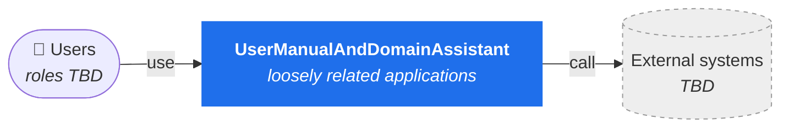
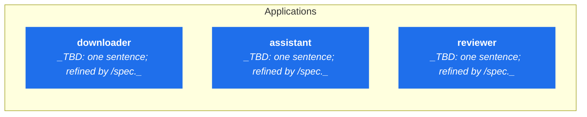
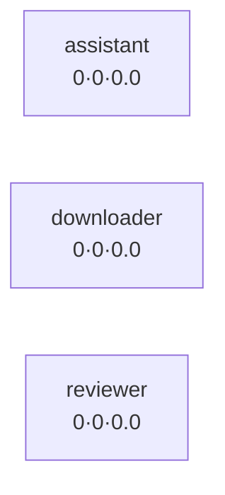

# UserManualAndDomainAssistant · System architecture

- **Last updated:** 2026-11-13
- **Reflects:** no code yet; this skeleton gets filled in as apps are added and specs are planned and built
- **Decisions:** [root ADR index](adr/README.md) · **Metrics:** [latest](metrics/latest.md)

> **How to maintain this document.** This is the **system level** of a two-level architecture (ADR-0011): which applications exist, what they share (code and data), and the rules that hold across all of them. Each app's insides are described in `apps/<app>/docs/architecture/architecture.md`; don't repeat them here, link to them. It shows the *current* state; the ADRs explain how it got here. The system map in section 3 is generated from [components.json](components.json) by `tools/monorepo/system-map.sh`, and the coupling diagram in section 5 by `/arch-metrics`. Don't edit either by hand.

## 1. Purpose and scope

_One paragraph: what UserManualAndDomainAssistant is for as a whole, who it serves, and how the applications relate to each other. What the monorepo deliberately does not contain. Filled in from the first approved spec._

## 2. System context

Who uses the applications, and which external systems they depend on.

| Actor / external system | Kind | Which apps it touches | Protocol / interface |
|-------------------------|------|-----------------------|----------------------|
| _User_ | person | _TBD_ | _TBD_ |

## 3. System map: applications, shared datasets, shared code

Arrows: an app **writes** a dataset it owns, a dataset is **read by** other apps, a unit **uses** shared code. Apps never depend on each other directly (ADR-0010); every dataset has exactly one owner, its only writer (ADR-0013).

<!-- system-map:begin (generated by tools/monorepo/system-map.sh from components.json, do not edit) -->

| App | Responsibility | Writes | Reads | Uses shared code | Docs |
|-----|----------------|--------|-------|------------------|------|
| **downloader** | _TBD: one sentence; refined by /spec._ | — | — | — | [architecture](../../apps/downloader/docs/architecture/architecture.md) · [specs](../../apps/downloader/docs/specs/README.md) · [ADRs](../../apps/downloader/docs/architecture/adr/README.md) |
| **assistant** | _TBD: one sentence; refined by /spec._ | — | — | — | [architecture](../../apps/assistant/docs/architecture/architecture.md) · [specs](../../apps/assistant/docs/specs/README.md) · [ADRs](../../apps/assistant/docs/architecture/adr/README.md) |
| **reviewer** | _TBD: one sentence; refined by /spec._ | — | — | — | [architecture](../../apps/reviewer/docs/architecture/architecture.md) · [specs](../../apps/reviewer/docs/specs/README.md) · [ADRs](../../apps/reviewer/docs/architecture/adr/README.md) |
<!-- system-map:end -->

## 4. Rules that hold across all applications

| Rule | Enforced by | ADR |
|------|-------------|-----|
| Apps never import from each other; they share code only through `shared/<component>` public entry points | `system-map.sh` (declarations), per-language boundary checker (imports) | [ADR-0010](adr/0010-monorepo-of-loosely-coupled-applications.md) |
| Each shared dataset has one owner, its only writer; readers depend on the contract in `shared/contracts/<dataset>/`, not on the owner's code | `system-map.sh`, contract review | [ADR-0013](adr/0013-shared-data-through-owned-datasets-and-contracts.md) |
| Configuration comes from layered `.env` files: process env > `apps/<app>/.env` > root `.env` | `tools/env/with-env.sh` | [ADR-0012](adr/0012-layered-environment-configuration.md) |
| Decisions that another app can see are root ADRs; the rest are app ADRs | `/adr`, review | [ADR-0011](adr/0011-two-level-documentation-and-architecture.md) |

## 5. Coupling between apps and shared code

Measured from the code by `/arch-metrics` at system level: edges between apps and shared components, labelled with reference counts. Any edge between two apps is a violation and is drawn red. Definitions and thresholds: [metrics/README.md](metrics/README.md).

<!-- coupling:begin (generated, do not edit) -->

Nodes: `name Ca·Ce·I`; edges: reference counts; red: boundary violation or cycle.
<!-- coupling:end -->

## 6. Key cross-app flows

_Sequence diagrams for flows that span several apps, typically through a shared dataset (e.g. app A publishes a dataset version, app B picks it up). Flows inside one app belong in that app's architecture document._

## 7. Cross-cutting concerns

| Concern | Approach | ADR |
|---------|----------|-----|
| Configuration and secrets | Layered `.env` files; secrets only in git-ignored `.env` files or the process environment | [ADR-0012](adr/0012-layered-environment-configuration.md), [ADR-0008](adr/0008-security-checks-for-a-public-repository.md) |
| Shared data | Owned datasets with versioned contracts under `${SHARED_DATA_DIR}` | [ADR-0013](adr/0013-shared-data-through-owned-datasets-and-contracts.md) |
| LLM access | `ANTHROPIC_API_KEY` and `CLAUDE_MODEL` from the base `.env`; apps may override the model | [ADR-0012](adr/0012-layered-environment-configuration.md) |
| Error handling | _TBD_ | |
| Logging and observability | `LOG_LEVEL` from the base `.env`; _rest TBD_ | |
| Security and privacy | _TBD_ | |
| Testing strategy | Test-first, per acceptance criterion; contract tests for every dataset reader | [ADR-0002](adr/0002-specification-driven-development.md), [ADR-0013](adr/0013-shared-data-through-owned-datasets-and-contracts.md) |
| Domain models | Hand-authored YAML sources per domain folder (curated models in `data/<Domain>/`); every format, diagram and level view is generated into `generated/` by `tools/domain-model/` and checked (model, freshness, SHACL samples) in pre-commit and CI | [ADR-0015](adr/0015-curated-domain-models-are-versioned-in-data.md), [ADR-0016](adr/0016-generate-domain-model-formats-from-yaml-sources.md) |
