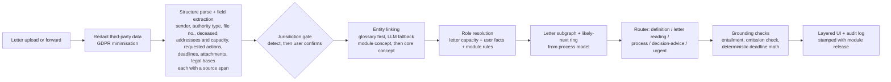

# Explain the letter, route the decision

Yes, with a hard boundary. The domain-assistant stack can help a bereaved layperson who receives an inheritance letter they cannot read, but it helps for different reasons, and with different strength of evidence, across the three capabilities. **(c) Explaining the letter itself is the strongest case.** The letter is short and self-contained, so definitions can come from a curated, jurisdiction-scoped glossary, every claim can point back to a highlighted span, and redesigned official notices are known to change real behaviour. New York's redesigned court summons cut failures to appear by about 13% ([Fishbane, Ouss & Shah, Science 2020](https://www.ideas42.org/wp-content/uploads/2020/10/Behavioral-nudges-reduce-failure-to-appear-for-court_Science.full_.pdf)). **(a) Answering "who is who, what is my role, what must I do" is a conditional yes.** Everything the letter states can be answered reliably. Anything that depends on succession law, such as deadlines the letter does not mention, debt liability, or whether a role even exists in this jurisdiction, must come from curated jurisdiction modules, never from the model. The model is the weak point: even commercial legal RAG tools sold to lawyers still hallucinated on **17–33% of queries** ([Magesh et al. 2025](https://law.stanford.edu/publications/hallucination-free-assessing-the-reliability-of-leading-ai-legal-research-tools)). Questions that ask for a decision ("should I disclaim?") must be answered with options and a referral, not a recommendation. **(b) Learning through diagrams is a yes for timelines, swimlanes and role diagrams, and a no for full ontology graphs as the main view.** Visual-law experiments support the first ([Passera 2018](https://acris.aalto.fi/ws/portalfiles/portal/9920876/JBTC_submission.pdf)). The second is an expert artefact that overloads novices. No study has tested any of these visuals with grieving users. The use case matters beyond inheritance. It is the sharpest stress test so far of the platform designed in the four earlier reports. Concepts here are structurally non-equivalent across jurisdictions, not just differently labelled. The user's own document is the natural entry point. One extracted field, the deadline, can cause irreversible harm. And the regulatory envelope (information vs advice, GDPR for third parties' data, product liability) is stricter than for internal manuals. This is a brainstorming document, not legal advice. Every statement of law below is an illustration for the data model and must be re-verified against primary sources.

## Three verdicts, strongest where the letter speaks for itself

"Evidence strength" follows the convention of *Domain assistants for emerging cross domains*: it rates evidence that the *remedy* works, not that the problem exists. The problem is well documented here. Laypeople see their situation as facts and events, while the law frames it as issues, and bridging that gap is the core limitation of self-help tools ([CEUR-WS Vol-3441](https://ceurspt.wikidata.dbis.rwth-aachen.de/Vol-3441/paper5.cermine)). No published benchmark, however, covers extracting a recipient's role, obligations and deadlines from official letters, as opposed to contracts.

| Capability | Verdict | Evidence strength | Main risk |
|---|---|---|---|
| (a1) What the letter says about me, the sender, the other parties | **Strong yes**, as span-grounded extraction the user can check | Moderate. Document-grounded reading is easier than open legal QA; legal NER still varies widely by language ([Lamarr Institute](https://lamarr-institute.org/publication/a-comparative-study-of-large-language-models-for-named-entity-recognition-in-the-legal-domain/)) | Coreference errors ("the deceased", "the testator", a name); mis-assigned addressee role |
| (a2) My duties, others' duties, what happens next in general | **Conditional yes.** Only from a curated jurisdiction module, after the user confirms the jurisdiction | Weak to moderate. Hallucination rises on local, jurisdiction-specific law; no study of consumer inheritance explanations | Jurisdiction confusion, e.g. common-law executor logic applied to a civil-law heir |
| (a3) "Should I accept, disclaim, sign, pay?" | **No answer; route instead.** Neutral options with general consequences, plus a referral | Strong that laypeople over-trust LLM legal advice ([Schneiders et al., CHI 2025](https://arxiv.org/html/2409.07871v2)) | Crossing from information into advice; automation bias under grief |
| (b1) Learn the process via timeline, swimlane, role diagram | **Yes** | Moderate. Controlled experiments, but with professionals and civil servants, not bereaved laypeople ([Passera 2018](https://acris.aalto.fi/ws/portalfiles/portal/9920876/JBTC_submission.pdf); [Passera et al.](https://research.aalto.fi/en/publications/diagrams-in-contracts-fostering-understanding-in-global-business-/)) | Diagram implies a stage order or role this jurisdiction does not have |
| (b2) Learn via taxonomy tree and ontology graph | **Yes as an optional "explore" panel; no as the first view** | Moderate for concept maps in general (g≈0.43 for studying a ready-made map, from the earlier report); none for laypeople with legal graphs | Cognitive overload; visual over-trust |
| (c1) Definitions of terms mentioned in the letter | **Strong yes**, from the curated, jurisdiction-scoped glossary, with the original-language term kept | Strong for curated glossaries (earlier reports); multilingual label sources are only partly reliable | Wrong-system definition; false friends ("notary", "executor", "grant of probate") |
| (c2) Ontology diagram of the concepts in the letter | **Conditional yes**, as a focused subgraph of about 7±2 nodes with the user at the centre | Hypothesis. No user study of layperson-facing legal subgraphs | Revealing family conflict or unknown heirs; looking more certain than it is |
| (c3) Related terms I will need next | **Yes**, driven by curated process-stage and prerequisite edges, not by LLM free association | Hypothesis, with a deployed analogue in JusticeBot's curated pathways ([Westermann et al.](https://arxiv.org/pdf/2308.02032)) | Suggesting stages that do not apply (e.g. tax, or a court grant in a notary-led system) |

The pattern repeats the earlier reports' main finding: structure pays most where the model knows least. In succession law the model knows *something* about every jurisdiction and confidently blends them. The curated layer's job is less to fill a gap than to stop the blending.

## Succession law forces a core of functions, not a dictionary of titles

The earlier cross-domain report treated legal roles as needing jurisdiction parameters. Inheritance shows the difference is deeper: whole mechanisms differ, not just labels. In civil-law systems the estate passes to the heirs automatically at death. In Hungary succession is **ipso iure**, acceptance is not required, a waiver must reach the notary and takes effect retroactively to the date of death, and the notary's final order is **declaratory**, because ownership has already passed ([e-Justice: Succession – Hungary](https://e-justice.europa.eu/topics/family-matters-inheritance/inheritance/succession/hu_en)). The Hungarian notary runs the probate procedure with "the same effect as that of the court of first instance" ([Act XXXVIII of 2010](https://njt.hu/jogszabaly/en/2010-38-00-00)). In England and Wales, the estate is wound up by a personal representative whose authority comes from a court grant: probate for named executors, letters of administration on intestacy ([AvMA](https://www.avma.org.uk/resource/applying-for-probate-or-letters-of-administration/); [gov.uk](https://www.gov.uk/applying-for-probate/after-youve-applied)). The same English phrase, "grant of probate", appears in English-language e-Justice text for the Hungarian notarial order, even though the two documents have different legal effects. Germany adds a third shape: a **six-week disclaimer period** that starts when the heir *learns* of the devolution and the reason for it, after which the inheritance counts as accepted ([§ 1944 BGB](https://www.gesetze-im-internet.de/bgb/__1944.html)). Secondary sources report a six-month variant for cases with a foreign element ([smart-rechner.de](https://www.smart-rechner.de/erbausschlagung/rechner.php)). That variant still needs checking against the statute.

False friends are therefore the rule, not the exception. The German Testamentsvollstrecker is an optional add-on, while the common-law executor is central to every estate with a will. German courts reading an English will often hold that naming an "executor" did *not* mean a Testamentsvollstrecker ([Cross Channel Lawyers](https://www.crosschannellawyers.co.uk/?p=353)). German executor sub-types such as the Dauertestamentsvollstrecker have no English counterpart ([german-probate-lawyer.com](https://www.german-probate-lawyer.com/en/glossary/def/durable-executor.html)). Even EU terminology infrastructure carries this hazard. EuroVoc maps "Erbrecht" to "inheritance" only as a *near* match ([ZBW STW](https://zbw.eu/stw/version/latest/descriptor/16029-3/about)), and "succession of States" sits in public international law, unrelated to inheritance ([EuroVoc 8456](https://light.onki.fi/eurovoc/en/page/8456)). IATE's three-star "reliable" rating was **auto-assigned** to many entries when its source databases were merged ([IATE help](https://online-help.iate.europa.eu/?p=5325)).

### The core models functions, and modules specialise them with typed mappings

The answer is the boundary-object pattern from *Domain assistants for emerging cross domains*, applied more strictly. A small, hand-built **succession core**, roughly 60–150 concepts, defines roles by *function*. Each **jurisdiction module** then holds the native concepts, in the native language, and maps them to the core with typed SKOS relations plus a `falseFriendOf` annotation that carries an explanation. Modules never assert equivalence across systems. For example, `uk:Executor skos:broadMatch core:EstateManager`, `de:Testamentsvollstrecker skos:broadMatch core:EstateManager`, and `uk:Executor ex:falseFriendOf de:Testamentsvollstrecker`.

| Core concept (function) | Hungary (illustration) | Germany (illustration) | England & Wales (illustration) |
|---|---|---|---|
| Successor → Heir / Legatee | örökös; two legacy types (direct transfer vs claim against the heir) | Erbe / Vermächtnisnehmer | beneficiary; residuary vs specific gifts |
| ForcedShareClaimant | kötelesrész claimant | Pflichtteilsberechtigter | no direct equivalent (family-provision claims differ) |
| EstateManager | will-named executor exists but does **not** replace the notary | Testamentsvollstrecker (optional), Nachlasspfleger | executor / administrator (personal representative), central |
| CertifyingAuthority | notary (quasi-judicial) | Nachlassgericht (probate court) | Probate Registry |
| CertificateOfSuccession | hagyatékátadó végzés (declaratory) | Erbschein | grant of probate / letters of administration (gives the PR authority) |
| DisclaimerAct + Deadline | waiver to the notary, retroactive; fixed statutory period **not found** in this research | six weeks from knowledge, then deemed acceptance | different mechanism; not researched here |
| Module switch `transferMode` | `ipsoIureToHeirs` | `ipsoIureToHeirs` | `viaPersonalRepresentative` |

Sources for the cells: [e-Justice HU](https://e-justice.europa.eu/topics/family-matters-inheritance/inheritance/succession/hu_en), [§ 1944 BGB](https://www.gesetze-im-internet.de/bgb/__1944.html), [haufe.de](https://www.haufe.de/id/beitrag/9-testamentsvollstreckung-iv-laenderueberblick-HI15502131.html), [AvMA](https://www.avma.org.uk/resource/applying-for-probate-or-letters-of-administration/). The English forced-share cell and the US column are deliberately left open: the research did not cover English family-provision claims, the Uniform Probate Code, or US state variation, and a US module would have to be per state.

The core also needs a **process model**. Death → notification and opening → will search → inventory and valuation → determination of successors → acceptance or disclaimer window → debt settlement → certification → distribution and registration, with disputes and supplementary proceedings as side branches. Each module marks every stage as present, absent, merged or reordered, and names the actor responsible. Hungary, for instance, has an inventory step run by a local official, a notary proceeding, an optional allocation agreement among heirs, and a final order that is forwarded to the land registry. Disputes go to court, not to the notary ([e-Justice HU](https://e-justice.europa.eu/topics/family-matters-inheritance/inheritance/succession/hu_en)).

**Duties and deadlines are first-class Norm objects**, not prose. Each has a bearer role, an action, a *trigger event* (knowledge of the devolution, not the date of death), a duration, conditional variants, a *default consequence* (deemed acceptance), a legal source with an ELI or section citation, and a verification date. LegalRuleML can serve as an export format, since it models deontic operators, defeasibility, temporal validity and jurisdiction ([OASIS](https://www.oasis-open.org/?p=7617)). JSON-LD or LinkML with these fields is enough for the Q&A layer. This adds a legal twist to the earlier versioning designs. The KG must be **bitemporal**, and for succession the relevant valid-time is usually the **law in force at the date of death**, not today's law. That is a general principle to verify per jurisdiction. Every answer is stamped with the module release, as *Ontology change management in git* already requires. Each jurisdiction module becomes a separately owned module in the monorepo, curated by a lawyer-steward of that jurisdiction under the same never-delete and impact-class rules.

### Seeds exist; a succession ontology does not

No published open ontology of probate, wills or inheritance turned up. The practical stack has five layers. **LKIF Core** provides role, action and norm modules; it is frozen at 2008 content but has been CC BY 4.0 since a 2026-02-23 release ([GitHub](https://github.com/RinkeHoekstra/lkif-core)). **UFO-L** models legal relations as relators built on Hohfeld's categories ([NEMO](https://nemo.inf.ufes.br/en/projetos/ufo-l/)); its licence is unknown. **FOLIO** gives 18,000+ CC BY 4.0 concepts for generic actors and document types ([GitHub](https://github.com/alea-institute/folio)), but how deeply it covers succession is unverified. **EuroVoc and IATE** supply multilingual labels as *secondary* labels with provenance, and **ELI/ECLI** serve as citation anchors ([EU Vocabularies](https://op.europa.eu/it/web/eu-vocabularies/eli)). The highest-value EU content seed is official. The Succession Regulation 650/2012 gives jurisdiction to the courts of the deceased's last habitual residence in every member state except Denmark and Ireland ([e-Justice](https://webgate.ec.europa.eu/e-justice/380/EN/succession)). The **European Certificate of Succession form** is a fixed, multilingual, jurisdiction-neutral schema covering the deceased, heirs and shares, legatees, executors and their powers, and assets ([e-Justice ECS](https://webgate.ec.europa.eu/e-justice/478/EN/european_certificate_of_succession)). Per-country e-Justice fact sheets, the CNUE "Successions in Europe" database for 22 member states ([Notaries of Europe](https://notariesofeurope.eu/en/citizens/successions-in-europe)) and the EU Adapt "closest equivalent right in rem" tool ([e-Justice](https://e-justice.europa.eu/166/EN/succession)) are, in effect, a ready-made template for EU modules, subject to licensing. This mirrors the "harvest, then curate" stance of *Enterprise platform domain assistants*: the structure is seeded from authoritative schemas, not extracted from prose.

## A letter-first pipeline keeps law in the graph and language in the model

The earlier reports' architecture applies unchanged in principle: a deterministic spine, curated definitions with provenance, a question router, and graph computation that the LLM only verbalises. The inheritance case adds a document-anchored front end and two hard gates, one for jurisdiction confirmation and one for deadline verification.

**Extraction is a draft for the user to check, not ground truth.** Published accuracy is mediocre: an ontology-plus-NER tax-law system reached only about **53% F-measure** on specialised legal entities ([VJIKMS 2025](https://www.citedrive.com/en/discovery/semantic-legal-information-retrieval-for-tax-law-using-ai-and-ontology-based-methods/)), and LLM legal NER varies significantly across languages ([Lamarr Institute](https://lamarr-institute.org/publication/a-comparative-study-of-large-language-models-for-named-entity-recognition-in-the-legal-domain/)). Letters are short, so the task is easier than open legal QA, and the risk moves to two places: inferring what the letter does not say ("you must pay inheritance tax") and filling in jurisdiction-specific general knowledge. Coreference across "the deceased", "the testator" and a proper name is a known weakness that LLM-guided coreference resolution targets ([LINK-KG, arXiv 2510.26486](https://arxiv.org/html/2510.26486v1)). Every extracted fact therefore carries **span-level provenance**, highlighted in the original.

**The jurisdiction gate comes before anything law-specific.** Candidate jurisdiction is inferred from letterhead, language, authority names and statute references, then confirmed by the user. Until then, the assistant shows only what the letter literally says and generic core concepts. Cross-border signals (deceased living abroad, assets in two countries, a foreign will) trigger the 650/2012 habitual-residence explanation and a professional referral, not an answer.

**Deadlines follow "never miss, never invent".** Date and period arithmetic is deterministic code that shows the verbatim source text beside it. The UI separates deadlines *stated in the letter* from *statutory* deadlines that may apply. The latter come only from a curated Norm, with its trigger event and the facts the app cannot verify. A letter that states no deadline yields "the letter states no deadline; one may still apply under law", never silence. This field matters most because missing it can be irreversible: in the German illustration, the default consequence is deemed acceptance of the inheritance.

**Routing replaces model confidence.** LLMs are poorly calibrated and accept false premises ([Dahl et al. 2024](https://arxiv.org/html/2401.01301v1)), so a classifier routes each question into definition, letter reading, process overview, decision/advice, or urgent. Definitions come from glossary entries. "Who else is involved and what do they do" runs parameterised graph templates. Decision questions get a fixed pattern: options, general consequences, the official source, and who to ask. This extends the earlier router with a *decision* class, which is new to this use case.

**Grounding checks target the specific RAG failure that citations hide.** Magesh et al. define hallucination to include *misgrounding*, where a cited source does not support the claim ([arXiv 2405.20362](https://arxiv.org/pdf/2405.20362)), and a citation UI makes misgrounded claims look trustworthy. Each role or deadline claim gets an entailment check against its cited span or Norm. A graph-alignment checker such as HalluGraph reports AUC 0.979 on structured documents but degrades on short, sparse contexts ([arXiv 2512.01659](https://arxiv.org/abs/2512.01659)); this is a self-reported preprint. An **omission check** compares the obligations, conditions and deadlines extracted from the original with those that survive into the plain-language rewrite. Legal-linguistics analysis warns that current tools *summarise* (and drop legally operative content) rather than *simplify* while keeping the text's legal function ([Journal of Language and Law](https://languageandlaw.eu/jll/article/download/208/105/836)).

**Personalisation is role resolution with visible reasons.** The user's role is resolved from three inputs: the capacity the letter states ("as statutory heir", line 3), facts the user supplies ("I am his son"), and module rules (a child is a statutory heir in most systems, subject to the will). It is shown as "The letter addresses you as heir (line 3)", with a correction control. The assistant never asks for what the letter already answers; a legal-aid intake tool frustrated users by doing exactly that ([Stanford Legal Design Lab](https://justiceinnovation.law.stanford.edu/category/current-projects/page/2/)). Scaffolding then adapts per concept, as the cross-domain report argued: a user who is an accountant needs "estate debts" explained less than "ipso iure".

## Lead with the action card; keep the ontology graph one tap away

The best field evidence in this space is not AI at all. New York's summons redesign put the date and time at the top, clarified the place and named the document as a court appearance ticket. The redesign lowered failures to appear by 6.4 percentage points from a 41% baseline, and text reminders cut them by about 21%. Most no-shows were unintentional ([J-PAL](https://www.povertyactionlab.org/node/2395); [Science PDF](https://www.ideas42.org/wp-content/uploads/2020/10/Behavioral-nudges-reduce-failure-to-appear-for-court_Science.full_.pdf)). Plain-language rewriting alone helps less in law than elsewhere. In a randomised study of 4,563 people, LLM simplification raised comprehension by only **3.5 points for legal texts**, against 14.6 for biomedical texts ([Guidroz et al., arXiv 2505.01980](https://arxiv.org/abs/2505.01980)). Layout, salience and reminders are therefore the levers that move outcomes. Rewriting is a supporting act.

The screen therefore uses five layers. First, a one-line answer to "Do I need to do anything now?" (yes or no, and the date). Second, an **action card**: what, by when (verbatim source, countdown, calendar export after acknowledgement), where and how to respond, and what happens if you do not respond. Third, a paragraph-by-paragraph plain rewrite aligned side by side with the original. Fourth, definitions on tap from the glossary. Each definition shows the original-language term first (e.g. "hagyatékátadó végzés"), then the jurisdiction-specific explanation, then "closest English concept: …, not identical because …". Fifth, the original letter, always reachable. Every statement carries one of three provenance badges: **stated in your letter**, **generally true in this jurisdiction (source, law as of date)**, or **depends on facts we cannot check — ask the notary or court**.

The visuals have different jobs, and the evidence ranks them. The **who-is-who diagram** places the user at the centre and shows the deceased, the sending authority, other named heirs and any executor. Edges are labelled in plain words ("sent you this letter", "decides who inherits", "also named as heir"), and only relationships stated in the letter or confirmed by the user appear. Inferred kinship is never drawn, because such diagrams can expose family conflict or unknown heirs. The **timeline** shows the jurisdiction's process stages with "you are here" and the letter's deadlines pinned on it. The **swimlane** shows who acts at each stage (notary or court, heirs, executor, registries). Timelines, flowcharts and swimlanes are the visual forms with controlled evidence for faster and more accurate comprehension of legal-bureaucratic instructions ([Passera 2018](https://acris.aalto.fi/ws/portalfiles/portal/9920876/JBTC_submission.pdf)). That evidence comes mostly from one group and from professional participants. The **letter subgraph** instantiates only the concepts evidenced in the letter, with edges such as `addresses`, `heir_of`, `administers`, `requires` and `due_by`, kept to about 7±2 nodes. A second, visually distinct ring holds the "likely next" concepts drawn from `requires`, `precedes` and `alternative_to` edges in the module's process model. That ring is the "related terms you will need" list (c3), and because it is curated it is auditable. The **taxonomy tree** (person role → successor → heir → statutory / testamentary heir; document → will → holographic / notarial) sits behind "Explore the concepts". The cross-domain report showed that hierarchical maps cost novices less mental effort than network maps, and nothing suggests laypeople want a taxonomy as the first view. The full **ontology graph** is a governance and expert artefact. Practitioners in the LinkQ study trusted wrong answers *because* the graph looked helpful, as the earlier report recorded.

A short German illustration shows how this fits together. Suppose a letter from a Nachlassgericht tells a son that he is a statutory heir and mentions Ausschlagung. The action card leads with "The letter does not ask you to reply; a six-week disclaimer period may already be running from when you learned you are an heir — confirm with the court." The timeline marks "determination of successors → acceptance or disclaimer window". The letter subgraph links the son, the father, the Nachlassgericht, "Erbe", "gesetzliche Erbfolge" and "Ausschlagung". The likely-next ring offers "Erbschein", "Nachlassverbindlichkeiten" (estate debts) and "Pflichtteil". Nothing in that view says whether he *should* disclaim.

Tone follows government guidance on content for people dealing with a death. Use plain, literal words rather than euphemisms, do not assume everyone is grieving, and do not tell users how to feel ([DWP Digital](https://dwpdigital.blog.gov.uk/2020/02/06/designing-content-for-people-dealing-with-a-death/)). In practice that means one short acknowledgement, then facts. Add save and resume, "remind me later", printable summaries for co-heirs, no upsells, and no fear-driven urgency. A 2026 qualitative study of a digital bereavement service names emotionally sensitive language, streamlined triage and reduced cognitive load as success factors ([University of Suffolk](https://oars.uos.ac.uk/5647/1/Integrating%20an%20ethic%20of%20care%20into%20the%20design%20of%20digital%20bereavement%20services---.pdf)). The single most useful low-risk output is a **"questions to ask your notary or lawyer" sheet**: a structured summary the user brings to the appointment.

## Information, not advice: the regulatory envelope is tighter than for manuals

**The information/advice line is the product's legal spine.** Explaining a term, what the letter literally says, which authority sent it and how the process usually runs is information. Applying the law to the user's facts to recommend a course of action ("you should disclaim", "you are liable for the debts") is advice. In the US, states may enforce unauthorised-practice rules even against free, non-profit, one-to-one advice ([Upsolve v. James, 2d Cir. 2025, via Public Citizen](https://clpblog.citizen.org/second-circuit-holds-unlawful-practice-law-can-apply-to-debt-collection-advice/)). Whether chatbot output itself counts as practising law is being tested in *Nippon Life v. OpenAI*, with no merits ruling found ([AI Lawsuit Tracker](https://ailawsuittracker.com/issues/openai-unauthorized-law-practice/)). In Germany the BGH allowed the Smartlaw contract generator, but on the basis that it handles typical cases schematically ([LTO](https://www.lto.de/recht/juristen/b/bgh-urteil-izr11320-vertragsgenerator-smartlaw-keine-unzulaessige-rechtsdienstleistung-rak-hamburg-rdg-legal-tech)). That leaves individualised generative output in open territory. The nearer enforcement risk is **marketing**. The FTC's final order against DoNotPay imposed $193,000 and banned "performs like a lawyer" claims without competent evidence, because the company had never tested its output against lawyers ([FTC](https://www.ftc.gov/node/87474)). The positioning follows directly: "explains your letter and helps you prepare for your notary or lawyer", never "AI lawyer". Any accuracy claim must be backed by expert-graded tests. The only route to real advice is partnering with licensed professionals.

**The EU AI Act most likely puts this in the limited-risk tier, with one trap.** Annex III point 8 covers AI used *by or on behalf of judicial authorities* or in ADR to research and apply law ([EUR-Lex, AI Act](https://eur-lex.europa.eu/eli/reg/2024/1689/oj)), not a private person's self-help tool. Article 50(1) chatbot disclosure has applied since 2 August 2026. The Digital Omnibus agreement postpones Annex III high-risk duties to 2 December 2027 ([Gibson Dunn](https://www.gibsondunn.com/eu-ai-act-omnibus-agreement-postponed-high-risk-deadlines/)), but its Official Journal publication was not confirmed in this research. The trap is the notary. Civil-law notaries perform official, quasi-judicial succession functions, so a version sold *to* notaries for handling cases could fall within point 8. The intended purpose and the classification rationale should be written down and re-checked against the final Commission guidelines, which read the Article 6(3) exemptions narrowly ([Jones Day](https://jonesday.com/en/insights/2026/06/draft-eu-guidelines-clarify-when-ai-systems-are-highrisk-under-the-ai-act)).

**GDPR is the heavier everyday constraint, because the letter is full of other people.** Recital 27 leaves the deceased's data to national law ([GDPR Recital 27](https://gdpr-text.com/de/read/recital-27)). The letter, however, names living co-heirs, with addresses, birth dates and sometimes asset and debt details. It can also reveal special-category data, such as religion through a church-tax mention or health through a cause of death. This calls for redaction before the LLM call, no training on uploads, EU processing with proper processor agreements, short retention, a legitimate-interest assessment covering third parties, and a DPIA, given new technology, vulnerable users and third-party data. The same constraint shapes the visuals: co-heirs appear as role nodes, not as personal profiles.

**Disclaimers are a weak shield, so liability has to be managed through design.** From 9 December 2026 the new Product Liability Directive treats software and AI as products, with presumptions of defect where technical complexity makes proof excessively difficult ([CMS](https://cms.law/en/int/publication/the-new-eu-product-liability-directive-eu-2024-2853)). Whether pure economic loss from a missed disclaimer deadline falls under the PLD is doubtful, but national tort and contract law still applies; that point needs counsel. Audit logs therefore matter: redacted input, retrieved sources and module release, model version, the user's jurisdiction confirmation, and the notices shown. Disclaimers also do not change behaviour. In the CHI 2025 study, telling people the advice came from AI did not reduce their trust in it ([Schneiders et al.](https://arxiv.org/html/2409.07871v2)). Pro se litigants account for **885 US entries** in a tracker of court cases involving AI-hallucinated content, against 587 for lawyers ([Vaquill](https://vaquill.ai/blog/ai-hallucination-sanctions-tracker)). Safeguards must be structural: verbatim evidence beside every claim, a "this is a decision — confirm with X" step at accept, disclaim, sign and pay junctions, plain rather than authoritative language, and referral paths to the letter's sender, legal aid and bereavement support. The ethical edge is regressive error. The people who gain most from a free explainer are the people least able to catch its mistakes.

## What inheritance teaches the general platform

Several lessons transfer directly to the manual and enterprise assistants in the earlier reports, and some change them.

**Non-equivalence is the general case, not the legal exception.** The cross-domain report introduced typed, analogy-aware mappings for overlapping fields. Inheritance shows the same need between *variants of one domain*: jurisdictions here, but equally product editions, regional regulations or platform versions whose "same" feature behaves differently. A core of functions, variant modules with typed mappings, `falseFriendOf` with an explanation, and a module-level structural switch like `transferMode` together form a reusable pattern for any product family.

**The user's artefact should be a first-class entry point.** The event-to-issue gap argues for starting from what the user holds, whether a letter, an error message, a config file or an invoice, and turning it into an *artefact-anchored subgraph* with a likely-next ring. This generalises the earlier "local subgraph" answer component into a document-first mode, and it is where span-level provenance pays off most.

**Three provenance badges generalise.** "Stated in your document / generally true for this variant / depends on facts we cannot check" maps onto the earlier "stated in manual §x / inferred by inheritance" labels, adding the explicit *variant-dependent* tier the platform lacked.

**Some fields must never be generated.** Deadlines here correspond to version numbers, limits, quotas and prices in manuals. The rule carries over: extract deterministically, compute in code, show the verbatim source, and say explicitly when the value is absent.

**The router needs a "decision" class.** Manual users also ask "should I…?" (upgrade, migrate, delete). The legal case shows how to answer: options, consequences, sources, owner. It also shows why to abstain from recommending when the stakes are irreversible.

**Visuals should be chosen by task.** Action-oriented visuals (timeline, swimlane, role map) serve users who must *do* something. Taxonomy trees serve learners. Full ontology graphs serve curators. This sharpens the earlier "five view templates" into a rule about who sees which view first.

**Evaluation should measure empowerment as well as correctness.** The Stanford Legal Design Lab rubrics score actionability, empowerment and avoiding needless fear ([Stanford Legal Design Lab](https://justiceinnovation.law.stanford.edu/tag/benchmarks/)). Satisfaction overstates comprehension, as a medical lay-summary study found ([arXiv 2505.10409](https://www.emergentmind.com/papers/2505.10409)). The platform's factorial harness should therefore add comprehension-check items and an "actionability" score alongside correctness, for every domain.

**Consumer deployment changes the envelope, not the architecture.** The same deterministic spine, curated modules, Reviewer agent and release stamping serve both settings. The consumer setting adds third-party data minimisation, marketing hygiene, liability logging and vulnerability-aware UX as non-functional requirements. Organisationally, as Lone Star Legal Aid found, most of the work is non-technical: governance, testing, security and accuracy safeguards ([Lone Star Legal Aid](https://www.lonestarlegal.org/news/2026/02/building-smarter-access-to-justice-an-update-on-lone-star-legal-aids-ai-powered-chatbot-project/)).

## Open questions and experiments to run first

Several facts the design depends on remain unverified. They are: the Hungarian statutory disclaimer period; the German six-month variant in § 1944(3); FOLIO's actual depth on succession (inspect `FOLIO.owl`); UFO-L's licence; IATE's terms for commercial reuse; the Omnibus's final publication and the final high-risk guidelines; whether the European Accessibility Act applies to this product type; and how the PLD treats economic loss. The US was not researched at all: a US module would be per state, with Uniform Probate Code alignment still to be investigated. No notary-run inheritance AI assistant was found. That may reflect limited searching, but it suggests a partnership opportunity with national notary chambers. One question matters more than all the legal ones: **do diagrams help or overwhelm a grieving user?** No study exists.

| Experiment | What it decides | Design sketch |
|---|---|---|
| Visual A/B/C/D | Whether (b) and (c2) earn their place | Text only vs text + timeline vs text + letter subgraph vs both; measure comprehension-check accuracy ("what is your deadline, who decides, what happens if you do nothing") and task completion, not satisfaction |
| Golden-letter extraction set | The real accuracy of (a1) | 50–100 anonymised letters per pilot jurisdiction, expert-labelled for addressee role, parties, requested actions and deadlines; field-level F1 with deadlines scored separately and at zero tolerance |
| Jurisdiction-confusion red team | Whether modules stop the blending | Paired letters from different systems with near-identical wording; adversarial questions with false premises ("as executor I must…"); count system-mixing answers |
| Omission audit | The fidelity of the plain rewrite | Run the omission check on rewrites and have experts measure the rate of legally material omissions, and whether users notice them |
| Over-reliance probe | Whether decision interstitials work | Measure intended action on accept/disclaim scenarios with and without the "confirm with X" step and verbatim evidence |
| "No deadline stated" test | The never-silent rule | Letters with no explicit deadline in a short-deadline jurisdiction; pass only if the statutory warning appears |
| Seed-source comparison | Where module labels should come from | Compare e-Justice and ECS parallel texts against IATE candidates for 100 succession terms, rated by expert translators |
| Notary or legal-aid pilot | Real-world value and the referral loop | A small pilot with one notary chamber or legal-aid body, logging referrals, appointment preparedness and complaints |

## Conclusion

The inheritance letter shows that the valuable thing is not the knowledge graph as a picture, but the knowledge graph as a *refusal mechanism*. It keeps one jurisdiction's law out of another's answer. It keeps a deadline from being invented. It keeps an explanation from turning into a recommendation. The diagrams a layperson needs are the humble ones: an action card, a timeline with "you are here", a who-is-who map. The ontology graph earns its keep behind the scenes, and in front of the curator.

For the platform, this use case is the right place to set the bar. A design that is safe enough for a grieving heir facing a six-week clock will be safe enough for an engineer reading a manual. The reverse is not true. Treating jurisdiction-style variant modules, artefact-first entry, a decision route that abstains, and comprehension-based evaluation as platform defaults, rather than legal extras, is the main structural change this report adds to the earlier designs.
