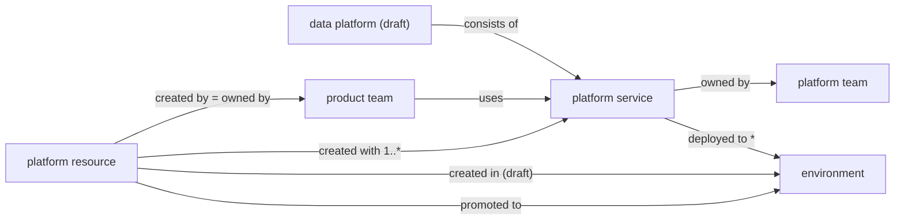
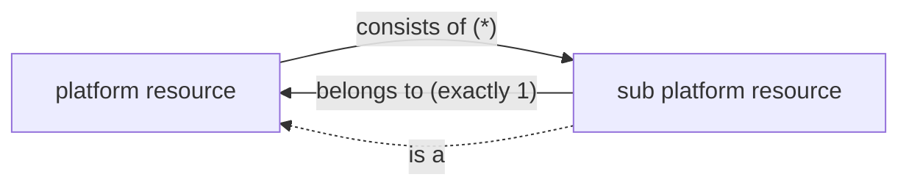
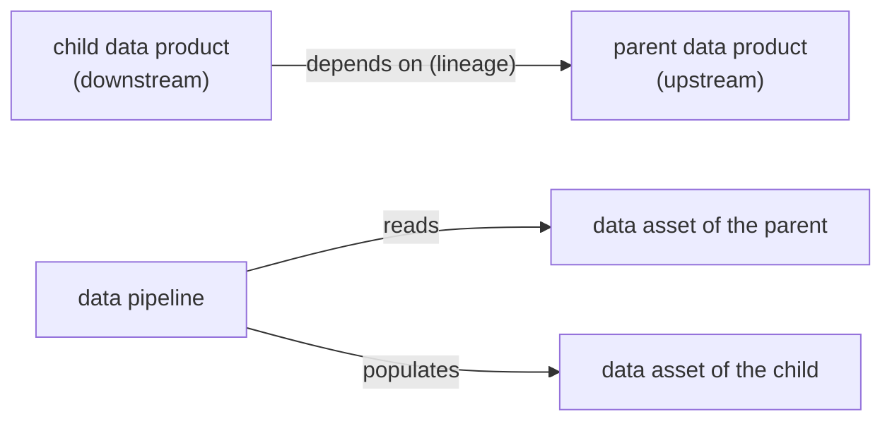
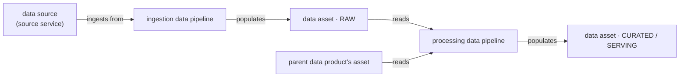
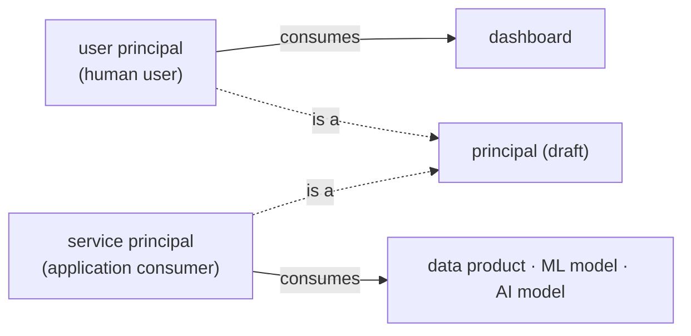
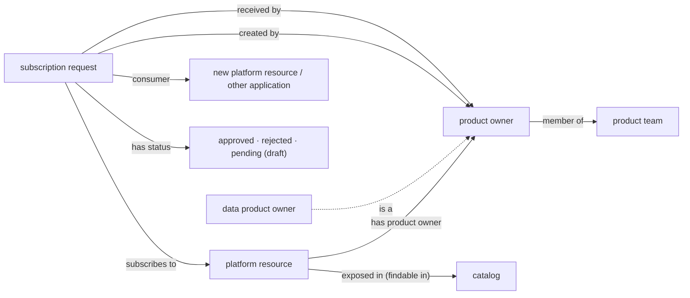

# Session 2026-11-14 · Plan 0002 implementation

- **Session:** `e83a2a2d-a5b6-45ce-bebf-78f58cb89e0d`
- **Saved:** 2026-11-14T19:42Z

## Summary

Spec 0002 (a YAML-to-ontology generator in `tools/domain-model/`) was built test-first, passed an independent review after one missing test was added, and was pushed to the branch `spec-0002-domain-model-generator`. After that you and Claude modelled the AcmeDataPlatform domain in Q&A rounds, growing it to about 68 rules and statements S11–S50, with a Mermaid parse error in the README fixed along the way. None of that modelling is committed yet. Open items are whether to commit it to the current branch or a new one, whether to trim the overlapping generated files, and six gaps Claude raised, such as whether level 1 is complete and whether users need subscriptions.

---

## 1 · 10:46 UTC

### Request

> /clear

### Response

_No text reply._

## 2 · 10:46 UTC

### Request

> /implement 0002

### Response

Setting up spec 0002: idea marked in-progress; starting T1 (workspace member + dependencies).

T1 passes (workspace member, deps locked, gate green). Now T2: the typed model and loader.

Node expressions (path objects) are supported by pyshacl. Writing `model.py` and `load.py`.

Now the example library domain (T3) so tests have something to build on.

Now the test helper and T2/T3 tests.

Failing as expected (the CLI is a stub). Now a CLI `check` that runs the loader.

T2 and T3 pass. Running the full gate, then T4 (property paths).

Now T4: tests for the path mini-language first.

T4 passes. Now T5 (model consistency): extending the AC-13 test with one fixture per FR-12 problem first.

Now `consistency.py`, plus two small helpers on the model (namespace check, SPARQL prefixes).

Now wire it into `check` and run the tests.

The checker is right: Book (level 1) declares disjointness with a level-2 concept. Fixing the example by declaring it on the level-2 side.

T5 passes. Now T6 (OWL graph): tests first, as SPARQL ASK queries per YAML field.

T6 nearly there (OWL graph done; one literal-typing detail and line lengths). Fixing.

T6 passes. T7 (deterministic serialisation): tests first.

Cross-process output differs somewhere; finding where.

RDF/XML subject order follows a hash-seeded set. Applying the plan's fallback: sort the top-level `rdf:Description` blocks (markup lines are unambiguous since `<` in literals is escaped).

Passing. Guarding the empty-graph case (Acme is empty today), then T8 (SKOS).

T1–T8 done (model, loader, example, paths, consistency, OWL, serialisation, SKOS). Now T9: SHACL generation, tests first.

pyshacl wants the `sh:condition` node to be a recognisable shape. Checking what it looks for.

T9 passes. Quick early sanity check of all samples through pyshacl (T16 will formalise it):

All patterns behave correctly in pyshacl (including path-valued TripleRules and SPARQL rules). T9 ticked; now T10 (glossary Markdown + TBX), tests first.

T10 passes. T11 (`statements.md`, `rules.md`): tests first.

T11 passes. T12 (Mermaid): tests first.

T12 passes. T13 (level views + draft marking): tests first.

Now the level views in `markdown.py`.

Tests pass; tidying the relations/properties tables and long lines.

Let me eyeball a rendered level view.

Level views render well. T14 (`build`): tests first.

Now `build.py` and the CLI `build` command.

Test bug: the snapshot should be relative to the domain folder.

T14 passes; example `generated/` built. T15 (freshness in `check`): tests first.

T15 passes. T16 (`validate` + sample coverage): tests first.

All T16 tests pass. Fixing long lines and replacing the `assert` with an explicit check rather than silencing the rule.

The formatter had already wrapped those lines. Checking what remains:

Removing unneeded `noqa`s (BLE isn't enabled), replacing the assert, and building TBX with a string builder so the source needs no security suppression.

T16 passes. T17 (`check --all` with discovery): tests first.

Passing. Let me review the CLI as a whole.

T17 passes. T18 (pre-commit hook + CI step): test first.

T18 passes (hook rejects the hand edit; file restored). T19 (tool README): test first.

Now migrating the Acme folder.

Generated statement rows are byte-identical to the old hand-written table. Now the folder README and the `.gitignore` comment.

T20 passes; Acme migrated and still un-ignored. Gate, then T21 (performance test).

Passes at 5.9 s (budget 10 s). Quick profile to see whether there's an easy margin win:

CLAUDE.md commands are accurate; adding a row for the tool to its "Where things live" table, then the full pre-commit run.

Python hooks were skipped because the new files are untracked (`--all-files` only sees tracked files). Running every hook over tracked + untracked files:

Every hook passes over all files. Checking the lockfile, then recording the small implementation deviations in the plan.

All implementation tasks (T1–T22) are ticked. Step 5 of the skill: running the independent review.

The spec touched no app, so the metrics run is system level only.

System metrics: PASS (today's snapshot replaced same-day one). The tool isn't a system unit, so I'll also check its own complexity directly:

No function exceeds CC 15. Two are in the 11–15 warn band (`check_taxonomy` 14, `check_duplicates` 12). The spec-reviewer agent is still running; I'll relay its verdict when it finishes.

All tasks T1–T22 for spec 0002 are done, and the code and every pre-commit hook pass. The independent spec review is still running, so the spec isn't marked `implemented` yet.

**What was built:** a new tool, `tools/domain-model/`, with three commands:
- **`build`** turns a domain folder's YAML sources into the 13 files the spec lists under `generated/`. The output is byte-identical across runs and processes.
- **`check`** reports model problems as `file:item: message`, plus stale, missing or extra generated files, rules without samples, and sample failures.
- **`validate`** runs the generated rules on the sample data and checks each sample behaves as its name says.

There is a small library-lending example domain that uses every field and every rule type. `check --all` now runs in pre-commit and in the CI workflow.

**AcmeDataPlatform migrated:** S1–S10 are now in `statements.yaml`. The hand-written `ontology.owl.ttl`, `rules.shacl.ttl` and `statements.md` are replaced by generated files, and the folder README is rewritten. The generated statements table is byte-identical to the old hand-written one.

**Results so far:**
- The full quality gate passes: ruff, mypy strict, pytest, boundary check, pip-audit, `uv lock --check`, and all hooks run over tracked and untracked files.
- `system-map.sh --check` passes, and the system metrics snapshot is PASS. No app was touched, so there are no app snapshots.
- No function in the tool goes over complexity 15. Two are in the 11–15 warning band: `check_taxonomy` (14) and `check_duplicates` (12).
- The 200-item performance test takes about 6 s against the 10 s limit. Almost all of that time is spent in the rule checks run on each sample. The speed-up the plan holds in reserve wasn't needed.

**Where I departed from the plan:** I logged every departure under a new "Implementation notes" section in `plan.md`; none changes the spec. Three you should know about:
- **Commit rejection not tested with a real commit:** you didn't ask for commits, and a real one would be created if the hook let it through. I ran the exact hook a commit runs on a hand-edited generated file instead. It failed and named the file, and I restored the file.
- **Statements diff source:** `data/AcmeDataPlatform/` was never committed, so `git show HEAD:…` had nothing to compare against. I diffed against a copy of the old files I saved before migrating.
- **Example domain fix:** the level check correctly flagged a level-1 concept declaring disjointness with a level-2 concept. I moved the declaration to the level-2 concept.

I asked you no questions, so nothing new went into the idea's Q&A log. Nothing has been committed. The idea is marked `in-progress` and T23 (the review) is still open.

**Next:** when the reviewer reports, I'll pass on its pass or fail for each acceptance criterion with evidence. If it all passes, I'll mark the spec `implemented` and the idea `done`; if not, I'll add follow-up tasks to `tasks.md`.

## 3 · 12:10 UTC

### Request

> This session is being continued from a previous conversation that ran out of context. The summary below covers the earlier portion of the conversation.
> 
> 
> Summary:
> 1. Primary Request and Intent:
>    The user ran `/implement 0002`. The skill's steps are:
>    - Read the spec, plan, tasks and the CLAUDE.md files.
>    - Set the idea to `in-progress`.
>    - Do each task test-first and run the full quality gate after each. Tick a task only when its check passes.
>    - Never import across apps. Never silence complexity or boundary findings.
>    - Commit only if the user asks. They did not, so no commits have been made.
>    - On a deviation, ask with AskUserQuestion and log it. No questions were needed.
>    - When every task is ticked, run `/review-spec 0002`.
>    
>    The review-spec skill's steps are:
>    - Launch the `spec-reviewer` subagent with only the spec path.
>    - Relay each acceptance criterion as pass, fail or unverified, with evidence.
>    - Run `system-map.sh --check` and `/arch-metrics` for the system and every touched app (none were touched).
>    - Check the architecture docs, ADRs and env variables.
>    - If everything passes: set the spec to `implemented` and the idea to `done`, and update `docs/ideas/README.md` and `docs/specs/README.md`.
>    - If anything fails: add follow-up tasks to `tasks.md`. Ask the user if a decision is needed, and log it in the idea file (stage `review`).
>    
>    Constraints to keep:
>    - Never read, print or ask for `.env` contents.
>    - Never use `--no-verify`.
>    - The repo is public: no secrets.
>    - Label every question with a bold source tag, e.g. **[review-spec · …]** or **[Claude]**.
>    - Log every question and its answer in the idea's `## Q&A log`.
>    - Never edit `generated/` by hand.
>    - Accepted ADRs are never edited.
> 
> 2. Key Technical Concepts:
>    - Python 3.15 in a uv workspace.
>    - ruff with complexity limits: CC ≤ 15, ≤ 5 arguments, ≤ 50 statements, nesting ≤ 4, line length 110.
>    - mypy strict with the pydantic plugin.
>    - Libraries: pytest, rdflib 7.6.0, pyshacl 0.40.2 (SHACL-AF, RDFS inference via owlrl), pydantic 2.14.3, pyyaml.
>    - Formats produced: OWL 2, SKOS, SHACL and SHACL-AF (TripleRule with node expressions, SPARQLRule, SPARQLConstraint), TBX-Basic in DCA style, Mermaid flowcharts.
>    - Deterministic serialisation: canonical blank nodes, triples re-inserted in sorted order, RDF/XML Description blocks sorted afterwards, JSON-LD arrays sorted.
>    - Workflow: pre-commit hooks, a CI workflow, and spec-driven development.
> 
> 3. Files and Code Sections:
>    - `tools/domain-model/` is a new workspace member: package `domain_model`, console script `domain-model`. It contains:
>      - `pyproject.toml`
>      - `README.md`, which documents the format.
>      - `src/domain_model/`:
>        - `cli.py`: build, check (folder or `--all`), validate; exit codes 0, 1 and 2.
>        - `model.py`: pydantic models with `extra="forbid"` (Id pattern, Cardinality pattern, `PATTERN_KEYS`, `TYPE_PREDICATE="a"`, `Rule.kind`/`pattern_key`, `Finding.__str__` giving `file:item: msg`, `cardinality_bounds`, `Ontology.sparql_prefixes`, `DEFAULT_LEVELS`). Pydantic aliases are used for the `in`, `class`, `if` and `construct` fields.
>        - `load.py`: reads YAML and reports malformed input as findings.
>        - `paths.py`: the path mini-language converted to SHACL and SPARQL.
>        - `consistency.py`: every FR-12 model check plus `kind_index`, `rule_refs` and `sparql_iris`.
>        - `rdf/vocab.py`, `rdf/owl.py`, `rdf/skos.py`, `rdf/serialize.py`.
>        - `rdf/shacl.py`: shapes are named `<ns><RuleId>_shape` and `_shape_property`; condition shapes are typed `sh:PropertyShape`; prefixes are declared at `<ns>_prefixes`.
>        - `text/markdown.py`: glossary, statements, rules and `level_md`.
>        - `text/mermaid.py`: `label()` escapes `#` as `#35;` and `"` as `#quot;`.
>        - `text/tbx.py`: a string builder that uses `html.escape`.
>        - `build.py`: `render_all` produces the 13 files; `write_generated` removes extra files.
>        - `freshness.py`, `validate.py` (sample naming convention, coverage, pyshacl runner) and `discover.py`.
>      - `tests/`: `dm_fixtures.py` (no conftest), plus one test module per acceptance criterion: test_smoke, test_check_model, test_paths, test_owl, test_serialize, test_taxonomy, test_shacl, test_glossary, test_statements, test_edge_cases, test_levels, test_draft, test_build, test_check_freshness, test_validate, test_discover, test_repo_wiring, test_docs, test_repo_domains, test_performance. Also `resources/tbx-core-minimal.rng`.
>      - `example/`: the library-lending domain (prefix `lib`) with sources, samples for R1–R8, and a committed `generated/` folder.
>    - Changes outside the tool:
>      - Root `pyproject.toml`: new workspace member, dev dependencies, mypy files and plugin, pytest `testpaths`, and a filter for rdflib's `ConjunctiveGraph` deprecation warning.
>      - `uv.lock`.
>    - Wiring:
>      - `.pre-commit-config.yaml`: new `domain-model` hook running `uv run --frozen domain-model check --all`, with `files: ^(data/|tools/domain-model/)` and `pass_filenames: false`.
>      - `.github/workflows/python.yml`: new step "Domain models (check)".
>    - `data/AcmeDataPlatform/` was migrated:
>      - New `statements.yaml` holding S1–S10 verbatim.
>      - `ontology.yaml` and `taxonomy.yaml` rewritten in the new format, still empty.
>      - Removed the hand-written `ontology.owl.ttl`, `rules.shacl.ttl` and `statements.md`. Backups are in `/private/tmp/claude-501/-Users-belaboros--LOCAL-WORK-my-github-UserManualAndDomainAssistant/e83a2a2d-a5b6-45ce-bebf-78f58cb89e0d/scratchpad/acme-before/`.
>      - Added `samples/valid.ttl`, rebuilt `generated/` and rewrote the README.
>    - Documentation and indexes:
>      - `data/README.md`: describes the ADR-0015 exception.
>      - `.gitignore`: comment now cites ADR-0015.
>      - `docs/architecture/architecture.md` §7: new "Domain models" row.
>      - Root `CLAUDE.md`: new row for `tools/domain-model/`.
>      - The idea and both indexes are set to `in-progress`.
>      - `tasks.md`: T1–T22 ticked.
>      - `plan.md`: new "Implementation notes" section listing the deviations.
>      - `docs/architecture/metrics/latest.md` and `history/2026-11-14.json` were regenerated (system level, PASS).
> 
> 4. Errors and fixes:
>    - **Recurring lint failures** (long lines, import order): fixed with ruff fix and format, plus manual splits.
>    - **`token` flagged as a hardcoded password (S105)**: renamed the variable to `symbol`.
>    - **`assert` in source code**: replaced with `raise TypeError`.
>    - **pydantic warning that `construct` shadows a BaseModel method**: renamed the field to `construct_` with alias `construct`.
>    - **Disjointness level problem in the example**: a level-1 concept declared disjointness with a level-2 concept. Moved `disjoint_with` to `AudioVisualItem`.
>    - **String literals not matching**: emitted plain literals for strings instead of `xsd:string`.
>    - **RDF/XML output not identical across processes**: sorted the Description blocks; also handled the empty-graph case.
>    - **pyshacl rejecting bnode conditions**: declared condition shapes as `sh:PropertyShape`.
>    - **TBX module needed security suppressions with `xml.etree`**: switched to a string builder.
>    - **Test bugs**: a snapshot path, mypy typing in tests, a mermaid helper moved into `dm_fixtures`, and documenting the `in` field in the README.
>    - **Python pre-commit hooks skipped**: they skip untracked files, so I ran `git ls-files -co --exclude-standard | xargs pre-commit run --files`. Every hook passed.
> 
> 5. Problem Solving:
>    - Performance: build plus check of 200 items takes about 6 s against a 10 s budget. Almost all of it is owlrl's RDFS closure, so the plan's mitigation was not needed.
>    - The AC-16 manual check was simulated with `pre-commit run domain-model --files <edited file>` instead of a real commit. It failed as expected and the file was restored.
>    - The AC-17 diff was taken against the scratchpad backup, because the Acme files were untracked and `git show HEAD:…` had nothing to show. The statement rows were identical.
>    - Final state: gate script passes (ruff, format, mypy, pytest, qg-boundaries), pip-audit passes, `uv lock --check` passes, system-map is ok, system metrics PASS.
>    - Tool complexity: maximum CC is 14 (`check_taxonomy`); `check_duplicates` is 12. Both are in the warn band; nothing fails.
> 
> 6. All user messages:
>    - `/implement 0002`. The skill text has the instructions summarised in section 1.
>    - After that, the conversation contained only system-injected "The user hasn't heard from you…" reminders and the review-spec skill launch (`/review-spec 0002`, invoked by me through the Skill tool as step 5).
> 
> 7. Pending Tasks:
>    - Wait for the spec-reviewer agent's result and relay each acceptance criterion (AC-1 to AC-20) as pass, fail or unverified, with evidence.
>    - Report the metrics: system PASS, the first snapshot replaced on the same day, no apps touched, and the tool's CC with its two warn-band functions.
>    - Confirm that the architecture docs, ADRs (0015 and 0016 already exist) and env variables are in order. There are no new env variables.
>    - If everything passes: set the spec status to `implemented`, set the idea to `done`, update `docs/ideas/README.md` and `docs/specs/README.md`, and tick T23 in `tasks.md`.
>    - If anything fails: add follow-up tasks to `tasks.md`. Ask labelled questions if a decision is needed and log them in the idea file (stage `review`).
>    - Then summarise the whole implementation for the user, including the deviations listed in the plan's implementation notes and the fact that no commits were made.
> 
> 8. Current Work:
>    `/review-spec 0002` is in progress. The spec-reviewer subagent was launched in the background with only the spec path. `system-map --check` is ok, the system metrics are PASS, and the tool's complexity was checked. A fallback wakeup is scheduled for 1200 s with the prompt "Continue /review-spec 0002 once the spec-reviewer agent finishes." While waiting, I told the user: "No function exceeds CC 15. Two are in the 11–15 warn band (`check_taxonomy` 14, `check_duplicates` 12). The spec-reviewer agent is still running; I'll relay its verdict when it finishes."
> 
> 9. Optional Next Step:
>    When the spec-reviewer notification arrives, relay its per-AC findings. Then follow review-spec step 4 or 5: "If everything passes: set the spec to `implemented` and the idea to `done`, and update `docs/ideas/README.md` and `docs/specs/README.md`," and tick T23. If anything fails, "add follow-up tasks to `tasks.md`."
> 
> If you need specific details from before compaction (like exact code snippets, error messages, or content you generated), read the full transcript at: /Users/belaboros/.claude/projects/-Users-belaboros--LOCAL-WORK-my-github-UserManualAndDomainAssistant/e83a2a2d-a5b6-45ce-bebf-78f58cb89e0d.jsonl
> Continue the conversation from where it left off without asking the user any further questions. Resume directly — do not acknowledge the summary, do not recap what was happening, do not preface with "I'll continue" or similar. Pick up the last task as if the break never happened.
> 
> The messages after this summary are the most recent messages from before compaction, kept verbatim. The summary was written without seeing them, so something it says has not happened yet may already have happened in them.

### Response

The new case passes and the full gate is green. Now I'll close out the statuses.

Spec 0002 is now marked `implemented` and idea 0002 is `done`. The independent review passed 19 of the 20 acceptance criteria outright. The one gap was a missing test, which I added. Nothing is committed.

| AC | Result | Evidence |
|----|--------|----------|
| 1–3 | pass | `test_build.py`: all 13 files are written, nothing is written outside `generated/`, two domains don't mix namespaces, and output is byte-identical across runs and across processes |
| 4–5 | pass | `test_taxonomy.py`: SKOS and Mermaid trees match the `parent` fields. `test_owl.py`: 26 OWL triple cases plus the merged axioms file |
| 6 | pass | Turtle, RDF/XML and JSON-LD hold the same triples; the reviewer also checked the committed example and Acme files |
| 7 | pass | `test_shacl.py`: one shape per rule, covering every pattern; the README documents every pattern |
| 8 | pass | Glossary in Markdown and TBX. The TBX is checked against a minimal schema written for the tests, not the official one (the plan allows this) |
| 9–12 | pass | Level views, one level per resource, draft marking, statements copied word for word |
| 13 | gap, now fixed | The "rule has no sample proving it" check worked, but no test covered it: the helper was written and never added to the test list. Fixed as follow-up task T24 |
| 14–15 | pass | Stale, missing and extra generated files are reported; sample checks name the rule they fail on |
| 16 | pass | Hook and CI step are in place. The reviewer couldn't repeat the rejected-commit check without editing the repo; I only simulated it earlier |
| 17–18 | pass | Acme is migrated to YAML sources; the tool README documents every field |
| 19–20 | pass | Every gate command exits 0; the 200-item performance test passes |

**After the fix:**
- The full gate passes again: ruff, format, mypy, all of pytest and the boundary check.
- `system-map --check` is ok and the system metrics are PASS, with no change from the earlier run.
- No app was touched, so there are no app snapshots.
- No function goes over complexity 15. `check_taxonomy` (14) and `check_duplicates` (12) are close to the limit but allowed.
- ADR-0015 and ADR-0016 cover the decisions, the architecture docs are updated, and no new env variables were needed.

**Three things the reviewer raised that I left alone:**
- **The hooks haven't really run on this code yet.** Everything is untracked, so `pre-commit run --all-files` skipped ruff, mypy, pytest and pip-audit. I ran all four directly and they pass. Run `pre-commit run --all-files` again once the files are staged.
- **The `domain-model` hook ignores dependency changes.** It doesn't run when only `pyproject.toml` or `uv.lock` changes. A library upgrade that changes the output would only be caught in CI.
- **A few things are correct in the output but not tested:** the level filter on the Relations and Properties sections, and draft marking in `diagrams.md`.

**Files changed in this step:**
- `test_check_model.py`: new test case.
- `test_validate.py`: corrected a docstring that claimed to cover AC-13.
- `tasks.md`: T23 and T24 ticked.
- The spec and idea status lines, and both indexes.

## 4 · 14:21 UTC

### Request

> commit and push everything

### Response

I'm on `main`, so I'll put the work on a new branch, commit it there, and push that branch.

Every hook ran on the staged code and passed, which settles the reviewer's point about skipped hooks. Pushing now.

All the changes are committed and pushed to a new branch, `spec-0002-domain-model-generator`. You were on `main`, so I made the branch first rather than pushing to `main` directly. `main` itself hasn't changed.

- **Commit:** `ce3b69f` holds all 194 changed and new files: spec 0002, the Python quality gate, the migrated Acme domain, the ideas, the architecture docs and the saved sessions.
- **Hooks:** every pre-commit hook passed on the commit, including ruff, mypy, pytest, pip-audit, gitleaks and `domain-model check --all`. That closes the reviewer's point that these hooks had been skipped because the files were untracked.
- **Left out:** caches, `.venv`, `.env` and `data/archive-data-platform-concepts-v0.1.zip` are git-ignored, so they weren't committed.
- **CI:** GitHub will run the new CI workflow on this branch. I haven't checked its result yet.

To bring this into `main`, open a pull request: https://github.com/belaboros/UserManualAndDomainAssistant/pull/new/spec-0002-domain-model-generator. I can create it with `gh` if you'd like.

## 5 · 14:25 UTC

### Request

> Who writes the ontology.yaml and taxonomy.yaml files?

### Response

Claude writes them, in a session with you as the domain expert. No tool writes them. The domain-model tool only reads these two files and writes `generated/` from them.

The working loop, as recorded in idea 0001, the Acme README and ADR-0015/0016:

1. **You give statements.** Claude copies each one word for word into `statements.yaml` (S1, S2, …), with a date and the current working level.
2. **Claude models them.** It adds the concepts, relations, properties and rules each statement implies to `ontology.yaml`, plus any extra trees such as part-of to `taxonomy.yaml`. Every item cites the statements it came from in `source`.
3. **Claude asks when something is unclear.** For example: "is a data product *a* data asset or does it *have* one?" Each question and your answer goes into the idea's Q&A log.
4. **Status records whose wording it is:**
   - `confirmed`: the item is in your words, or you approved it.
   - `draft`: Claude proposed the wording and you haven't confirmed it yet. Drafts are shown as _(draft)_ in every Markdown output until you confirm them.
5. **Claude runs `build` and then `check`.** You review the result in `generated/`: the glossary, diagrams and level views.

Nobody edits `generated/` by hand. Pre-commit and CI fail if those files differ from what the YAML sources would produce. For `data/AcmeDataPlatform/`, both YAML files are currently empty apart from their headers: S1–S10 are recorded, and modelling them is the next step.

## 6 · 14:27 UTC

### Request

> The statements.yaml contains my latest statements.
> List the drafts to review.

### Response

There are no drafts to review yet. `ontology.yaml` and `taxonomy.yaml` are still empty: no concepts, relations, rules or trees, so no item has `status: draft`.

`statements.yaml` still holds only S1–S10, the same as in the commit I just pushed. If you meant to add newer statements, they haven't been saved to the file. All ten are recorded but none has been modelled yet. When I migrated the folder for spec 0002, I kept the model content empty on purpose so modelling could resume in the idea 0001 session.

Should I model S1–S10 now? I'd turn them into level-1 concepts, relations and rules, mark as `draft` any wording you didn't give, run `build` and `check`, and then list the drafts for you to confirm or correct.

## 7 · 14:28 UTC

### Request

> Let's do modelling now. I want to see partial results.

### Response

Before I write anything, I'll check what the format allows for relation domains and duplicate labels.

I've modelled level 1 from S1–S10, and `check --all` passes. The model now has 12 concepts, 5 individuals, 8 relations and 12 rules, and every rule has sample data showing it catches what it should. You can see it all at once in `data/AcmeDataPlatform/generated/level-1.md` (glossary, trees, relations, rules and both diagrams).



**Drafts to review.** These use my wording or my reading of what you said:

1. **[Claude] `data platform` (concept):** I treat AcmeDataPlatform as one instance of a kind called "data platform". Is that right, or should AcmeDataPlatform be a concept itself, with no general kind?
2. **[Claude] `created in` and R7:** "A platform resource is created in exactly one environment." S7 says "in the EXP or in the DEV environment". Is it always exactly one?
3. **[Claude] R9:** "A platform resource can only be promoted to DEV, ACC or PRD." In other words, nothing is ever promoted *into* EXP. Correct?
4. **[Claude] R10:** "A platform resource promoted to DEV was created in EXP." A resource created in DEV starts there and is never promoted to DEV. Correct?
5. **[Claude] R11:** "A platform resource promoted to ACC was created in or promoted to DEV first." Correct?
6. **[Claude] R12:** "A platform resource promoted to PRD was promoted to ACC first." Correct?

**Open point (not a draft):**

7. **[Claude] S9 resource kinds:** S9 says a platform resource "can be one of those" five kinds. Is the list complete, so every resource is one of the five? And can one resource be two kinds at once (for example a data product that is also a dashboard)? Right now the list is open and overlapping is allowed.

**What I modelled as confirmed, with my reasoning:**
- **One `owned by` relation (S3, S5):** S3 and S5 share the relation. R1 and R2 say a service has exactly one owner, a platform team. R6 says a resource's owner is its creator.
- **R5 is a SPARQL check:** a plain check on the creator's kind can never fail, because the validator infers the creator is a product team from the relation's range. The SPARQL check instead catches a resource created by a *platform* team.

I logged this modelling round as Note N4 in idea 0001. Nothing new is committed. Reply with your answers by number and I'll apply them, log them in the Q&A log, rebuild and show you the result.

## 8 · 14:41 UTC

### Request

> 1. correct.
> 
> 2. A platform resource is either created in EXP environment first and then promoted to DEV, ACC and PRD. Or it is created in DEV and promoted to ACC and PRD.
> 
> 3. Correct. EXP is the environment for experimentation. This is an environment for teams who do not know what they want or how they want to implement it. Or just want to learn the new technologies.
> 
> 4. correct. See the extra information I added for point #3.
> 
> 5. Correct. Only automated CI/CD pipelines are allowed to deploy anything to ACC environment. Creating platform resources manually in ACC environment is not allowed and prevented by policy. 
> 
> 6. Yes. Platform resources have to be promoted to ACC first then some of the modifications can be promoted further to PRD environment.
> 
> 
> 7. Those are all the currently available platform resources related to end-to-end use-cases. But you are right those platform resources may consist of multiple sub-components. I will create those statements for level-2.

### Response

I'll record your new information as statements S11–S15, word for word. Then I'll confirm the drafts, add the closed list from S15, and log Q47–Q53.

I've applied all seven answers, the model rebuilds, and `check --all` passes. No drafts are left: everything in level 1 is now in your words or confirmed by you.

**What changed:**
- **New statements S11–S15:** your new information from answers 2, 3, 5, 6 and 7, copied word for word into `statements.yaml`, with the question each one answers.
- **Confirmed:** `data platform`, `created in` (exactly one environment), and rules R7 and R9–R12. Their sources now cite S11–S14.
- **EXP definition:** "The environment for experimentation." (S12).
- **R8 now also cites S13:** R8 already said resources are created only in EXP or DEV, so it also covers "creating platform resources manually in ACC environment is not allowed."
- **Closed list (S15):** `ontology.axioms.ttl` now says every platform resource is one of the five kinds. When a new kind becomes available, it gets added to that list.
- **PRD stays optional (S14):** "some of the modifications" reach PRD, so no rule requires a resource to get there.
- **Logs:** Q47–Q53 are in idea 0001's Q&A log, and the README now lists the axioms file.

**Two open points from your answers:**

- **[Claude] Q54 · automated CI/CD pipeline:** S13 introduces "automated CI/CD pipelines" as the only way to deploy to ACC. Should it be a level-1 concept now, for example "a promotion to ACC (and PRD) is done by an automated CI/CD pipeline"? Or should it wait for level 2 with the sub-components?
- **[Claude] Q55 · one kind per resource:** can one platform resource be two kinds at once, for example a data product that is also a dashboard? If not, I'll make the five kinds mutually exclusive, and the validator will reject a resource typed as two of them.

Nothing is committed yet. Once these two are answered I can commit the level-1 model to the branch.

## 9 · 14:48 UTC

### Request

> Q54: CI/CD pipeline will be introduced for level-2. It is only needed for teams which need to build something.
> 
> Q55: They are not mutually exclusive. Example. An "analytical application" may come with a business "dashboard" as well.
> What is your suggestion to modell that a dashboard can be a (top-level) platform resource as well as a (sub / nested) platform resource?

### Response

I recorded both answers as statements S16 and S17 and logged Q54–Q56; `check` passes. The model itself didn't change. CI/CD pipelines wait for level 2, and the five kinds already allowed overlap.

**My suggestion: "top-level" and "nested" are roles a dashboard plays, not different kinds of dashboard.**

- **One kind:** keep a single `dashboard` concept. A dashboard is the same thing whether it stands alone or comes with an application.
- **One part-of relation between platform resources:** for example `hasComponent`, which you might call "consists of" or "comes with":
  ```
  sales analytics app (AI/analytical application) ──consists of──▶ sales dashboard (dashboard)
  ```
- **The role follows from the relation:**
  - **Nested:** some other resource has it as a component. OWL can work this out by itself.
  - **Top-level:** no resource has it as a component. OWL can't conclude "not part of anything", because it assumes there may always be facts it hasn't been told. A small SPARQL rule can derive it from the data instead.

**Two alternatives I'd avoid:**
- **Separate concepts such as "top-level dashboard" and "nested dashboard":** every kind would need two copies, and one dashboard couldn't move between roles.
- **A "component usage" object between the two resources:** only worth it if a nesting carries its own data, such as "included since version 3".

This belongs at level 2, together with the sub-components you announced in S15. It would also mean the existing rules apply to nested resources too: a nested dashboard would need its own creator, owner and creation environment.

**[Claude] Q57 · composition or two kinds?** Your example, "an analytical application may come with a business dashboard", reads to me like *composition*: two separate resources, one containing the other. It doesn't read like *one* resource that is both an application and a dashboard. If composition is what you mean, the five kinds could still be mutually exclusive. Which is it?
1. **Composition only:** each resource is exactly one kind, and nesting goes through "consists of".
2. **Both:** nesting exists, and a single resource can also genuinely be two kinds at once.

Nothing is committed yet.

## 10 · 14:53 UTC

### Request

> Q57: Let's go with composition for level-2. A platform resource may consist of multiple (nested / sub) platform resourcs. The (nested / sub) platform resources belong to their (parent) platform resource and cannot live on their own and they are created/owned by the same product team.

### Response

Duplicate labels are allowed, so I can reuse your wording "consists of". Writing the level-2 composition now.

I've added composition at level 2. Your answer is recorded word for word as S18, Q57 is logged, and `check --all` passes. `level-1.md` is unchanged. `level-2.md` and `diagrams.md` show the new parts:



**New at level 2 (all from S18):**
- **`sub platform resource`** (synonym "nested platform resource"): "A platform resource that belongs to a parent platform resource and cannot live on its own." A nested dashboard is both a `dashboard` and a `sub platform resource`.
- **`consists of` and `belongs to`:** the two directions of the same link. A sub platform resource belongs to exactly one parent and can't belong to itself.
- **R13:** "A sub platform resource belongs to exactly one parent platform resource; it cannot live on its own."
- **R14:** "A sub platform resource is created by the same product team as its parent platform resource." Ownership follows automatically, because R6 already says a resource's owner is its creator.
- **Samples:**
  - `valid.ttl` now has a sales analytics app with a nested sales dashboard.
  - New samples show R13 rejecting a parentless sub-resource and R14 rejecting a dashboard created by another team.

**Changed at level 1:** you chose composition, which was option 1: each resource is exactly one kind. So the five kinds (data product, dashboard, ML model, AI model, AI/analytical application) are now mutually exclusive. This replaces what I recorded for Q55. If you meant composition *and* overlapping kinds, tell me and I'll remove it.

**[Claude] Q58 · do sub-resources follow their parent's lifecycle?** Every platform resource rule applies to sub-resources too: created with at least one platform service, created in EXP or DEV, and the promotion path. Should a sub platform resource instead:
1. **Follow its parent:** same environment, and promoted together with the parent. I'd add rules for this and drop the sub-resource's own "created with" and "created in".
2. **Have its own lifecycle:** keep the current rules, so a nested dashboard can be created and promoted separately.

Nothing is committed yet.

## 11 · 15:00 UTC

### Request

> Q58. Yes, nested platform resources are promoted with their parent platform resource.
> In fact, promoting a data product from DEV to ACC means:
>  - promote the contract 
>  - promote the data pipeline
>  - the data asset will be automatically built from parent/upstream data products automatically.
> This is also a level-2 information.

### Response

Your answer is recorded as S19. "Promoted with their parent" is a derivation: a sub-resource *gets* its parent's environments, so they don't have to be entered twice. I'll model that now. The data-product parts (contract, pipeline, data asset) raise two questions, which I'll ask after the build.

Nested resources now follow their parent, at level 2. Your answer is recorded word for word as S19, Q58 is logged, and `check --all` passes.

**New rules (level 2):**
- **R15** (derived): "A sub platform resource is created in the environment of its parent platform resource."
- **R16** (derived): "A sub platform resource is promoted with its parent platform resource." When the app is promoted to ACC, its nested dashboard is treated as promoted to ACC too, without anyone recording it.
- **R17** (check): "A sub platform resource is never promoted on its own." It rejects a nested dashboard recorded in ACC while its parent stays in DEV.

**Samples:** each new rule has one. In `valid.ttl` the nested dashboard no longer records its own environment and still passes, which shows R15 fills it in before the other rules are checked.

**One thing I kept:** R3, "created with at least one platform service", still applies to sub-resources. Dropping it for them would mean a level-1 rule refers to a level-2 concept, which breaks the rule that level 1 stands on its own. Tell me if a nested dashboard really isn't created with any platform service, and I'll find another way.

**Two questions before I model the data-product parts from S19:**

- **[Claude] Q59 · are contract, data pipeline and data asset sub platform resources?** Right now every sub platform resource is also a platform resource, and every platform resource is exactly one of the five kinds. A contract is none of those five, so I can't make it a sub platform resource without changing that. Options:
  1. **A separate concept, e.g. "data product part"** (contract, data pipeline, data asset), with its own "consists of" link. Parts are promoted with their data product the way sub-resources are. They aren't platform resources and can't exist on their own.
  2. **They are sub platform resources:** the closed list of five kinds then covers only top-level resources.
- **[Claude] Q60 · "parent/upstream data products":** in "the data asset will be automatically built from parent/upstream data products", does "parent" mean the data products it *reads data from* (upstream)? Or does it mean the composition parent from S18? I read it as upstream. If so, I'd add a level-2 relation "data product *is built from* upstream data product".

Nothing is committed yet.

## 12 · 15:07 UTC

### Request

> Add a relation to level-1:
> Each "platform service" is owned by a "platform team".

### Response

S3 already covered this: the generic `owned by` relation plus rules R1 and R2. But that relation has no domain, so the ontology graph left it out, and you couldn't see it. I'll add a specific level-1 relation **platform service → owned by → platform team** as a sub-relation of the generic `owned by`, so it gets drawn as an edge.

The relation is in level 1, and `check --all` passes. It now shows up in the ontology graph in `level-1.md` and `diagrams.md`:

```
platform service ──owned by (exactly 1)──▶ platform team        S3
```

- **Why it was missing:** S3 was already modelled, but only through the general `owned by` relation, which has no starting concept, so the graph had no edge to draw. The new relation is a narrower version of that general one, so rule R6 (a resource is owned by its creator) still works unchanged.
- **R2 is now a SPARQL check.** It is still worded "The owner of a platform service is a platform team." I had to change it for the same reason as R5: the new relation's range makes a plain type check impossible to fail. The SPARQL check rejects a service whose owner isn't a platform team.
- **Samples** now record service owners with the new relation, and the R2 sample still shows a service owned by a product team being rejected.
- **Logged** in idea 0001 as Note N5. It repeats S3, so I didn't add a new statement.

**[Claude] Platform resources have the same gap:** "Each platform resource is owned by the product team which created it" (S5) isn't drawn either. Should I add a matching **platform resource → owned by → product team** relation at level 1?

Q59 (are contract, data pipeline and data asset sub platform resources?) and Q60 (does "parent/upstream" mean upstream?) are still open. Nothing is committed yet.

## 13 · 15:27 UTC

### Request

> Q59: Extra info for level-2:
> (nested/sub) platform resources of a data product:
>  - contract (mandatory)
>  - data pipeline (mandatory)
>  - compute cluster definition (mandatory)
>  - workspace infra definition (mandatory)
>  - data asset(s) NOTE: they are typically tables and views in case of structured data products (mandatory)
>  - dashboards which show the health of the data product (e.g.: how much the data quality rules are fulfilled) (mandatory)
> NOTE: 
> 
> (nested/sub) platform resources of an "analytical/AI application":
>  - dashboard(s) e.g.: showing the health or important business metrics of the application (optional)
>  - data product (optional)
>  - ML model (optional)
>  - AI model (optional)
> 
> (nested/sub) platform resources of a dashboard:
>  - data product (optional)
>  - ML model (optional)
>  - AI model (optional)
> 
> 
> Extra info for level-1:
> Product teams can subscribe to platform resources.

### Response

Your answer settles Q59: the parts are sub platform resources. So the closed list of five kinds (S15) only covers the end-to-end kinds, and I'll extend it with the part kinds. I'm recording both pieces of new information as statements S20 (level 2) and S21 (level 1), then modelling them.

pyshacl stops on every sample that has a platform resource in it. I'll run it directly to see the actual error.

The SHACL standard doesn't allow `VALUES` inside a SPARQL constraint. I'll switch to `FILTER (?kind IN (…))`, which means the same thing.

Both pieces are in the model, and `check --all` passes (about 2 s). Your text is recorded word for word as S20 (level 2) and S21 (level 1), and Q59 is logged.

**Level 1 (S21):**
```
product team ──subscribes to (*)──▶ platform resource
```

**Level 2 (S20):**
- **New sub platform resource kinds:** `contract`, `data pipeline`, `compute cluster definition`, `workspace infra definition`, `data asset`. Each is always nested (it can't live on its own) and is distinct from every other kind.
- **Closed list:** extended from the 5 end-to-end kinds to 10 kinds of platform resource.
- **R18–R23, a data product's mandatory parts:** "A data product consists of a contract / a data pipeline / a compute cluster definition / a workspace infra definition / at least one data asset / at least one dashboard showing its health." Each rule has a sample with that one part missing.
- **`valid.ttl`:** the sales data product now has all six parts. Like all nested resources, the parts follow their data product into ACC and PRD (R15–R17).
- **Fix along the way:** R24–R26 first failed because SHACL doesn't allow `VALUES` in a SPARQL check, so I rewrote them with `FILTER IN`. The tool reported this as "does not parse", which is misleading. That message is worth fixing in the tool later.

**Drafts to review:**

1. **[Claude] R24–R26 · are your lists the only sub-resources allowed?**
   - **R24:** a data product consists only of contract, data pipeline, compute cluster definition, workspace infra definition, data asset and dashboard.
   - **R25:** an AI/analytical application consists only of dashboards, data products, ML models and AI models.
   - **R26:** a dashboard consists only of data products, ML models and AI models.

   Each rejects anything else, for example an ML model inside a data product. Is each list complete?

**Still open:**

2. **[Claude] ML/AI models and the parts · can they have sub-resources?** You listed none for ML models, AI models or the new part kinds. Should they never have any? If so, I'd add one more rule.
3. **[Claude] Tables and views:** S20 says data assets are "typically tables and views in case of structured data products". Should `table` and `view` be kinds of data asset at level 2 or 3? Or leave them out, since it's only "typically"?
4. **[Claude] Q60 · "parent/upstream data products":** this still needs an answer. Is a data asset built from the data products it reads from (upstream)?
5. **[Claude] Resource ownership relation:** I asked this last time and it's still open. Should I add a matching **platform resource → owned by → product team** relation at level 1, so ownership shows in the graph?

Nothing is committed yet.

## 14 · 15:44 UTC

### Request

> 1.R24: yes, those are the only (nested/sub) platform resources of a data product.
> 1.R25: correct
> 1.R26: correct
> 
> 2. "ML/AI models may contain a data product (optional)
> 3. Level-3.
> 
> 4. Level-2: 
>  - a "data product" may depend on parent/upstream data product(s). Such a data product is also called as a child/downstream data product of its parent(s). 
>  - the parent/child relationship between the data products is called as "lineage"
>  - the data asset is always built by a "data pipeline". The data pipeline reads the content of the data asset(s) of the parent data products and populates the data assets of the child data product.
> 
> 5. yes. Let's add "created by" and "owned by" relations

### Response

I'll record your new content (the R24 answer, ML/AI models, lineage) word for word as S22–S24. The level choice for tables and views and the yes on relations are decisions, so they go only into the Q&A log. One note: `created by` already exists at level 1 (platform resource → created by → product team) and shows in the graph, so only `owned by` is new.

All five answers are in, and `check --all` passes. Your new content is recorded word for word as S22–S24, Q60–Q64 are logged in idea 0001, and there are no drafts left. The model now has 33 rules.

**Level 1 (Q64):**
```
platform resource ──owned by (exactly 1)──▶ product team        S5
platform resource ──created by (exactly 1)──▶ product team      S4, S5 (already there)
```

**Level 2, lineage (S24):**

- **R29, R30:** a data product that depends on another becomes a *child data product*, and the one it depends on becomes a *parent data product*. The validator works these out from the lineage, so nobody has to record them.
- **R31:** "A data asset is always built by a data pipeline."
- **R32:** "A data pipeline populates only the data assets of its own data product."
- **R33:** "A data pipeline reads only the data assets of the parent data products of its data product."

**Level 2, rules from your other answers:**
- **R24–R26** are confirmed: only the listed sub-resources are allowed.
- **R27, R28** (S23): an ML model or AI model consists only of data products.

**Level 3 (Q63):** `table` and `view` are added as kinds of data asset. A table is never a view.

**Samples:** `valid.ttl` now has a second data product, `crmCustomers`. `salesOrders` depends on it, and the pipeline of `salesOrders` reads the asset of `crmCustomers`. Every new check rule has a sample that breaks it, and both derivations have expected results.

**Open points from these answers:**

1. **[Claude] Data products without parents:** R33 means a pipeline may read *only* from parent data products. So a data product with no parents has a pipeline that reads nothing. Is that right? Or do some data products load from sources outside the platform, which would need a new concept such as "external data source"?
2. **[Claude] Cycles in lineage:** may A depend on B while B (directly or indirectly) depends on A? If not, I'll add a rule that forbids lineage cycles.
3. **[Claude] Sub-resources of the part kinds:** may a contract, data pipeline, compute cluster definition, workspace infra definition or data asset have sub-resources of its own? If not, I'll add a rule. Q62 left this unanswered.

Nothing is committed yet. The branch still has only the spec-0002 commit.

## 15 · 16:26 UTC

### Request

> Open points:
> 1. Level-2 information:
>  - data products can be created via ingestion.
>  - An "ingestion data pipeline" ingests data from an (internal or external) source service or data source. 
> example-1: ingesting the currency exchange rates from an official external API exposed by a bank or other financial institute. 
> example-2: ingesting the product prices for the next month from internal *.csv files 
> example-3: ingesting the orders from the OrderManagement service
>  - the ingestion produces a data asset in the RAW layer.
>  - then one or more "processing data pipelines" perform some of the transformations (cleansing, curation, filtering, enrichment, aggregation) across the RAW->CURATED->SERVING medallion layers
> 
> Data products can be created also from parent/upstream data products.
> 
> 2. Level-2: Yes, lineage is a DAG (Directed Acyclic Graph) and cannot contain cycles/loops.
> 
> 3. Level-2: An "analytical/AI application" can contain a "data product" as a (nested/sub) platform resource, and the data product also has its own (nested/sub) platform resources.
> But there is no circular dependency in this nested structure and all the (nested/sub) platform resources of a (top-level) platform resource are created and owned by the same product team.
> 
> 
> Level-2: 
> A dashboard, "Analytical/AI application" may also consume/reference/use to a "data product", "ML model", "AI model" created by another product team. In this case they are no nested/sub platform resources, but referenced upstream/parent platform resources, which are deployed separately and can live independently.

### Response

That's a lot of new structure. I'll record your four answers as S25–S28 and model them at level 2. One consequence first: R33 ("a pipeline reads only its parents' assets") no longer holds. A processing pipeline also reads its *own* data product's RAW and CURATED assets, so R33 has to widen.

I've modelled all four answers at level 2, and `check --all` passes, along with the full test suite, ruff and mypy. Your text is recorded word for word as S25–S28, and Q65–Q67 are logged. The model now has 43 rules.

**Ingestion and the medallion layers (S25):**

- **New concepts:** `ingestion data pipeline` and `processing data pipeline` (kinds of data pipeline), `data source`, `medallion layer` with RAW → CURATED → SERVING.
- **R34:** "The ingestion produces a data asset in the RAW layer."
- **R37:** "An ingestion data pipeline ingests data from at least one source service or data source."
- **R33 widened:** a pipeline reads only data assets of its own data product or of its data product's parents.

**Lineage, nesting and consumption (S26–S28):**
- **R39:** lineage has no cycles (S26).
- **R40:** nesting has no cycles (S27).
- **Deep nesting:** R15 and R16 now follow the whole nesting chain. A contract inside a data product inside an app gets the app's environments, and a new sample proves it.
- **New relation `consumes`** (synonyms: references, uses), a level-2 link from a resource to another team's resource.
- **R43:** "A consumed platform resource is not a sub platform resource: it is deployed separately and can live independently."

**Samples:** `valid.ttl` now covers it all:
- an ingested data product in RAW;
- a child data product built from it in CURATED and promoted to PRD;
- an app with a nested dashboard and a nested data product that has its own parts;
- another team's dashboard consuming a data product.

**One test changed:** a spec-0002 test (AC-17) expected the Acme statements to be *exactly* S1–S10, so adding S11 onwards broke it. It now checks only that S1–S10 stay first and unchanged.

**Drafts to review:**
1. **[Claude] R36 · one layer per asset:** "Each data asset is in exactly one medallion layer."
2. **[Claude] R35 · layer direction:** "A processing data pipeline populates only data assets in the CURATED or SERVING layer." In other words, it never writes RAW.
3. **[Claude] R38 · how a data product starts:** "A data product is created via ingestion or from parent data products." Each data product needs at least one of the two.
4. **[Claude] R41 · who consumes:** "Only dashboards and AI/analytical applications consume other platform resources."
5. **[Claude] R42 · what is consumed:** "Only data products, ML models and AI models are consumed."
6. **[Claude] Two pipeline kinds:** I made `ingestion data pipeline` and `processing data pipeline` mutually exclusive. Can one pipeline both ingest and transform?

**Still open:**

7. **[Claude] Sub-resources of the part kinds:** your answer to point 3 covered nesting in general, but not whether a contract, pipeline, compute cluster definition, workspace infra definition or data asset can have sub-resources of its own. Never, I assume?
8. **[Claude] "Created by another product team" (S28):** may a dashboard also consume a data product of its *own* team without nesting it? Right now that's allowed.

**Runtime:** `check` on the Acme domain now takes about 6.5 s, up from 2 s. That's still within the 10 s budget, but pre-commit will feel it as the domain grows.

Nothing is committed yet.

## 16 · 16:42 UTC

### Request

> R41: correction: data products may also consume other data products, those are the parent/upstream data products.
> 
> 6. No. An ingestion data pipeline only ingests and stores everything in the RAW layer as raw/unchenged data. i.e.: transformations are not allowed.
> A processing data pipeline is not allowed to ingest.
> And each data pipeline can do only one of those things.
> 
> 7. there are no nested/sub resources under a data pipeline, contract, ...
> 
> 8. yes, A dashboard can also consum an independent parent/upstream data product (created by a the same or another product team).

### Response

I'll record your four answers as S29–S32. Two modelling choices follow from them:
- For data products, "consume" and "depend on" are the same link: the consumed data products are the parents. So `depends on` becomes a narrower form of `consumes`.
- "Each data pipeline can do only one of those things" closes the list: every data pipeline is either an ingestion pipeline or a processing pipeline.

Your correction to R41 and your answers to points 6–8 are in, and `check --all` and the full test suite pass. Your text is recorded word for word as S29–S32, and Q68–Q71 are logged. The model now has 48 rules.

**R41 corrected (S29):** "Only dashboards, AI/analytical applications and data products consume other platform resources."
- **`depends on` is now a narrower form of `consumes`:** a data product that depends on a parent automatically counts as consuming it.
- **R44:** "The data products a data product consumes are its parent (upstream) data products." It rejects a data product that consumes another one without having it as a parent, so lineage can't be skipped.

**Pipelines (S30):**
- **Closed list:** every data pipeline is either an ingestion data pipeline or a processing data pipeline, never both and never neither. This is the axioms file plus **R45**.
- **R46:** "An ingestion data pipeline does not transform data: it reads no data assets."
- **R47:** "A processing data pipeline is not allowed to ingest."
- **Ingestion definition** now includes "and stores it unchanged in the RAW layer".

**No nesting under parts (S31):** **R48** says a contract, data pipeline, compute cluster definition, workspace infra definition or data asset has no sub platform resources.

**Consuming within the same team (S32):** no rule restricts which team's data product a dashboard consumes. The only condition is that the data product is independent, which R43 already checks.

Each new rule has a sample that breaks it.

**Drafts you haven't answered yet:**
1. **[Claude] R36 and `in layer`:** "Each data asset is in exactly one medallion layer."
2. **[Claude] R35:** "A processing data pipeline populates only data assets in the CURATED or SERVING layer." (It never writes RAW.)
3. **[Claude] R38:** "A data product is created via ingestion or from parent data products." (Every data product needs at least one.)
4. **[Claude] R42:** "Only data products, ML models and AI models are consumed."

Nothing is committed yet. Should I commit the domain model so far to the branch?

## 17 · 16:59 UTC

### Request

> R36: Yes, each data asset is in exactly one medallion layer.
> R35 correct
> R38 corect
> R42: Dashboards can be consumed by human users: (user principlas). Data products, ML models and AI models are consumed by downstream/child application consumers (service principals).

### Response

I'll record your R42 answer as S33, since it introduces two new concepts. The other three answers are confirmations, so they go only into the Q&A log.

All four answers are in, and `check --all` passes. R35, R36, R38 and R42 are confirmed, your R42 answer is recorded word for word as S33, and Q72 is logged. The model now has 50 rules and one draft.

**New at level 2 (S33):**

- **R49:** "User principals consume only dashboards."
- **R50:** "Service principals consume only data products, ML models and AI models."
- **`valid.ttl`:** user `alice` reads the HR dashboard, and the billing application's service principal consumes `salesOrders`. Each new rule also has a sample that breaks it.
- **A mistake I caught:** my first version of R49 could never fail. Its violation sample now confirms it rejects a user consuming a data product directly.

**Draft and open points:**
1. **[Claude] `principal` (draft concept):** I added "principal" as the common parent of user principal and service principal. It's my term. Keep it, rename it, or drop it?
2. **[Claude] Can one principal be both a user principal and a service principal?** For now I made them mutually exclusive.
3. **[Claude] Whose service principal is it?** S33 says service principals are "downstream/child application consumers". Should a service principal be linked to the application it acts for, for example "service principal *acts for* AI/analytical application"? And can that application be outside the platform?

**[Claude] Commit?** Nothing is committed yet. The branch has only the spec-0002 commit, and the model has grown to 50 rules. Should I commit it to `spec-0002-domain-model-generator` now, or on a separate branch for idea 0001?

## 18 · 17:15 UTC

### Request

> 1. keep the "principal" term. I will add details on it later.
> 2. mutually exclusive
> 
> Level-3:
> 3. A "Service principal" represents the identity of an application, data pipeline or other automation whch is not performed by a human.
> A "user principla" represents the identity of a user or group of users who can look at dashboards, use "analytical/AI applications"

### Response

I'll record your third answer as S34, at level 3. One consequence: S34 says user principals also *use* AI/analytical applications. That doesn't contradict R49 ("user principals consume only dashboards", level 2), so I'll keep R49 and add the use of applications as a separate level-3 relation. That way level 2 stays as you described it.

I've applied all three answers, and `check --all` passes. Your third answer is recorded word for word as S34, and Q73–Q74 are logged. The model now has 51 rules and two drafts.

**Points 1 and 2:**
- `principal` is now confirmed.
- User principals and service principals were already mutually exclusive; that is now confirmed too.

**Level 2, definitions in your words (S34):**
- **user principal:** "The identity of a user or group of users who can look at dashboards and use AI/analytical applications."
- **service principal:** "The identity of an application, data pipeline or other automation which is not performed by a human."

**Level 3, new:**
```
user principal    ──uses──▶ AI/analytical application
service principal ──represents the identity of──▶ application · data pipeline · automation
```
- **`valid.ttl`:** alice also uses the sales app, and the sales app's own identity (a service principal) consumes `crmCustomers`.
- **R49 is unchanged at level 2:** user principals consume only dashboards. Using an application is a separate level-3 relation, so level 2 still reads as you described it.

**Two drafts:**
1. **[Claude] `automation` (concept):** I added "automation" for "other automation which is not performed by a human". Is that a concept you want, or only part of the definition?
2. **[Claude] R51 · which applications?** Draft rule: "A service principal represents the identity of an AI/analytical application, a data pipeline or another automation." Does "application" in S34 mean only AI/analytical applications on the platform? Or also applications outside it, such as a billing system that consumes data products? If outside ones count, I'd add a level-3 concept such as "external application".

**[Claude] Commit?** Nothing is committed yet. Should I commit the domain model to the current branch `spec-0002-domain-model-generator`, or start a separate branch for idea 0001?

## 19 · 17:18 UTC

### Request

> 1. part of the definition.
> 
> R51: level-3: yes, "application" can be either an internal "analytical/AI application" which runs inside the AcmeDataPlatform and consumes the platform resources, or an external application that runs outside of the data platform and consumes the "externally exposed/shared" platform resources.

### Response

Your first answer means `automation` stays only in the definition, so I'll remove the concept. That leaves R51 unenforceable: "other automation" can be anything that isn't a human, so no list of kinds can be checked against it. I'll drop R51. Your second answer becomes S35, at level 3.

I've applied both answers, and `check --all` passes. Your second answer is recorded word for word as S35, and Q75 is logged. No drafts are left, and the model has 51 rules (R1–R50 and R52).

**Removed:**
- **The `automation` concept:** "other automation which is not performed by a human" now lives only in the service principal's definition.
- **R51:** since "other automation" can be any non-human actor, there was no fixed list of kinds to check a service principal against. I numbered the next rule R52 rather than reusing R51, so the Q&A log stays unambiguous.

**New at level 3 (S35):**
```
service principal ──represents the identity of──▶ external application
external application: "An application that runs outside of the data platform and consumes
                       the externally exposed/shared platform resources."
platform resource . externally shared (yes/no)        synonym: externally exposed
```
- **R52:** "An external application consumes only externally exposed/shared platform resources." It checks what the external application's service principal consumes.
- **`valid.ttl`:** an external billing system's service principal consumes `salesOrders`, which is marked externally shared. The R52 sample rejects the same consumption of `crmCustomers`, which is not shared.
- **A modelling choice to check:** I made "externally shared" a yes/no property of a platform resource. An alternative is a concept "externally shared platform resource". The property is simpler. The concept would only be worth it if shared resources have their own relations, such as who approved the sharing.

**[Claude] Commit?** Nothing is committed yet; I've asked this twice. Should I commit the domain model (S11–S35 and its 51 rules) to the current branch `spec-0002-domain-model-generator`, or start a new branch for idea 0001?

## 20 · 17:22 UTC

### Request

> R52: make "externally shared" a yes/no property.

### Response

Nothing needed to change: "externally shared" was already modelled as a yes/no property of a platform resource (`adp:externallyShared`, true or false), and R52 checks it. I've logged your decision as Q76, and `check` still passes.

Nothing is committed yet. Should I commit the domain model (S11–S35 and 51 rules) to the current branch `spec-0002-domain-model-generator`, or start a new branch for idea 0001?

## 21 · 17:37 UTC

### Request

> Extra statements for level-2:
> 
> - Each data product has a "DataProductOwner", who is member of the owner product team
> - Each ML model, AI model, and other platform resource has a "ProductPwner" who is member of the owner product team
> - By default, each platform resource (in EXP, DEV, ACC, PRD) is exposed (automatically) in catalogs (finabile) for anyone incide ACME company.
> - By default platform resources cannot be used/consumed/accessed by other product teams and applications.
> - SubscriptionRequest can be creaeted by a (Data)ProductOwner to an existing platform resource in order to consume it to build a new platform resource or consume it by another application
> - the (Data)ProductOwner of the subscribed platform resource receives the SubscriptionRequest from the other (Data)ProductOwner and either approves it or rejects it.
> - After approval the subscribed platform resource will be accessible for the consumer appolication and its owner team.

### Response

I'll record each of your seven bullets word for word as S36–S42 and model them at level 2. Two notes before I write:
- I'll spell `ProductPwner` as **product owner**, and treat **data product owner** as a kind of product owner, which is how I read your "(Data)ProductOwner" notation.
- "After approval … accessible" fits the derivation pattern: an approved request *grants* access, and a rule then rejects cross-team consumption without that access.

I've modelled all seven statements at level 2, and `check --all` passes. They're recorded word for word as S36–S42, and the round is logged as Note N6. The model now has 63 rules.



**Owners (S36, S37):**
- **R54:** "A platform resource has at most one product owner."
- **R55:** "The product owner of a data product is a data product owner."
- **R56:** "The product owner of a platform resource is a member of the owner product team."

**Subscriptions (S39–S42):**
- **R57–R59:** a request has exactly one creator, one subscribed resource and one consumer.
- **R61:** "The product owner of the subscribed platform resource receives the subscription request."
- **R63** (derived): an approved request gives the consumer access to the resource, and makes the consumer's owner team subscribe to it. This uses the level-1 relation `subscribes to` (S21).
- **R64:** "A platform resource consumes one of another team only after an approved subscription request." `valid.ttl` shows the HR dashboard consuming `salesOrders` through an approved request, and the R64 sample shows the same consumption rejected after a request was turned down.

**Drafts to review:**
1. **[Claude] R53 · who needs a product owner:** "Each platform resource that is not a sub platform resource has a product owner." I left sub-resources out, because a contract or pipeline having its own product owner seemed odd, and they belong to the parent's owner team anyway. Correct?
2. **[Claude] `pending` and R62:** "A subscription request is pending, approved or rejected." You mentioned only approve and reject. Is "pending" the right term for a request that hasn't been decided yet?
3. **[Claude] R60 · who creates the request:** "When the consumer is a platform resource, the subscription request is created by its product owner." Correct?

**Open points:**

4. **[Claude] Catalogs (S38):** "by default … exposed (automatically) in catalogs". Is there one catalog per environment (EXP, DEV, ACC, PRD)? And can a product owner turn exposure *off*? If it can never be turned off, I'd add a rule that every platform resource is exposed in its environment's catalog.
5. **[Claude] Applications as consumers (S39, S42):** R64 only covers platform resources consuming each other. Should applications acting through a service principal, including external ones, also need an approved request before they consume another team's resource?
6. **[Claude] Data product owner (Q-history):** before the restart, v0.1 had "the data product owner is a person". Should a product owner also be a *user principal*, the identity a human uses on the platform?

Nothing is committed yet.

## 22 · 17:48 UTC

### Request

> R54: correction: each (top-level) platform resource has exactly one ProductOwner or DataProductOwner.
> R64: correction: A platform resource can be consumed by a team/app (different than the owner team) only after an approved subscription request.
> R53: correction: each platform resource (which is not a sub platform resource has exactly one product owner.
> R62: the "PENDING" term is correct
> R60: SubscriptionRequest to a platform resource for a new data product, application or other platform resource is created by the owner of that new application, dataproduct or platform resource.

### Response

I'll record your three corrections with new content as S43–S45 (R53/R54, R64, R60). "PENDING" is a confirmation, so it goes only into the Q&A log.

I've applied all five corrections, and `check --all` passes. They're recorded as S43–S45, and Q77 is logged. No drafts are left, and the model has 64 rules.

**Owners (S43):**
- **R53:** "Each top-level platform resource (not a sub platform resource) has a product owner or data product owner."
- **R54:** "Each top-level platform resource has at most one product owner."
- Together they mean exactly one. R54 no longer applies to sub-resources.

**Who creates the request (S45):** **R60** is confirmed: "A subscription request for a new data product, application or other platform resource is created by its owner."

**Status:** `pending`, `approved` and `rejected` are confirmed (R62).

**Consumption by another team or app (S44):** this is now two rules, at different levels.
- **R64** (level 2): "A platform resource can be consumed by a platform resource of a team other than the owner team only after an approved subscription request."
- **R65** (level 3): "A platform resource can be consumed by an application of a team other than the owner team (or by an external application) only after an approved subscription request."

R65 sits at level 3 because the level check rejected it at level 2. Applications consume through their service principal, and "represents the identity of" is a level-3 relation (S34). Your own team's applications don't need a request.

**Samples:** `valid.ttl` now also has the external billing application, consuming `salesOrders` after an approved request. R65 has two violation samples: an external app and another team's app, each consuming without approval.

**Open points:**
1. **[Claude] Who creates a request for an external application?** In the sample, the external billing app's request is created by a product owner who isn't a member of any team, because an external application has no owner team on the platform. Who is the owner of an external application?
2. **[Claude] Catalogs (S38):** is there one catalog per environment, and can exposure be turned off?
3. **[Claude] Should a product owner also be a user principal?**

Nothing is committed yet.

## 23 · 17:59 UTC

### Request

> R64: correction: any platform resource can be consumed by a new application, child data product or child platform resource after approved subscription request.
> 
> Special case: a product team creats a data product "A". If the same product team creates a new child platform resource or application which needs to consume the "A" data product. Approved subscription is needed ieven in this case. But in this case the same DataProductOwner will be the approver as well as the consumer.
> 
> Open points:
> 1. Each external application (which runs outside of the AcmeDataPlatform) has exactly one product owner. That product owner can create subscription request to platform resources.
> 
> 2. There is a catalog per environment. Exposure can be turned off.
> 
> 3. Yes, each employee (ProductOwners, DataProductOwners or other employees) has a exactly one user principal.

### Response

Your R64 correction removes the same-team exemption: *every* consumption needs an approved request, even within one team. That changes R64, R65 and `valid.ttl`, because lineage counts as consumption: `salesOrders` depends on `crmCustomers`, so it now needs a request too. I'll record the new content as S46–S50.

I've applied the R64 correction, the special case and all three open points, and `check --all` passes. They're recorded as S46–S50, and Q78–Q79 are logged. No drafts are left, and the model has 68 rules.

**Every consumption needs an approved request (S46, S47):**
- **R64** (level 2): "A platform resource consumes another platform resource only after an approved subscription request, also when both are created by the same product team."
- **R65** (level 3): the same for applications, internal or external.
- **This includes lineage:** a child data product consuming its parent needs approval too.
- **The special case is allowed:** the same data product owner may create *and* receive the request.
- **`valid.ttl`** now has two same-team requests created and approved by the same owner: `salesOrders` consuming its parent, and the sales app consuming `crmCustomers`. A new sample shows R64 rejecting a child data product that consumes its parent without a request.

**External applications (S48, level 3):**
- **R66:** "Each external application has exactly one product owner."
- **R67:** "A subscription request for an external application is created by its product owner."

**Catalogs (S49, level 2):**
- **Four catalogs:** EXP, DEV, ACC and PRD, one per environment.
- **New yes/no property `exposed in catalog`:** yes by default, and it can be turned off.
- **R68** (derived): "By default a platform resource is exposed (automatically) in the catalog of each environment it is in, unless exposure is turned off." A data product created in DEV and promoted to ACC appears in both catalogs without anyone recording it.

**Employees (S50, level 2):**
- **New concept `employee`:** the product owner is now a kind of employee, so data product owners are too.
- **R69:** "Each employee has exactly one user principal."

**One limit:** the samples can show that a resource *is* exposed, but not that turning exposure off really hides it. A sample can only check that facts are present, never that they're absent.

Nothing is committed yet. Tell me when you want the model committed, and whether to use the current branch or a new one for idea 0001.

## 24 · 18:16 UTC

### Request

> Generate a diagram into README.md showing the way of working:
> 1. user creates a statement
> 2. Claude generates drafts in files: file1, file2, ...
> 3. Claude asks confirmation for open questions
> 4. user accepts/rejects/corrects drafts
> 5. Claude generates files ...
> 
> 
> Add an extra table which explain the intended use of each file.
>  - what it stores
>  - who writes it
>  - who/ which application can use it
>  - alternative files holding the same information
> 
> Which files are overlapping?
> Do you recommend keeping all the overlapping files or does it make sense to get rid of some of them?

### Response

I'll put the diagram and the table in the domain folder's README, `data/AcmeDataPlatform/README.md`, replacing its two short file tables. Your overlap questions I'll answer here in chat.

I've added the way-of-working diagram and a file table to `data/AcmeDataPlatform/README.md`, replacing its two short file tables.

- **Diagram:** your five steps as a Mermaid sequence diagram. You give statements. Claude records them and writes drafts into the source files. The tool rebuilds `generated/`. Claude lists the drafts and asks the open questions. You accept, reject or correct. Claude updates the sources and rebuilds. Every question and answer goes into the Q&A log, and the loop repeats.
- **Table:** one row per file (5 sources, the Q&A log, 13 generated files), each with what it stores, who writes it, who or which tool can use it, and where else the same information lives.

**Which files overlap.** The sources don't overlap, apart from one intended copy: answers that add content become statements, so their text is in both the Q&A log and `statements.yaml`. The generated files overlap in four groups:

| Group | Files | How much overlaps |
|-------|-------|-------------------|
| Ontology | `ontology.owl.ttl`, `.owl.rdf`, `.jsonld` | 100%: identical triples in three syntaxes |
| Terms | `glossary.md`, `glossary.tbx`, labels and definitions in `taxonomy.skos.ttl` | Same terms, labels, synonyms, definitions |
| Rules | `rules.md`, `rules.shacl.ttl` | Same rules: one for people to read, one for validators to run |
| Human views | `level-3.md` vs `glossary.md` + `rules.md` + `diagrams.md` | `level-3.md` contains all three |

There's also smaller overlap between the class hierarchy in the OWL files and the SKOS broader/narrower tree.

**My recommendation: keep everything for now, then trim.**
- **Why keep them for now:** you asked for every format so you could find out which ones you like (Q2). The duplication costs nothing to maintain, because it's all generated and `check` guarantees the copies agree. The only cost is about 9,800 lines of diff noise per change.
- **What to drop, in this order, once you've tried them:**
  1. **`ontology.owl.rdf`:** RDF/XML is only for older tools, and nothing here needs it.
  2. **`glossary.md`, `rules.md`, `diagrams.md`:** `level-3.md` already contains them.
  3. **`ontology.jsonld`:** only worth keeping if a web or JavaScript app will read it.
- **What I'd keep for good:**
  - the sources;
  - `statements.md` and the three level views;
  - `ontology.owl.ttl`, `rules.shacl.ttl` and `taxonomy.skos.ttl`;
  - `glossary.tbx`, but only if a terminology or translation tool is planned.

Dropping a generated file is a change to spec 0002, because its file list and AC-1 name all 13 files. So it would go through the spec process, not a quick edit. I've logged your question and this answer as Q80.

**[Claude] Trim the generated files?** Should I prepare that spec change now with the files above, or keep all 13 until you've used them for a while?

Nothing is committed yet.

## 25 · 18:23 UTC

### Request

> The generated diagram in data/AcmeDataPlatform/README.md has an error:
> 
> 
> <pasted_content id="f833">
> Parse error on line 17:
> ...; rejected → removed;<br/>corrected → re
> -----------------------^
> Expecting '()', 'SOLID_OPEN_ARROW', 'DOTTED_OPEN_ARROW', 'SOLID_ARROW', 'SOLID_ARROW_TOP', 'SOLID_ARROW_BOTTOM', 'STICK_ARROW_TOP', 'STICK_ARROW_BOTTOM', 'SOLID_ARROW_TOP_DOTTED', 'SOLID_ARROW_BOTTOM_DOTTED', 'STICK_ARROW_TOP_DOTTED', 'STICK_ARROW_BOTTOM_DOTTED', 'SOLID_ARROW_TOP_REVERSE', 'SOLID_ARROW_BOTTOM_REVERSE', 'STICK_ARROW_TOP_REVERSE', 'STICK_ARROW_BOTTOM_REVERSE', 'SOLID_ARROW_TOP_REVERSE_DOTTED', 'SOLID_ARROW_BOTTOM_REVERSE_DOTTED', 'STICK_ARROW_TOP_REVERSE_DOTTED', 'STICK_ARROW_BOTTOM_REVERSE_DOTTED', 'BIDIRECTIONAL_SOLID_ARROW', 'DOTTED_ARROW', 'BIDIRECTIONAL_DOTTED_ARROW', 'SOLID_CROSS', 'DOTTED_CROSS', 'SOLID_POINT', 'DOTTED_POINT', got 'NEWLINE'
> </pasted_content id="f833">

### Response

Mermaid treats `;` as the end of a statement, even inside a sequence-diagram message, so line 17 got cut in half. I'll swap the semicolons for commas.

I fixed the parse error. Line 17 of the diagram had three semicolons, and Mermaid treats `;` as the end of a statement even inside a message, so it split the line and then expected an arrow. Line 17 now reads: `accepted → status "confirmed", rejected → removed, corrected → reworded, samples updated`.

There are no other semicolons in the diagram, and I couldn't spot anything else that would break it. I couldn't render the diagram here, though: no Mermaid renderer is installed locally, and fetching one through `npx` would also download a headless browser. Please reload the README to confirm it draws now.

## 26 · 18:25 UTC

### Request

> Are there open questions left?

### Response

No drafts are left: every item in `ontology.yaml` is confirmed. Two questions I asked are still waiting for you, and I've found four gaps in the model I haven't raised yet.

**Waiting for your answer:**
1. **[Claude] Commit:** the whole modelling session is uncommitted, from S11 to S50: the sources, samples, `generated/`, the README and the Q&A log. Should I commit it to the current branch `spec-0002-domain-model-generator`, or start a new branch for idea 0001?
2. **[Claude] Trim the generated files:** should I prepare the spec-0002 change that drops overlapping files (RDF/XML first, then `glossary.md`, `rules.md`, `diagrams.md`), or keep all 13 for now?

**Gaps in the model:**

3. **[Claude] Is level 1 complete?** `working_level` is still 1, though you have since given level-2 and level-3 information and I modelled it at those levels. In Q37 you said you'd tell me when level 1 is complete. Is it, so the working level moves to 2?
4. **[Claude] Do users need a subscription too?** S39 says resources can't be used by other "product teams and applications" by default. Does a *user principal* also need an approved subscription request before looking at another team's dashboard? Or can anyone inside ACME look at dashboards?
5. **[Claude] Can exposure be turned off per environment?** For example, a resource stays hidden in the EXP catalog but appears in PRD. Right now exposure is one yes/no for all environments.
6. **[Claude] Must nested resources be created with a platform service?** R3 ("created with at least one platform service") still applies to sub-resources such as a contract or a nested dashboard. Is that right for every nested resource?
