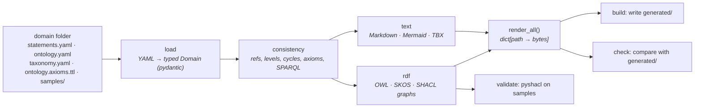

# Plan 0002 · Domain-model generator (formats, diagrams, level views)

- **Status:** approved
- **Spec:** [spec.md](spec.md)
- **Last updated:** 2026-11-14

## Approach

A new uv workspace member `tools/domain-model/` (package `domain_model`, console script `domain-model`) with three sub-commands: `build`, `check` and `validate`. The pipeline is a chain of pure functions:



1. **Load.** `statements.yaml`, `ontology.yaml` and `taxonomy.yaml` are parsed with `yaml.safe_load` into pydantic models (`extra="forbid"`, so a misspelt field is an error). Every error is reported as `<file>:<item id>: <message>`.
2. **Consistency.** One function per FR-12 problem, each returning a list of findings; `build` refuses to write when any *model* finding exists; `check` adds the freshness, sample-coverage and `validate` findings.
3. **Render.** `render_all(domain) -> dict[str, bytes]` produces every file of the spec's "Generated" table in memory. `build` writes that dict to `generated/` (and deletes files in `generated/` that are not in it); `check` compares it with the disk. Because both use the same function, "stale", "missing" and "extra" (AC-14) are a plain dictionary comparison, and the generated files can never drift from what `build` writes.
4. **RDF.** One rdflib graph per artefact: OWL (from the YAML, then `ontology.axioms.ttl` merged in), SKOS (is-a from `parent`/`also_parents`), SHACL (from the rules). Serialisation is made deterministic by (a) canonicalising blank nodes with `rdflib.compare.to_canonical_graph`, (b) rebuilding the graph by inserting triples in sorted order (rdflib's memory store iterates in insertion order), (c) post-sorting JSON-LD (`@graph` by `@id`, `sort_keys=True`). RDF/XML uses the plain `xml` writer, not `pretty-xml` (the v0.1 shared-list quirk). Turtle, RDF/XML and TBX get a "generated, do not edit" comment; JSON-LD cannot hold one.
5. **Text.** Markdown and Mermaid are built with small string-builder functions (no template engine). Mermaid node ids are item ids (`[A-Za-z0-9_]`), labels are quoted with `"` → `#quot;`, so labels such as "AI/analytical application" render.
6. **Validate.** pyshacl with `inference="rdfs"`, `advanced=True` (SHACL-AF), the generated OWL as `ont_graph` and `rules.shacl.ttl` as shapes, once per sample file (convention below). Results are mapped back to rules through the shape that produced them.
7. **Wiring.** `domain-model check --all` discovers every domain folder in the repo (a folder holding both `ontology.yaml` and `statements.yaml`, skipping hidden folders and `tests/`) and runs in pre-commit (on changes under `data/` or `tools/domain-model/`) and as a CI step in `.github/workflows/python.yml`.

The example domain the tests build (FR-16) is a small, neutral **library-lending** domain in `tools/domain-model/example/` (namespace `https://example.org/library#`, prefix `lib`) that uses every YAML field and every rule pattern. Its `generated/` folder is committed too, so the README can link to real output and `check --all` guards it like any other domain.

## Alternatives considered

- **Templates (Jinja2) for every output, including Turtle and TBX.** Readable templates, but one more dependency, templated Turtle can be syntactically wrong without anyone noticing, and RDF/XML and JSON-LD need a graph anyway. Rejected: graphs for RDF, string builders for Markdown/Mermaid, the stdlib `xml.etree` writer for TBX.
- **Every rule as SPARQL (one generic SHACL-SPARQL template).** A smaller generator, but the SHACL file becomes unreadable to anyone who knows SHACL core, and pattern-level checks (levels, undefined references) would have to parse SPARQL for every rule. Rejected in favour of the spec's patterns + SPARQL fallback (idea 0002, Q5); core SHACL is used wherever it can express the pattern.
- **Dataclasses + hand-written validation instead of pydantic.** No compiled dependency, but several hundred lines of field checks with their own complexity; pydantic gives field-path errors and strict typing (mypy plugin) for free. pydantic 2.14 installs and imports on CPython 3.15.2 (checked in a scratch venv on 2026-11-14).
- **A sample manifest (`samples.yaml`) instead of a file-name convention.** More flexible, but one more file to keep consistent; the convention makes "rule without a sample" and "sample for an unknown rule" a directory listing.
- **Explicit list of domain folders in `pyproject.toml` for pre-commit/CI.** Explicit, but a new domain folder that is not added is silently unchecked. Discovery was chosen; the test suite proves the discovery rules.
- **Statements as RDF resources (`adp:S3 a adp:Statement`).** Richer graph, but it puts statement ids into the domain namespace, which the axioms check and the glossary would then have to exclude. Sources are literals (`dct:source "S3"`); `statements.md` stays the readable provenance.

## Components and files

| Path | New/changed | Responsibility |
|------|-------------|----------------|
| `tools/domain-model/pyproject.toml` | new | Package metadata, pinned dependencies, `domain-model` script |
| `tools/domain-model/README.md` | new | Source format documentation (fields, cardinality syntax, path syntax, rule patterns, samples) and commands (FR-16) |
| `tools/domain-model/src/domain_model/cli.py` | new | Parses arguments and maps findings to exit codes |
| `…/model.py` | new | Typed schema of the three YAML sources (pydantic) |
| `…/load.py` | new | Reads a domain folder into a `Domain`, reporting malformed input as findings |
| `…/paths.py` | new | Parses the property-path mini-language into SHACL and SPARQL paths |
| `…/consistency.py` | new | Model checks of FR-12 (references, levels, cycles, reachability, axioms, SPARQL parse) |
| `…/rdf/owl.py` | new | Builds the OWL graph from the model and merges the hand axioms |
| `…/rdf/skos.py` | new | Builds the SKOS is-a scheme |
| `…/rdf/shacl.py` | new | Translates each rule pattern into SHACL / SHACL-AF |
| `…/rdf/serialize.py` | new | Deterministic Turtle, RDF/XML and JSON-LD output |
| `…/text/markdown.py` | new | Statements, glossary, rules and level-view Markdown |
| `…/text/mermaid.py` | new | Taxonomy and ontology-graph diagrams with safe labels |
| `…/text/tbx.py` | new | TBX (ISO 30042:2019, TBX-Basic, DCA style) glossary |
| `…/build.py` | new | `render_all()` and writing `generated/` |
| `…/freshness.py` | new | Compares `render_all()` with `generated/` |
| `…/validate.py` | new | Runs the generated SHACL on the samples and maps results to rules |
| `…/discover.py` | new | Finds the domain folders of the repo |
| `tools/domain-model/tests/` | new | One test module per acceptance criterion (see Verification map), plus `fixtures.py` (mutations of the example domain) and `resources/` (TBX core RNG schema) |
| `tools/domain-model/example/` | new | Example library-lending domain: sources, samples and committed `generated/` |
| `pyproject.toml` (root) | changed | Workspace member, mypy `files`/`mypy_path`, pytest `testpaths`, dev dependencies (`types-PyYAML`, `lxml`, `lxml-stubs`) |
| `uv.lock` | changed | Pinned dependencies |
| `.pre-commit-config.yaml` | changed | `domain-model` hook |
| `.github/workflows/python.yml` | changed | "Domain models (check)" step |
| `data/AcmeDataPlatform/` | changed | Migrated to sources + `generated/` (FR-15) |
| `data/README.md`, `.gitignore` | changed | Exception for curated domain models (ADR-0015) |
| `docs/architecture/architecture.md` | changed | Cross-cutting row "Domain models" (§7) |
| `CLAUDE.md` (root) | changed | `domain-model` commands in Conventions |

Dependency direction inside the package (acyclic, towards the stable core): `cli → build/freshness/validate/discover → rdf/*, text/*, consistency → paths, load → model`.

## Data and interfaces

### Command line

```
uv run domain-model build    <folder>        # writes <folder>/generated/ (refuses on model errors)
uv run domain-model check    <folder>|--all  # model + freshness + sample coverage + validate
uv run domain-model validate <folder>        # SHACL on the samples only
```

Exit code 0 = clean, 1 = findings (one line each on stdout: `<path relative to folder>:<item id>: <message>`), 2 = usage error.

### `statements.yaml`

```yaml
statements:
  - id: S1                 # S<number>, unique
    date: 2026-11-14
    level: 1
    text: "Core concepts: AcmeDataPlatform; …"   # verbatim
```

### `ontology.yaml`

```yaml
namespace: https://example.org/library#
prefix: lib
label: Library lending          # domain name, used in titles
language: en                    # default en; language tag of labels and definitions
working_level: 1
levels:                         # optional; defaults: core / main / detailed with the idea-0002 audiences
  1: {name: core, audience: "anyone: understand the domain in 5–10 minutes"}

concepts:      # id PascalCase
  - {id, label, level, status, source: [S1], definition, synonyms: [], parent: <id>|null, also_parents: [], disjoint_with: []}
individuals:   # id PascalCase
  - {id, label, level, status, source, definition, synonyms, types: [<concept>], facts: {<relation>: [<individual>]}, values: {<property>: <literal>}}
relations:     # id camelCase (object properties)
  - {id, label, level, status, source, definition, synonyms, domain, range, inverse: <id>|null, parent: <id>|null,
     cardinality: "1..*", characteristics: [functional|inverse_functional|transitive|symmetric|asymmetric|reflexive|irreflexive]}
properties:    # id camelCase (data properties)
  - {id, label, level, status, source, definition, synonyms, domain, datatype: string|integer|decimal|boolean|date|dateTime|anyURI, cardinality}
rules:
  - {id: R1, level, status, source, statement: "plain English", <exactly one pattern key>}
```

- **Required on every item:** `id`, `label` (rules: `statement`), `level` (1–3), `status` (`confirmed`/`draft`), `source` (≥ 1 statement id). Everything else is optional.
- **Cardinality** (read from the domain side, "each <domain> has … <range>"): `"1"`, `"0..1"`, `"1..*"`, `"2..4"`, `"*"`. Generated as OWL qualified cardinality restrictions on the domain class (`owl:qualifiedCardinality` when min = max, else `owl:minQualifiedCardinality` / `owl:maxQualifiedCardinality`; `onClass` = range, `onDataRange` for properties). OWL is open-world: a closed-world check needs a `cardinality` **rule** (documented in the README).
- **Property paths** (in rules): `rel`, `a/b` (sequence), `^rel` (inverse), `rel*`, `rel+`, `rel?`, `a|b` (alternative), parentheses. Translated to SHACL paths and SPARQL property paths by `paths.py`.

### Rule patterns (FR-6)

| Key | Kind | Fields | SHACL produced |
|-----|------|--------|----------------|
| `cardinality` | constraint | `focus`, `path`, `min`, `max`, optional `class` | `sh:property` with `sh:minCount`/`sh:maxCount` (qualified when `class` is given) |
| `values` | constraint | `focus`, `path`, one of `in: [individuals]` / `class` / `datatype` | `sh:property` with `sh:in` / `sh:class` / `sh:datatype` |
| `implies` | constraint | `focus`, `if: <condition>`, `then: <condition>`; condition = `{path, has_value \| in \| class \| min}` | `sh:or ( [ sh:not <if> ] <then> )` |
| `equal` | constraint | `focus`, `left: <path>`, `right: <path>` | `sh:equals` when both are single relations, else a generated `sh:sparql` constraint (values differ in either direction) |
| `derive` | derivation | `focus`, optional `if: <condition>`, `add: {predicate, object: <path> \| <individual> \| <concept>}` | SHACL-AF `sh:TripleRule` (`sh:subject sh:this`, `sh:condition` for `if`) |
| `sparql` | constraint or derivation | `select` (must bind `$this`) **or** `construct` | `sh:SPARQLConstraint` / `sh:SPARQLRule`, with `sh:prefixes` declared |

Every rule becomes one node shape `<prefix>:<RuleId>_shape` (target class = `focus`; a `sparql` rule names its `focus` too) carrying `rdfs:label` = statement, `sh:message` = statement, `<prefix>:level`, `<prefix>:status` and `dct:source`. The kind (constraint/derivation) follows from the pattern; there is no separate `kind` field. The concepts, relations and individuals a rule *uses* are read from its pattern fields, or, for `sparql`, from the domain-namespace IRIs in the parsed query; they drive the level and undefined-reference checks.

### `taxonomy.yaml` (optional, additional trees only; FR-3)

```yaml
trees:
  - id: LibraryPartOf
    label: Library composition (part-of)
    relation: part of                        # edge label in diagrams
    top: [{id: Library, children: [{id: Branch, children: [{id: Shelf}]}]}]
```

Nodes are concept ids; levels come from `ontology.yaml`. Extra trees appear in `diagrams.md` and the level views, not in SKOS.

### RDF vocabulary used

| What | Triple |
|------|--------|
| Label, synonyms, definition | `rdfs:label "…"@en` (+ `skos:prefLabel` in SKOS), `skos:altLabel`, `skos:definition` |
| Level, status | `<prefix>:level 1` (`xsd:integer`), `<prefix>:status "draft"` — both declared `owl:AnnotationProperty` in the domain namespace |
| Sources | `dct:source "S3"` |
| Is-a | `rdfs:subClassOf` (OWL), `skos:broader` / `skos:narrower`, `skos:inScheme`, `skos:topConceptOf` (SKOS; same IRIs as the classes, OWL 2 punning) |

### Samples (FR-13)

| File | Meaning |
|------|---------|
| `samples/valid.ttl` | Must conform (required, may be empty) |
| `samples/<RuleId>.violates[-<n>].ttl` | Must produce at least one violation from `<RuleId>`'s shape (one or more per constraint rule) |
| `samples/<RuleId>.derives[-<n>].ttl` + `…expected[-<n>].ttl` | After SHACL-AF rules run, every triple of the expected file must be in the data (one or more per derivation rule) |

A sample is validated together with the generated ontology (RDFS inference). A sample file naming an unknown rule, or of the wrong kind for its rule, is a `check` finding.

### Generated Markdown

- `statements.md`: table Id · Date · Level · Statement (verbatim).
- `glossary.md`: one table row per concept, individual, relation and property: term, kind, synonyms, definition, level, status, sources. Drafts are marked `_(draft)_` after the term (FR-10), here and in every other Markdown file.
- `rules.md`: per rule: id, statement, kind, pattern summary, level, status, sources.
- `diagrams.md`: Mermaid is-a tree (`flowchart BT`; a concept with several parents is one node with several edges), each extra tree, ontology graph (`flowchart LR`: classes as nodes, relations as labelled edges, is-a as dotted edges).
- `level-N.md`: intro (domain label, level name and audience, counts), glossary, is-a tree as a nested list (a multi-parent concept appears under each parent), extra trees, relations, properties, rules, both Mermaid diagrams, all filtered to level ≤ N.

## Architecture impact

- **System level** (root `docs/architecture/components.json`, then `tools/monorepo/system-map.sh`):
  - apps / shared components / datasets added: **none**. `tools/domain-model/` is repo tooling; like `tools/quality/python/` it is not a unit in `components.json` (the system map covers apps, shared code and datasets). `system-map.sh --check` must still pass unchanged.
  - new `reads` / `writes` / `mayDependOn` edges: none.
  - dataset contract changes: none. `data/AcmeDataPlatform/` is hand-authored, versioned source, not a dataset (spec non-goal); recorded in ADR-0015.
  - base environment variables added or changed: none (the tool takes a path argument and reads no environment).
- **App level:** no app is touched.
- **Components added/changed:** the workspace member `tools/domain-model` (internal modules listed above, under the Python complexity limits of ADR-0005/ADR-0014).
- **New dependencies between components:** none between units. New third-party dependencies, pinned in `uv.lock`: runtime `rdflib==7.6.0`, `pyshacl==0.40.2` (brings `owlrl`), `pydantic==2.14.3`, `pyyaml==6.0.3`; dev `types-PyYAML`, `lxml==6.1.3` + `lxml-stubs` (TBX schema validation in tests only). All resolved and imported on CPython 3.15.2 in a scratch venv on 2026-11-14; `pip-audit` runs in T1.
- **ADRs:**
  - [ADR-0015](../../architecture/adr/0015-curated-domain-models-are-versioned-in-data.md): curated, hand-authored domain models are versioned in `data/<Domain>/` (exception to ADR-0013; owed from idea 0001 Q1).
  - [ADR-0016](../../architecture/adr/0016-generate-domain-model-formats-from-yaml-sources.md): generate every domain-model format from YAML sources with a repo tool; generated files are committed and checked in pre-commit and CI.
- **App environment variables:** none.
- **New languages:** none (Python is registered, ADR-0014). Turtle, YAML, Markdown and TBX files are data, not code.
- **Root docs:** `architecture.md` §7 gets a "Domain models" row; `data/README.md` describes the exception; root `CLAUDE.md` Conventions get the `domain-model` commands.

## Verification map

Test modules live in `tools/domain-model/tests/`; `ex` = a temporary copy of the example domain.

| Acceptance criterion | How it is verified (test name / command) |
|----------------------|------------------------------------------|
| AC-1 | `test_build.py::test_build_writes_every_generated_file` (set of files == spec table) and `::test_build_writes_nothing_outside_generated` (snapshot of every other file's bytes before/after) |
| AC-2 | `test_build.py::test_each_domain_uses_only_its_own_namespace` (ex + a copy with namespace `https://example.org/other#`, prefix `oth`; no IRI or prefix of the other domain in any output) |
| AC-3 | `test_build.py::test_build_is_byte_identical` (two builds in one process) and `::test_build_is_byte_identical_across_processes` (two subprocesses with different `PYTHONHASHSEED`) |
| AC-4 | `test_taxonomy.py::test_skos_broader_matches_parents` (exact set of `skos:broader` pairs == parent + also_parents pairs), `::test_mermaid_is_a_edges_match_parents`, `::test_part_of_tree_in_diagrams` |
| AC-5 | `test_owl.py::test_owl_triples` (parametrised, one case per field: subclass, domain/range, inverse, super-property, min/max/exact cardinality, disjointness, label, synonym, definition, source, level, status, characteristics, individual types/facts/values) and `::test_axioms_file_is_merged` |
| AC-6 | `test_serialize.py::test_rdfxml_and_jsonld_isomorphic_to_turtle` (`rdflib.compare.isomorphic`), including a list-valued axiom (`owl:unionOf`) in the example axioms |
| AC-7 | `test_shacl.py::test_one_shape_per_rule_with_level` (parametrised over the example's rules: one per pattern + one `sparql`) and `test_docs.py::test_readme_documents_every_pattern` (every pattern key from `model.py` appears in the README's pattern table) |
| AC-8 | `test_glossary.py::test_glossary_md_has_every_entry`, `::test_tbx_has_every_entry`, `::test_tbx_validates_against_core_structure` (lxml RelaxNG with the vendored TBX core schema) |
| AC-9 | `test_levels.py::test_level_view_contains_only_items_up_to_level` (parametrised N = 1, 2, 3) and `::test_level_view_has_all_sections_and_diagrams` |
| AC-10 | `test_levels.py::test_every_rdf_resource_has_exactly_one_level` (OWL classes/properties/individuals, SKOS concepts, SHACL node shapes vs YAML) and `::test_every_tbx_entry_has_level_note` |
| AC-11 | `test_draft.py::test_draft_marked_in_markdown`, `::test_draft_status_in_rdf_and_tbx` |
| AC-12 | `test_statements.py::test_statements_md_lists_every_statement_verbatim` |
| AC-13 | `test_check_model.py::test_problem_is_reported` — parametrised, one fixture per FR-12 problem (malformed YAML, missing required field, duplicate id, undefined reference, unknown statement, level out of range, lower level than a used item — one case each for relation, property, rule, individual, child concept —, concept unreachable / parent cycle, undefined domain IRI in axioms, unparsable SPARQL, rule without sample); asserts exit ≠ 0 and the message names file and item id. `::test_clean_example_passes` |
| AC-14 | `test_check_freshness.py::test_hand_edited_file_fails`, `::test_missing_file_fails`, `::test_extra_file_fails`, `::test_missing_generated_folder_reports_every_file` |
| AC-15 | `test_validate.py::test_example_samples_pass`, `::test_unflagged_violation_fails`, `::test_flagged_valid_sample_fails`, `::test_missing_derivation_fails` (each failure names the rule) |
| AC-16 | `test_repo_wiring.py::test_precommit_runs_check_all` and `::test_ci_runs_check_all` (parse the YAML files), `test_discover.py::test_discovers_domain_folders` (finds `data/AcmeDataPlatform` and `tools/domain-model/example`, skips `tests/` and hidden folders); manual once in T18: edit a generated file, `git add` it, `git commit` is rejected by the `domain-model` hook |
| AC-17 | `test_repo_domains.py::test_acme_domain_passes_check`, `::test_acme_statements_s1_to_s10`, `::test_no_handwritten_ttl_at_top_level`; in T20 the generated `statements.md` rows are diffed against the pre-migration `statements.md` (`git show HEAD:data/AcmeDataPlatform/statements.md`) |
| AC-18 | `test_docs.py::test_readme_exists_and_references_example` (the README links `example/` and the tests' `EXAMPLE_DIR` is that folder) |
| AC-19 | `uv run ruff check .`, `uv run ruff format --check .`, `uv run mypy`, `uv run pytest`, `uv run qg-boundaries`, `uv run pip-audit --skip-editable` (pre-commit and CI) |
| AC-20 | `test_performance.py::test_build_and_check_200_items_under_10s` (a synthetic 200-item domain with rules and samples, generated in `tmp_path`) |

Edge cases from the spec: `test_edge_cases.py` — empty domain builds and checks; multi-parent concept in the Markdown tree and Mermaid; parent cycle names the cycle; Mermaid-unsafe label escaped; missing `generated/` created by `build`.

## Risks and mitigations

- **rdflib serialisers are not deterministic** (blank-node ids, iteration order) → canonical blank nodes + sorted re-insertion + JSON-LD post-sort, proven by the cross-process AC-3 test. If a serialiser still varies, fall back to sorting its output (RDF/XML elements via lxml C14N, Turtle via our own emitter of the sorted graph).
- **RDF/XML writer quirks** (v0.1 duplicated shared lists) → plain `xml` writer and the AC-6 isomorphism test with a list-valued axiom.
- **`check` too slow for pre-commit** (pyshacl with RDFS inference per sample) → shapes and ontology parsed once per domain; hook only runs on changes under `data/` or `tools/domain-model/`; AC-20 measures it. If over budget, pre-compute the ontology's RDFS closure once per domain and validate each sample with `inference="none"` (every sample is still validated; no skipping).
- **Two `tests/` folders in one mypy/pytest run** (`tools/quality/python/tests` already exists; duplicate module names such as `conftest`) → pytest with `--import-mode=importlib`, mypy with `explicit_package_bases`, or distinct module names; settled and proven green in T1 before any feature code.
- **TBX core schema licensing/availability** → vendor the official ISO 30042:2019 core structure RNG (TBXcoreStructV03) with its licence note if its licence allows redistribution; otherwise write a minimal RNG of the core structure (tbx/tbxHeader/text/body/conceptEntry/langSec/termSec/term) and record that in the README.
- **pyshacl/owlrl lagging behind CPython 3.15** → already installed and imported on 3.15.2; any runtime incompatibility shows in T1's smoke test of `pyshacl.validate` and is a stop-and-ask (spec NFR).
- **SHACL-AF support details in pyshacl** (`sh:TripleRule` with path objects, `sh:condition`) → the example domain covers each pattern with a sample, so `validate` on the example is the integration test; a pattern pyshacl cannot run is generated as `sh:SPARQLRule` instead (same YAML).

## Implementation notes (2026-11-14, /implement)

Small departures from the text above, none of which changes the spec:

- **Test helper name:** `tests/dm_fixtures.py` instead of `fixtures.py`, and no `conftest.py`, so module names stay unique across the workspace's two `tests/` folders (the T1 question, settled with "distinct module names"; pytest keeps its default import mode).
- **Extra module** `rdf/vocab.py`: namespaces and the label/level/status/source annotations shared by `owl.py`, `skos.py` and `shacl.py`.
- **RDF/XML determinism:** the plain `xml` writer visits subjects in hash order, so its top-level `rdf:Description` blocks are sorted after writing (the fallback named under Risks); proven by the cross-process AC-3 tests.
- **TBX** is written with a small string builder (escaped values) rather than `xml.etree`, so the source needs no security-rule suppression; the tests validate it against a minimal TBX core RNG written for them (official schema not vendored: redistribution licence unconfirmed).
- **SHACL:** condition shapes are typed `sh:PropertyShape` (pyshacl only accepts a declared shape as `sh:condition`); a rule's property shape is `<prefix>:<RuleId>_shape_property`. Conditions mean "at least one value" (`in`/`class` via `sh:qualifiedValueShape` + `sh:qualifiedMinCount 1`).
- **Example domain:** `disjoint_with` is declared on the level-2 concept (`AudioVisualItem`), because the level check treats a disjointness target as an item the concept uses.
- **AC-16 discovery of `data/AcmeDataPlatform`** is asserted in `test_repo_domains.py::test_acme_domain_passes_check` (it only becomes a domain folder in T20); `test_discover.py` covers the discovery rules and the example.
- **AC-16 manual check:** simulated with `pre-commit run domain-model --files <hand-edited generated file>` (exactly what the commit hook runs) instead of a real `git commit`, because no commit was requested; it failed naming the file, and the file was restored.
- **AC-17 diff:** `data/AcmeDataPlatform/` was untracked, so `git show HEAD:…/statements.md` did not exist; the generated statement rows were diffed against a copy of the hand-written `statements.md` taken before the migration: identical.
- **AC-20:** build + check of the synthetic 200-item domain takes about 6 s locally (budget 10 s); almost all of it is owlrl's RDFS closure per sample. The precomputed-closure mitigation was not needed.
- **Level views, diagrams first (2026-11-14, after review):** at the expert's request, `level-N.md` puts the Diagrams section right after the intro, before the text sections, because diagrams are understood faster. FR-8 lists the sections without an order, so the spec is unchanged; `test_levels.py::test_level_view_shows_diagrams_first` checks the order.
- **Is-a diagram packed towards 16:9 (2026-11-14, after review):** at the expert's request. Mermaid put every separate is-a tree and loose top concept side by side, so the Acme level-3 taxonomy was about 29:1 (estimated). New `text/layout.py` estimates each tree's size from its label lengths and ranks, then stacks the trees into the number of columns whose estimated shape is closest to 16:9. `is_a_diagram` declares the nodes column by column and joins the trees of a column with invisible links (`~~~`); the is-a edges are unchanged, so FR-3/AC-4 still hold. Reading order (expert's follow-up): the most complex tree (most concepts, then ranks, then width) comes first, in the top left corner; smaller trees follow below it, then in the next columns to the right, in decreasing size. Columns are filled top to bottom up to the height whose estimated shape is closest to 16:9. Acme estimates: level 1 2.0:1, level 2 1.8:1, level 3 1.8:1. Tests: `test_layout.py`.

## Out of scope for this plan

- Modelling content: applying idea 0001's Q44–Q46 answers to the AcmeDataPlatform `ontology.yaml` (resumes in the idea-0001 modelling session once the generator exists).
- A dataset contract for domain folders, per-level standard formats, non-Mermaid diagrams, a reading-time check (spec non-goals).
- Hand-drawn "views" from v0.1 `ontology.yaml` (not in spec 0002).
