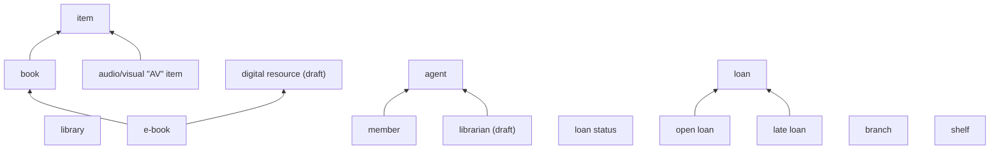
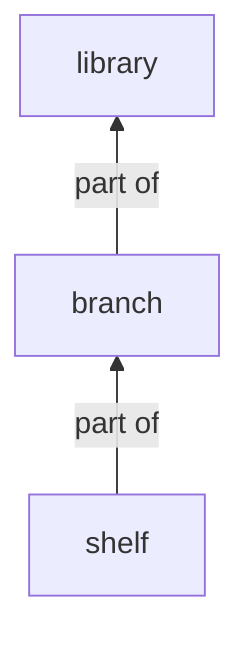
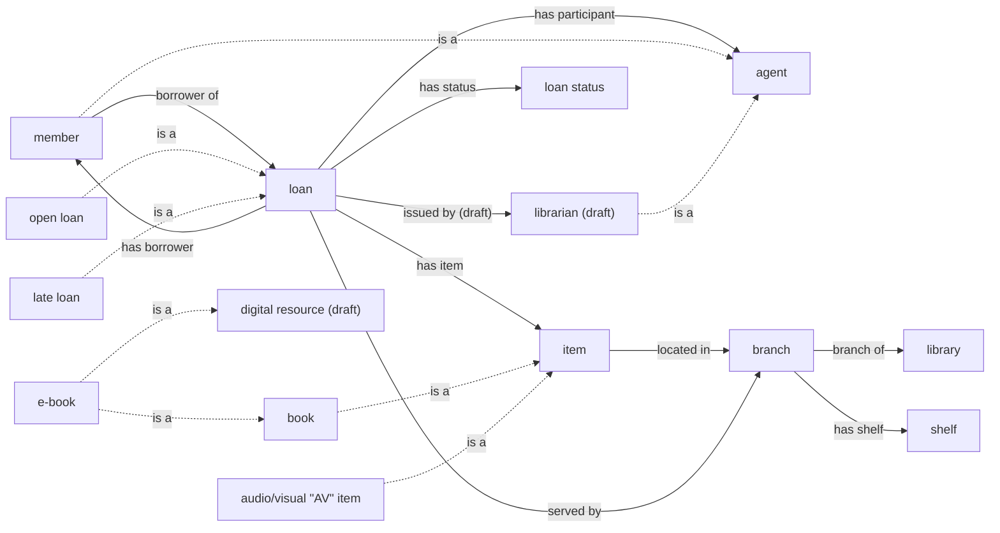

<!-- Generated by domain-model from the YAML sources of this folder. Do not edit. -->

# Library lending: diagrams

The whole domain (all levels).

## Taxonomy (is-a)

## Library composition (part-of)

## Ontology graph

