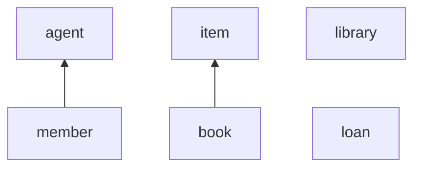
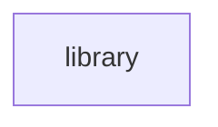
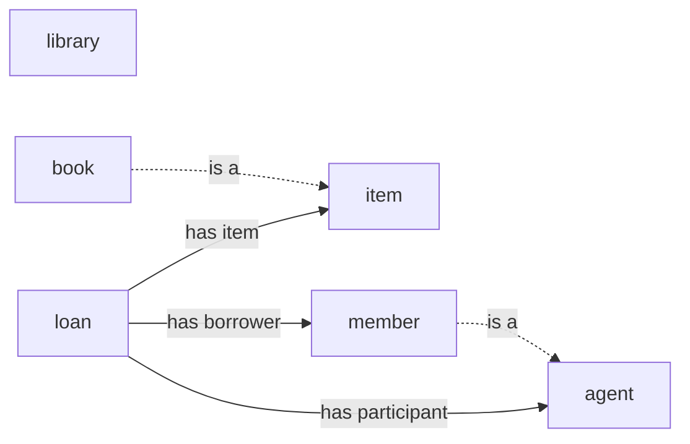

<!-- Generated by domain-model from the YAML sources of this folder. Do not edit. -->

# Library lending · level 1: core

For **anyone: understand library lending in 5 minutes**. Levels are cumulative: this view holds the level-1 items.

Contents: 6 concepts, 1 individuals, 3 relations, 3 properties, 2 rules. Items marked _(draft)_ are proposed wording, not yet confirmed.

## Diagrams

### Taxonomy (is-a)



### Library composition (part-of)



### Ontology graph



## Glossary

| Term | Id | Kind | Synonyms | Definition | Level | Status | Sources |
|---|---|---|---|---|---|---|---|
| agent | `Agent` | concept |  | A person who takes part in a loan. | 1 | confirmed | S1 |
| book | `Book` | concept |  | A printed item with pages. | 1 | confirmed | S2 |
| due date | `dueDate` | property |  | The day by which the items must be back. | 1 | confirmed | S1 |
| has borrower | `hasBorrower` | relation |  |  | 1 | confirmed | S1 |
| has item | `hasItem` | relation | includes |  | 1 | confirmed | S1, S2 |
| has participant | `hasParticipant` | relation |  |  | 1 | confirmed | S1 |
| item | `Item` | concept | holding, library item | Something a library lends. | 1 | confirmed | S1 |
| library | `Library` | concept | lending library | An organisation that lends items to its members. | 1 | confirmed | S1 |
| loan | `Loan` | concept |  | The record of items a member borrowed. | 1 | confirmed | S1 |
| main library | `MainLibrary` | individual |  |  | 1 | confirmed | S1 |
| member | `Member` | concept | borrower, patron | A person registered to borrow items. | 1 | confirmed | S1 |
| start date | `startDate` | property |  |  | 1 | confirmed | S1 |
| title | `title` | property | name |  | 1 | confirmed | S1 |

## Taxonomy (is-a)

- library (`Library`)
- item (`Item`)
  - book (`Book`)
- agent (`Agent`)
  - member (`Member`)
- loan (`Loan`)

## Library composition (part-of)

- library (`Library`)

## Relations

| Relation | Id | Domain | Range | Cardinality | Inverse | Super-relation | Characteristics | Level |
|---|---|---|---|---|---|---|---|---|
| has participant | `hasParticipant` | `Loan` | `Agent` |  |  |  |  | 1 |
| has borrower | `hasBorrower` | `Loan` | `Member` | 1 |  | `hasParticipant` | functional | 1 |
| has item | `hasItem` | `Loan` | `Item` | 1..* |  |  |  | 1 |

## Properties

| Property | Id | Domain | Datatype | Cardinality | Level |
|---|---|---|---|---|---|
| title | `title` | `Item` | `xsd:string` | 1 | 1 |
| start date | `startDate` | `Loan` | `xsd:date` | 1 | 1 |
| due date | `dueDate` | `Loan` | `xsd:date` | 1 | 1 |

## Rules

### R1 · A loan has between 1 and 5 items.

- **Kind:** constraint · **Pattern:** `cardinality` · **Level:** 1 · **Status:** confirmed · **Sources:** S2
- each `Loan` has at least 1 and at most 5 `hasItem` value(s)

### R7 · The due date of a loan is after its start date.

- **Kind:** constraint · **Pattern:** `sparql` · **Level:** 1 · **Status:** confirmed · **Sources:** S2
- SPARQL SELECT (each result is a violation) on each `Loan`

```sparql
SELECT $this WHERE {
  $this lib:startDate ?start ; lib:dueDate ?due .
  FILTER (?due <= ?start)
}
```

