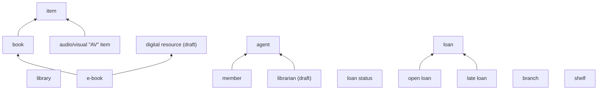
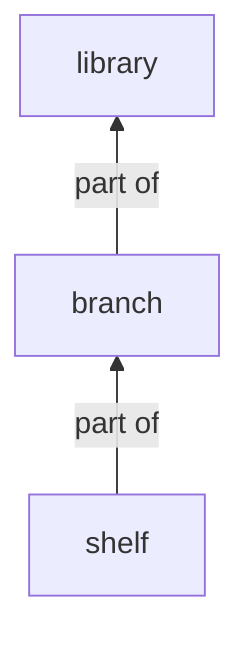
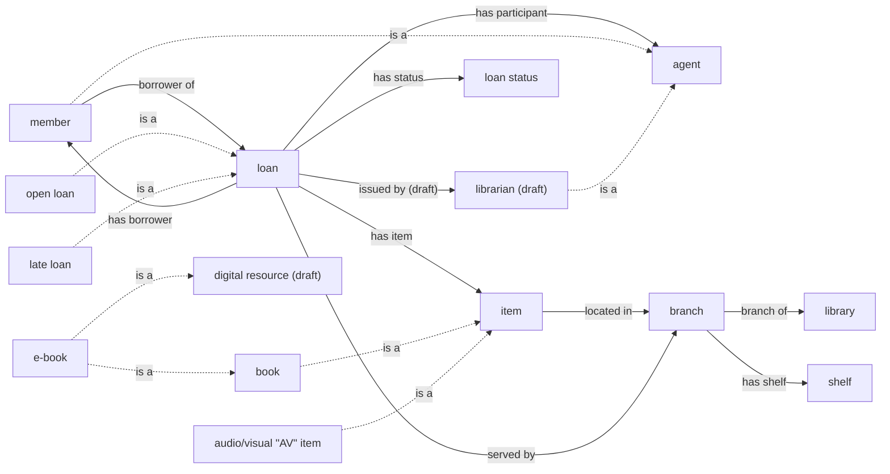

<!-- Generated by domain-model from the YAML sources of this folder. Do not edit. -->

# Library lending · level 3: detailed

For **everything in the domain**. Levels are cumulative: this view holds the whole domain.

Contents: 15 concepts, 5 individuals, 10 relations, 6 properties, 8 rules. Items marked _(draft)_ are proposed wording, not yet confirmed.

## Glossary

| Term | Id | Kind | Synonyms | Definition | Level | Status | Sources |
|---|---|---|---|---|---|---|---|
| active | `Active` | individual |  |  | 2 | confirmed | S3 |
| agent | `Agent` | concept |  | A person who takes part in a loan. | 1 | confirmed | S1 |
| audio/visual "AV" item | `AudioVisualItem` | concept |  | A recording on a physical carrier. | 2 | confirmed | S2 |
| book | `Book` | concept |  | A printed item with pages. | 1 | confirmed | S2 |
| borrower of | `borrowerOf` | relation |  |  | 2 | confirmed | S1 |
| branch | `Branch` | concept |  |  | 2 | confirmed | S3 |
| branch of | `branchOf` | relation |  | Links a branch to the library it belongs to. | 2 | confirmed | S3 |
| central branch | `CentralBranch` | individual |  |  | 2 | confirmed | S3 |
| copy of The Hobbit _(draft)_ | `HobbitCopy` | individual | Hobbit | A sample book. | 3 | draft | S4 |
| digital resource _(draft)_ | `DigitalResource` | concept |  | Anything that exists only as a file. | 2 | draft | S2 |
| due date | `dueDate` | property |  | The day by which the items must be back. | 1 | confirmed | S1 |
| e-book | `EBook` | concept | electronic book |  | 2 | confirmed | S2 |
| has borrower | `hasBorrower` | relation |  |  | 1 | confirmed | S1 |
| has item | `hasItem` | relation | includes |  | 1 | confirmed | S1, S2 |
| has participant | `hasParticipant` | relation |  |  | 1 | confirmed | S1 |
| has shelf | `hasShelf` | relation |  |  | 3 | confirmed | S4 |
| has status | `hasStatus` | relation |  |  | 2 | confirmed | S3 |
| is reference _(draft)_ | `isReference` | property |  | Reference items are not lent out. | 3 | draft | S4 |
| issued by _(draft)_ | `issuedBy` | relation |  |  | 2 | draft | S3 |
| item | `Item` | concept | holding, library item | Something a library lends. | 1 | confirmed | S1 |
| late loan | `LateLoan` | concept |  | A loan returned after its due date (derived by rule R8). | 3 | confirmed | S4 |
| librarian _(draft)_ | `Librarian` | concept |  |  | 2 | draft | S3 |
| library | `Library` | concept | lending library | An organisation that lends items to its members. | 1 | confirmed | S1 |
| loan | `Loan` | concept |  | The record of items a member borrowed. | 1 | confirmed | S1 |
| loan status | `LoanStatus` | concept |  |  | 2 | confirmed | S3 |
| located in | `locatedIn` | relation |  |  | 3 | confirmed | S4 |
| main library | `MainLibrary` | individual |  |  | 1 | confirmed | S1 |
| member | `Member` | concept | borrower, patron | A person registered to borrow items. | 1 | confirmed | S1 |
| open loan | `OpenLoan` | concept |  | A loan whose status is active (derived by rule R5). | 2 | confirmed | S3 |
| page count | `pageCount` | property |  |  | 3 | confirmed | S4 |
| returned | `Returned` | individual |  |  | 2 | confirmed | S3 |
| returned on | `returnedOn` | property |  |  | 2 | confirmed | S3 |
| served by | `servedBy` | relation |  | The branches holding the items of a loan (rule R6). | 3 | confirmed | S4 |
| shelf | `Shelf` | concept |  |  | 3 | confirmed | S4 |
| start date | `startDate` | property |  |  | 1 | confirmed | S1 |
| title | `title` | property | name |  | 1 | confirmed | S1 |

## Taxonomy (is-a)

- library (`Library`)
- item (`Item`)
  - book (`Book`)
    - e-book (`EBook`)
  - audio/visual "AV" item (`AudioVisualItem`)
- digital resource _(draft)_ (`DigitalResource`)
  - e-book (`EBook`)
- agent (`Agent`)
  - member (`Member`)
  - librarian _(draft)_ (`Librarian`)
- loan (`Loan`)
  - open loan (`OpenLoan`)
  - late loan (`LateLoan`)
- loan status (`LoanStatus`)
- branch (`Branch`)
- shelf (`Shelf`)

## Library composition (part-of)

- library (`Library`)
  - branch (`Branch`)
    - shelf (`Shelf`)

## Relations

| Relation | Id | Domain | Range | Cardinality | Inverse | Super-relation | Characteristics | Level |
|---|---|---|---|---|---|---|---|---|
| has participant | `hasParticipant` | `Loan` | `Agent` |  |  |  |  | 1 |
| has borrower | `hasBorrower` | `Loan` | `Member` | 1 |  | `hasParticipant` | functional | 1 |
| has item | `hasItem` | `Loan` | `Item` | 1..* |  |  |  | 1 |
| borrower of | `borrowerOf` | `Member` | `Loan` |  | `hasBorrower` |  | inverse_functional | 2 |
| issued by _(draft)_ | `issuedBy` | `Loan` | `Librarian` | 0..1 |  | `hasParticipant` |  | 2 |
| has status | `hasStatus` | `Loan` | `LoanStatus` | 1 |  |  |  | 2 |
| branch of | `branchOf` | `Branch` | `Library` | 1 |  |  | asymmetric, irreflexive | 2 |
| has shelf | `hasShelf` | `Branch` | `Shelf` | 2..4 |  |  |  | 3 |
| located in | `locatedIn` | `Item` | `Branch` | 0..1 |  |  |  | 3 |
| served by | `servedBy` | `Loan` | `Branch` |  |  |  |  | 3 |

## Properties

| Property | Id | Domain | Datatype | Cardinality | Level |
|---|---|---|---|---|---|
| title | `title` | `Item` | `xsd:string` | 1 | 1 |
| start date | `startDate` | `Loan` | `xsd:date` | 1 | 1 |
| due date | `dueDate` | `Loan` | `xsd:date` | 1 | 1 |
| returned on | `returnedOn` | `Loan` | `xsd:date` | 0..1 | 2 |
| page count | `pageCount` | `Book` | `xsd:integer` | 0..1 | 3 |
| is reference _(draft)_ | `isReference` | `Item` | `xsd:boolean` | 0..1 | 3 |

## Rules

### R1 · A loan has between 1 and 5 items.

- **Kind:** constraint · **Pattern:** `cardinality` · **Level:** 1 · **Status:** confirmed · **Sources:** S2
- each `Loan` has at least 1 and at most 5 `hasItem` value(s)

### R2 · The status of a loan is active or returned.

- **Kind:** constraint · **Pattern:** `values` · **Level:** 2 · **Status:** confirmed · **Sources:** S3
- every `hasStatus` value of a `Loan` is one of `Active`, `Returned`

### R3 · A returned loan has a return date.

- **Kind:** constraint · **Pattern:** `implies` · **Level:** 2 · **Status:** confirmed · **Sources:** S3
- if a `Loan` has `Returned` as `hasStatus`, then it has at least 1 `returnedOn` value(s)

### R4 · The borrower of a loan is the member recorded as its borrower. _(draft)_

- **Kind:** constraint · **Pattern:** `equal` · **Level:** 2 · **Status:** draft · **Sources:** S1
- for each `Loan`, `hasBorrower` and `^borrowerOf` have the same values

### R5 · An active loan is an open loan.

- **Kind:** derivation · **Pattern:** `derive` · **Level:** 2 · **Status:** confirmed · **Sources:** S3
- each `Loan` that has `Active` as `hasStatus` is also a `OpenLoan`

### R6 · A loan is served by the branches where its items are located.

- **Kind:** derivation · **Pattern:** `derive` · **Level:** 3 · **Status:** confirmed · **Sources:** S4
- each `Loan` gets `servedBy` → `hasItem/locatedIn`

### R7 · The due date of a loan is after its start date.

- **Kind:** constraint · **Pattern:** `sparql` · **Level:** 1 · **Status:** confirmed · **Sources:** S2
- SPARQL SELECT (each result is a violation) on each `Loan`

```sparql
SELECT $this WHERE {
  $this lib:startDate ?start ; lib:dueDate ?due .
  FILTER (?due <= ?start)
}
```

### R8 · A loan returned after its due date is a late loan.

- **Kind:** derivation · **Pattern:** `sparql` · **Level:** 3 · **Status:** confirmed · **Sources:** S4
- SPARQL CONSTRUCT (derived triples) on each `Loan`

```sparql
CONSTRUCT { $this a lib:LateLoan . } WHERE {
  $this lib:returnedOn ?returned ; lib:dueDate ?due .
  FILTER (?returned > ?due)
}
```


## Diagrams

### Taxonomy (is-a)



### Library composition (part-of)



### Ontology graph


